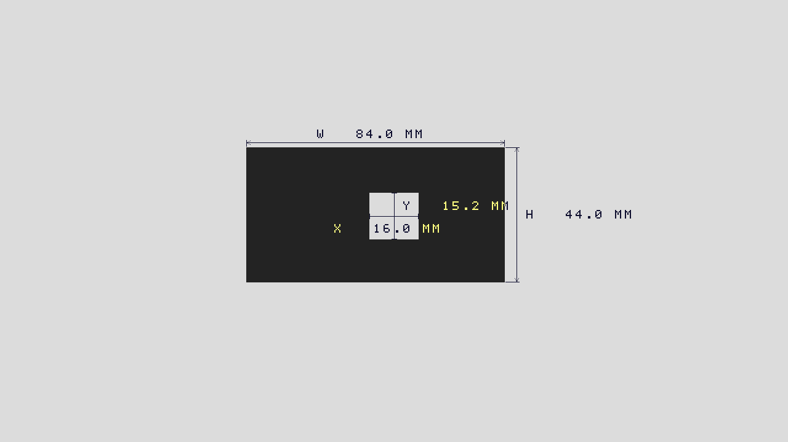

# INSPECTION_AUTO_DIMENSION_V2 交付报告

2026-11-01 / MAIN。准确基线7cffe56（INSPECTION_UI_DIMENSION_V1/PR #18）。
本版将手调SPAN的双轴标定改为指定区放1mm尺、一键读比例，将底部尺寸表改为工件旁的工程尺寸线。
这是待上板candidate，不是计量精度或长期稳定性已验收的最终版。

## 用户操作的变化

1. ORIGIN、尺寸/CAL开启，将丁字尺的黑色1mm短刻线水平放入中央读尺框，让短刻线穿过虚线。
2. 短按K4一次，采集下一完整帧并自动校验；CAL OK后移走尺子、退出CAL，即可测静止薄工件。
   不再逐像素调SPAN，不再访问X/Y后靠开关退出冒充标定成功。失败可重新摆尺再按一次。
3. 外包宽W在工件上方、高H在右侧，带箭头、尺寸线和引出线；中心孔槽截线X/Y在对应位置。
   不再在底部列W/H/GAP表。透明统一字形，亮底深笔画、暗底浅笔画，无新增黑色背景块。

实板已确认的前三路物理效果保持：第二路用户称OFF为尺寸启用；第三路OFF进入CAL、ON进入RUN；
第一路RUN中ON为DARK、OFF为BRIGHT，CAL中不再用它选择轴。第四路颜色显隐尚未定位，本版不猜引脚改线。
详细[操作与验收](INSPECTION_AUTO_DIMENSION_V2_BOARD_TEST.md)、[设计](INSPECTION_AUTO_DIMENSION_V2_DESIGN.md)。

## 自动读尺的证据与边界

只存三条512像素灰度线，x384..895，y304/306/308。自适应明暗阈值，
检测完整黑刻线中心，用已知1mm间隔计算比例；至少16条刻线、间距2..16px，
最大/最小间距差<=1px，至少两线的100mm等效跨度相差<=8px。完整帧几何错误、
低对比、缺线、不一致或取消均不生成成功标定。新请求撤销旧标定；复位须重新标定。

**水平尺仅直接约束X，本版X/Y共用比例。** 需要正俯视、同平面、近似等比例成像。
必须独立检验已知水平和竖直长度；不校正透视/畸变，不承诺0.1mm准确度。
算法不是OCR，周期本身不能证明1mm单位：若只让厘米长刻线入框或把规则纹理当尺，可能尺度误判。
要确保每条毫米短刻线清楚入线，并用另一已知长度复核。真实尺子成功率及实测误差目前未知。

只保留原有单件轴对齐外包W/H和固定中心孔槽截线；新增实际端点信号用于画线，未猜测开口对称。
不自动生成示意图中的三视图、隐藏边、厚度、任意斜边或所有CAD特征。圆孔须居中才可解释内径截线。
参数来自前一完整采集帧，另有原DDR延迟；仅针对静止工件，不宣传同帧动态计量。
上方CNT保持高优先级，靠近上边缘的部分标注可能被覆盖；当前无通用文字避碰，首轮请居中摆放。

## 验证结果（数字边界，非实板）

| 验证 | 最终结果 |
|---|---|
| 自动读尺 | 27项/367941周期PASS；整数与2.2、2.5、3.3、6.6、11.7px/mm非整数间距、相位、单线干扰、低对比、缺线、三线不一致、异常帧、取消和复位 |
| 工程绘图 | 五组整屏、1152000四像素位置PASS；宽高、真实孔槽端点、近ROI边缘、CAL/空区、字形和透明区域 |
| 实际ISP接线 | 九帧1280x720、2089345周期、2073600四像素有效拍、1555200个128位打包字PASS；五模式、颜色/尺寸、MM/PX、帧内UI请求隔离；一次触发实际读尺正确得到500px/100mm |
| 旧版回归 | 几何160帧91459周期、240换算快照；透明显隐3帧691200拍；实际消抖/短长按/原手动回退；颜色218快照2398字段PASS |
| 隔离 | 66个旧TD输入冻结；Sensor/BLC/AWB/曝光增益、五算法、Logo/CNT、MIPI/DDR/HDMI、原按键、引脚/PLL/SDC保持；颜色分类/MAX12未变 |

回归入口：tests/run_auto_ruler_v2.py、run_engineering_dimension_v2.py、run_auto_dimension_stream_v2.py --full。
完整视频用显式post-AWB RGB，控制/比例为明确仿真边界；读尺另外经实际ISP观察点验证。
没有仿真真实Sensor、DDR PHY或HDMI电气。软件图为合成模型，不是实板照片，不是用户工件真实尺寸。

## 最终TD与资源

Synthesis -> Physical Design -> final Timing Check -> bitgen全部PASS，未放宽SDC或降低视频规格。

| 资源/时序 | 最终r2 | 相比V1 |
|---|---:|---:|
| Slice | 20503/21216（96.64%） | +461 |
| LUT6 | 19369 | +701 |
| FF | 18808/42432 | +248 |
| ERAM20K | 86/108 | +1 |
| DSP | 24/40 | +1 |
| Setup WNS / TNS | +0.251ns / 0 | V1 +0.152ns |
| Hold WNS / TNS | +0.020ns / 0 | V1 +0.020ns |

违例端点0；公共视频延迟增加0拍，仍31拍统一对齐。新增缓存仅三条灰度线，不是整帧。
出现PHY-7022高占用告警，最终余713个Slice，扩展空间小；STA通过不替代供电/温度/长期实板验证。
关键warning类型仍为PHY-5060/5079，无新增关键类型；继承FIFO B/S、Gray指针覆盖风险及第四物理开关问题未排除。
S稳态增长时应停止尺寸精度验收，先定位视频完整性。

r0（0f19311）和r1（590d161）仅完成SYN，分别因扫描线间隔及笔画对比/资源复查撤回，未PHY或bitgen。
最终r2空心恒定偏移箭头和仅四个尺寸字段降低逻辑，浅底对比改进后重新完成全部变动部分回归和TD。
不完整的早期全视频仿真未计为PASS。保留这些源检查点和SYN证据，不使用其网表构建最终bit。

## 版本追溯与上板状态

- Version：INSPECTION_AUTO_DIMENSION_V2
- Git Branch：codex/main/inspection-auto-dimension-v2
- Actual TD source Git Commit：a198ef662d293e4a4699e3222b51da0c40cb21ec
- 验证/归档工具提交：34eed1f9f31ed40fa10708938134c0ccf7d64545；TD输入与实际源码一致。
- Git Tag：inspection-auto-dimension-v2-candidate（归档后建立，不移动历史tag）
- Bit：[camera_to_dsi_display.bit](../artifacts/bitstreams/INSPECTION_AUTO_DIMENSION_V2/camera_to_dsi_display.bit)
- Bit SHA256：`db8e1490d85d0acf8d10937897cb0ec03fe537e2987ee401b8e41eaeb07edd20`
- [BUILD_INFO](../artifacts/bitstreams/INSPECTION_AUTO_DIMENSION_V2/BUILD_INFO.md)及同目录build_evidence包含完整构建、资源、时序、源码清单、验证和撤回检查点证据。
- Remote：Private origin https://github.com/Philid14/anlogic-ph1p35-image-processing.git
- Push Status：分支和candidate tag已实际push，远程引用、tag内bit SHA和73个实际TD输入源码闭环均已核对，见[REMOTE_RECEIPT](evidence/INSPECTION_AUTO_DIMENSION_V2/REMOTE_RECEIPT.json)。
- Draft PR：[#21](https://github.com/Philid14/anlogic-ph1p35-image-processing/pull/21)，归档commit 0a5c262072c4e996cc0a7a4d078fbe2f3341ce42；依赖#18→#17→#13→#12，不合并。
- Git Status：只提交本任务内容，原docs/GITHUB_REFERENCE_RESEARCH.md修改及用户未跟踪资料保留。
- Board Test Status：NOT_RUN，等待用户真实尺子、水平/竖直独立尺寸、10次重复/旋转/位置、30分钟及光照变化验收。

回滚只需重新烧录历史INSPECTION_UI_DIMENSION_V1 bit/tag，不改任何Sensor或工程配置。
完成本candidate后停止，等待上板，不自行开发下一版。
