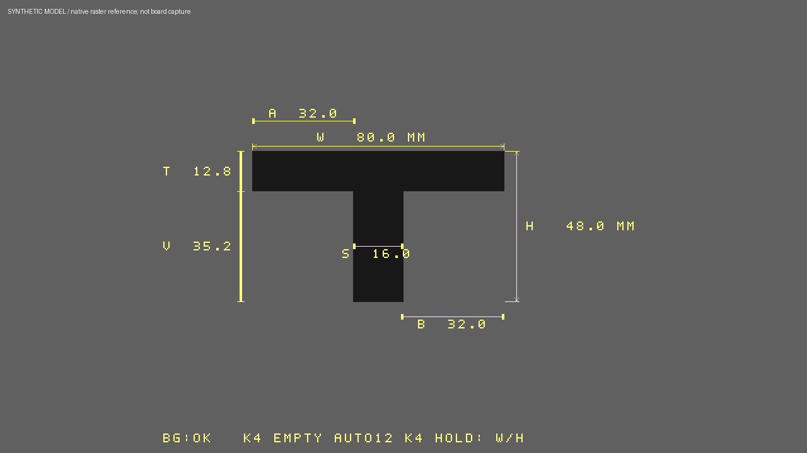
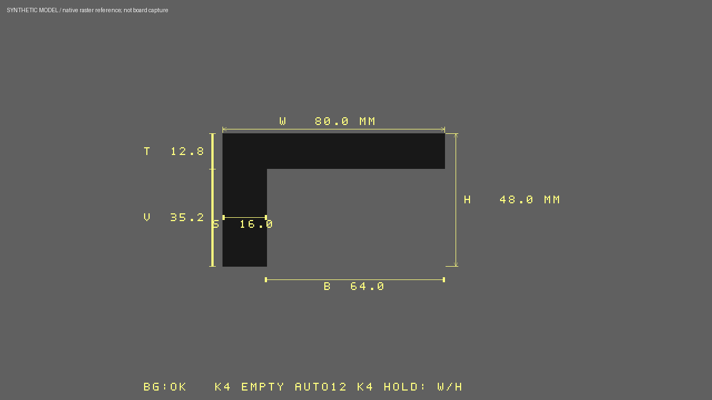

# INSPECTION_PARTS_MOTION_V1 / MAIN 报告

## 实现结果

本轮完成密集运动点阵、T/L各部分同时标注，并对逐帧AWB除法做功能等价资源复用。SYN/PHY/最终STA/bitgen通过，58份验证门禁及路由CDC检查通过；实板NOT_RUN。

- 基线6ad4f7cd70b5614240c07db2a16775aa492d9f14 / LATENCY_PERFORMANCE_V1。
- Branch：codex/main/inspection-parts-motion-v1。
- 实际TD源码：bb1f8811cafd441815b2248bcc19b263b02657eb。
- [Draft PR31](https://github.com/Philid14/anlogic-ph1p35-image-processing/pull/31)依赖未合并PR30，不自动合并。
- 原91项.al入口、95项构建输入。仅8份MAIN RTL变化，原IP、PLL/引脚/SDC不改。

## 实际功能

MOTION：粉色稀疏4px改为FF3000橙红、8px间距3×3实心点，每32×16变化块最多8点/72px。检测网格、TH12/MIN3保持；均值RAM拓宽一位，仍2 ERAM。显示上一完整有效变化图，与LAST一致，约一采集帧滞后，不是提高检测分辨率或物体轮廓跟踪。

T/L：在原标尺和背景分割上复用行包络，两个稳定嵌套水平区段各至少6行，识别后在对应部位同时显示：

| 标记 | 含义 |
|---|---|
| W/H | 整体宽/高 |
| S | 竖段宽 |
| T | 横梁厚 |
| A/B | 左/右伸出，零侧不显示 |
| V | 横梁外竖段长度 |

保留透明统一字体、原长K4的W/H↔D/R、原CAL/BG流程。最终没有轮巡页。限定单个薄工件、正俯视、同标定平面、轴对齐，T横梁水平；旋转/复杂轮廓回退W/H。横向分段4px量化，显示0.1mm不是物理精度0.1mm。过曝融合的边界仍可能漏检，移动尺寸沿用LAST而非当前即时轮廓。

以上为合成轮廓和经原生逐像素验证的绘图参考，不是实板照片。

## 资源与延迟

| 最终布局指标 | 本版 | 与LATENCY_PERFORMANCE_V1相比 |
|---|---:|---:|
| Slice | 19209 / 21216（90.54%） | -1622 |
| LUT6 | 18551 | -981 |
| FF | 16340 | -4997 |
| ERAM20K | 105 / 108 | 0 |
| DSP | 25 / 40 | 0 |
| Setup WNS | +0.257 ns | +0.082 ns |
| Hold WNS | +0.020 ns | 0 |

Setup/Hold TNS为0，STA coverage94.40%。沿用原约束且仍有继承覆盖缺口，不能等同全部CDC/PVT签核。公共像素延迟31拍、额外0，4PPC/720p、DDR数据量和调度保持。

主要节省来自AWB两路逐帧除法：每拍求一商位，保留48/32位精确结果、启动后49拍done和原IP复位在途语义。720行保证至少720拍启动间隔；默认及小于64行配置仍用原IP。AWB采样、增益、统计及50拍图像RAM延迟不变，不是新白平衡算法。

## 验证

- 9帧密集MOTION参考，8039拍；15组T/L正反例、翻转、1px扰动与异常轮廓。
- 7帧原生720p七项同时绘图，零伸出、关闭和单位换算；原D10.0/R5.0绘图另行回归通过。
- 8帧实际31拍720p链路，6帧MOTION共1382400拍逐像素相同，2帧T形校准/背景/统计接线。
- 实际原厂除法器311组数学向量、50个复位时刻；完整AWB12帧256×64逐拍对照，52624拍/194744有效输出像素/9次完成除法/11次增益变化/两次在途复位，RGB、同步及实际/目标增益一致。
- 原18帧720p ISP/打包、160组几何/240换算、字体、按键、背景、TRACK、复位/SOF和同帧延迟回归。最后状态以归档REGRESSION_GATE为准，不能拿旧结果代替新源文件验证。
- 旧ISP边界测试只做新实现参数兼容，保留原金标准；实际AWB以单独原生对照为证据。
- 1639680组clamp、102400桶差、4288计数状态和148225高度的有限域等价检查；限定MAIN有效几何/阈值域。

路由CDC核对20位时间Gray、85位保持元数据、18位FIFO Gray的全部物理扇出；打包单元名称不能代表其中寄存器，另外核对逻辑Q输出与tuple高64位的显式key别名。保留初始名称筛选漏计证据，没有降低位数、放宽SDC或改路由数据库；旧全局约束覆盖、溢出复发和长期稳定性仍待实板。

## 失败证据及边界

最早同时标注R0打包21710、轮巡R1为21251，均超容量。R2打包21127但30轮/超过2小时仍拥塞，手动中止，没有最终STA/bit，不冒称工具已证明无合法路由。32bit RAM延迟试验超ERAM；18bit试验无Slice收益。首个串行除法试验因复位在途语义不等价拒绝，修正后原生对照通过。所有检查点、失败输入和报告保留。

Sensor曝光/增益/VTS/HTS、BLC/AWB算法、MIPI、DDR、HDMI、颜色比对、原模式、按键开关、Logo/CNT保持。用户最终要求延迟面板常显，不新增切换接口；SW5 BUZ/SW与SW6 DIG/LED不是新功能输入。

按[BOARD_TEST](INSPECTION_PARTS_MOTION_V1_BOARD_TEST.md)执行MOTION移动/静止、CAL→空背景→纸T/L→金属件、原D/R/色彩/TRACK、5s/30s/120s及30min E/B/S。没有实板结果，不能声称反光测量精度、视觉可见性和长期稳定性已验收。

## 签发与发布

- Version：INSPECTION_PARTS_MOTION_V1。
- Bit：artifacts/bitstreams/INSPECTION_PARTS_MOTION_V1/camera_to_dsi_display.bit。
- SHA-256：`1a1737923e33e0f8c87ca918978fff08d8dd4c7d6120e54f4835bfc911f1bf11`。
- 实际构建源码commit：bb1f8811cafd441815b2248bcc19b263b02657eb。
- Candidate tag：inspection-parts-motion-v1-candidate（归档提交后建立，不移动历史tag）。
- Branch：codex/main/inspection-parts-motion-v1；Remote：Private origin。
- Git Status：本轮文件独立提交，原有GITHUB_REFERENCE_RESEARCH.md的38行修改及未跟踪本地资料保留、排除提交。
- Push Status：远程回执在实际push并核对tag内bit及58份原生报告字节后记录。
- Setup/Hold：+0.257/+0.020ns；Board Test：NOT_RUN。

完整资源、配置、输入、验证和失败尝试在同目录BUILD_INFO/build_evidence；原生报告用目录内.gitattributes保留字节，避免Git换行转换破坏验证哈希。完成candidate后停止，等待用户审查/上板，不合并PR、不自行下一版。
