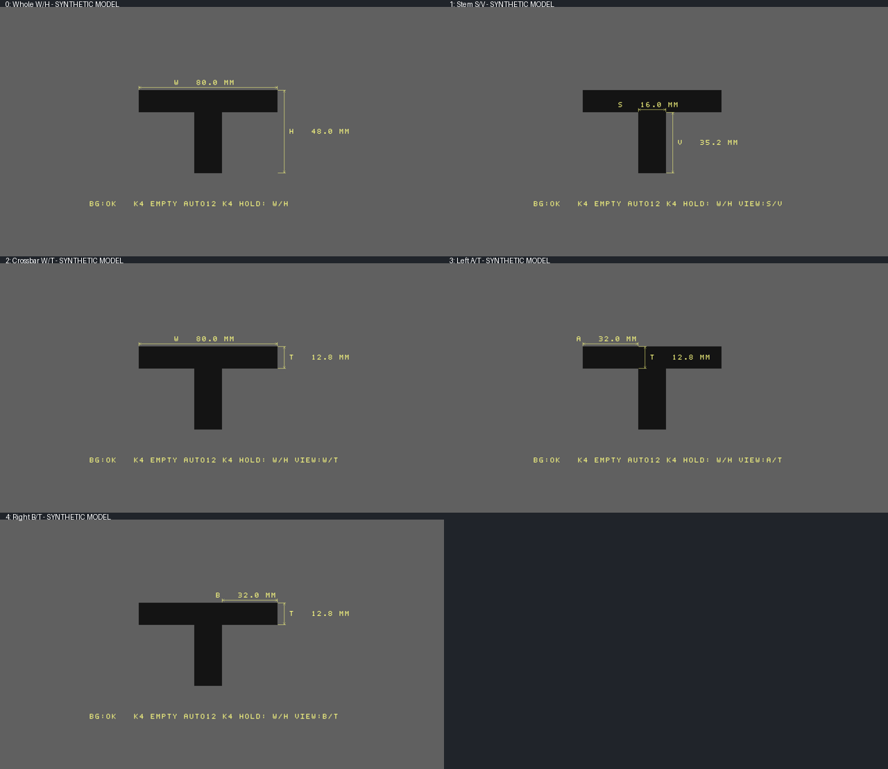
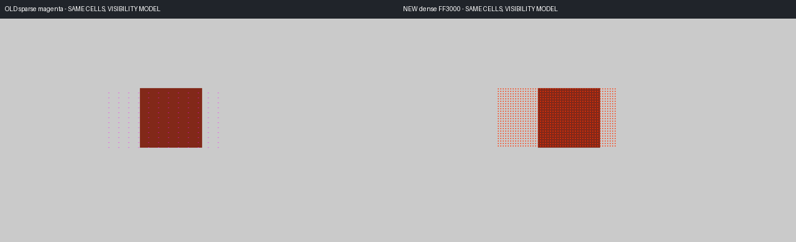

# INSPECTION_PARTS_MOTION_V1 / MAIN 交付核验

## 当前状态

本报告随实际构建结果更新。当前源码/原生RTL回归已完成，最终R2物理设计正在布线，**没有签发本轮candidate或新bit**。中间打包21127/21216 Slice、105/108 ERAM、25/40 DSP不代表最终布线/时序通过。正式资源、时序、bit SHA只在完整构建完成后填写；实板状态NOT_RUN。

- 准确基线：LATENCY_PERFORMANCE_V1，6ad4f7cd70b5614240c07db2a16775aa492d9f14。
- Branch：codex/main/inspection-parts-motion-v1。
- 实际R2构建源码：7b7a6144a810f8fdf4be368d51bb0012a0322b95。
- [Draft PR31](https://github.com/Philid14/anlogic-ph1p35-image-processing/pull/31)依赖未合并PR30；main不能视作已包含本轮功能。不合并、不自动进入下一版。
- .al原91项及总95个构建输入均有哈希；仅6个MAIN RTL文件改变。Sensor/ISP、PLL/引脚/SDC和队友独立RTL保持。

## 实际改变及显示口径

### 更清楚的MOTION点阵

粉点改为FF3000橙红色；每个32×16变化块内按8px间距画3×3实心点，最多8点、72个着色像素。原每块最多4个粉色像素。灰度块均值、TH12、MIN3与检测网格保持；增加的是显示密度。

原4096×8均值历史RAM拓宽为9bit保存变化标志，仍2 ERAM。只显示上一完整有效采集帧的变化图，沿用LAST口径；坏帧清资格，首个恢复帧只建立历史，不输出遗留点。不是目标轮廓或预测跟踪，也不是提高检测分辨率。

### T/L分段尺寸

保留原厘米尺标定及背景分割，复用每行包络检测上下两个稳定、嵌套的水平区段。单个薄工件、正俯视、轴对齐，T横梁水平；L支持上下/左右翻转。两个区段各至少6个合格行、宽差至少3个4px桶；第三段、渐变轮廓、断行、ROI触边或坏帧拒绝补充分段，保留原W/H回退。

| 轮巡视图 | 标注 | 位置/含义 |
|---|---|---|
| 整体 | W/H | 整体宽/高 |
| 竖段 | S/V | 较窄竖段宽/横梁外的竖段长 |
| 横梁 | W/T | 横梁宽/厚 |
| 左伸出 | A/T | 左侧伸出长/横梁厚 |
| 右伸出 | B/T | 右侧伸出长/横梁厚 |

数字、箭头和尺寸线仍画在对应部分位置，透明底、统一字体；VIEW提示当前部分。不存在的伸出侧回退横梁。每个补充视图32个真实采集帧，256采集帧循环；重复HDMI刷新不推进采集帧身份。七个量通过轮巡获得，**不同时显示七项**。未标定PX、标定后MM，末位舍入可能使H=T+V或W=A+S+B有末位差异。

原长按K4切W/H↔D/R保留，D/R旁路T/L轮巡。尺寸仍为上一完整有效采集结果（LAST），移动时约一采集帧观察滞后；横向分段4px量化，数字0.1mm不代表物理精度0.1mm。不是任意旋转轮廓、孔/圆弧拟合、三维测量或CAD重建；反光使真实边界与背景融合时仍可能漏检。

## 可复现验证

本轮最终门禁核对56份结果/原生源码清单哈希。测试并非板卡实测。

| 证据 | 覆盖 |
|---|---|
| 密集MOTION独立参考 | 9帧，8039拍，原生RAM、均值/变化图/点阵/坏帧恢复 |
| 分段轮廓 | 15组，T/L翻转、反光内部洞、矩形、第三段、渐变、短段、断行、坏帧、1px扰动 |
| 分段视图 | 168组，所有相位/翻转、源帧号回绕、D/R旁路和零伸出回退 |
| 工程尺寸绘制 | 13帧1280×720，5视图、换算、统一字体、透明、关闭及旧D/R |
| 实际视频链 | 8帧1280×720，31拍；6帧MOTION逐拍1382400拍与独立参考相同，2帧T形验证背景/统计/分段接线 |
| 原功能/延迟回归 | 字体、160组几何/240换算、背景、按键、TRACK、复位/SOF、原18帧720p ISP/4147200有效拍/3110400打包字及既有同帧延迟测量 |
| 有限域等价检查 | 1639680组端点clamp、102400组桶差、4288组像素计数状态、148225组区段高度；限定MAIN有效几何/阈值域 |

公共像素流水仍31拍，新增公共延迟0；4PPC、720p及DDR打包策略/数据量不变。没有新增整帧图像历史、外部接口或新跨域事件。原色彩对比、TRACK、其他算法、Logo/CNT、开关按键语义和延迟面板保持。

以上为合成图及原生金标准绘图的模型示意，不能代替摄像头实板画质。

## 资源尝试及取舍

| 尝试 | 实际结果 | 处理 |
|---|---|---|
| 七项同时绘制R0 | 打包21710 Slice >21216 | 拒绝；无bit |
| 共享数值/绘图轮巡R1 | 打包21251 Slice >21216 | 拒绝；无bit |
| SP RAM打包灰度/二值延迟 | 原生随机复位及8帧流通过；综合109 ERAM >108 | 拒绝；正式延迟/原.al保持 |
| R2同源18bit RAM映射 | 原生2782次检查通过；综合估算22268 Slice/107 ERAM，相较R2估算22266/105没有收益 | 拒绝；仅隔离综合，无正式推广 |
| 最终R2 | 打包21127 Slice，105 ERAM；布线中 | 尚未签发 |

最终R2共享锁存矩形的跨度计算，合格像素每4像素拍合计后饱和计数；只用于最少行数资格的计数饱和，端点clamp等价缩减。没有提高门槛、减少旧功能或放宽时序换取资源。失败源码、报告与原因均保留，不拿综合估算当最终资源。

## 实板验收与后续边界

按[BOARD_TEST](INSPECTION_PARTS_MOTION_V1_BOARD_TEST.md)执行：核对本轮签发bit SHA后，先MOTION静止/移动/消失，再ORIGIN CAL尺标→空背景→哑光纸T/L→实际金属件，记录各视图及独立尺测读数。检查原D/R、色彩、TRACK和延迟面板；5s/30s/120s及30min稳态记录E/B/S。

旧全局FIFO Gray约束覆盖、溢出是否稳态复发及PVT/长稳仍需单独验收，本轮没有擅改SDC。模型/RTL通过不能证明实际反光工件测量准确、点阵实板清楚或硬件长期稳定。完成可信候选后停止，等用户上板；若最终资源/路由/时序失败，保留证据并明确不签发bit。
