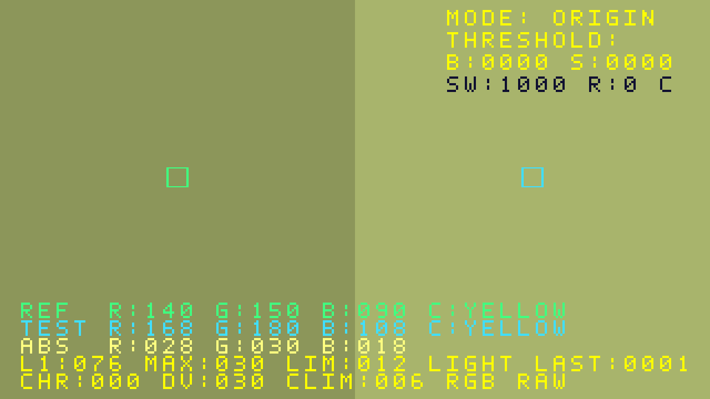
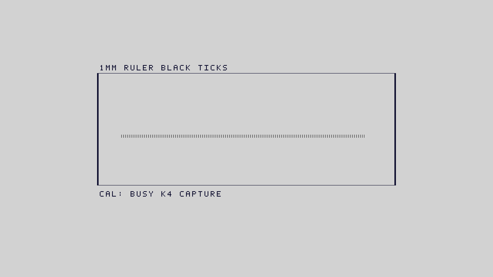

# INSPECTION_USABILITY_V4：大范围读尺与光照型色差提示

MAIN / 2026-11-01。基线8591403（Draft #22），新分支codex/main/inspection-usability-v4。
本轮针对两个用户实板问题；保留V3及所有历史bit/tag，不改Sensor/ISP、五算法、原按键/开关、视频规格、PLL/引脚/SDC或队友目录。
两个改动分别保留检查点：909d506为区域读尺，7067db0集成颜色诊断；实际TD输入以BUILD_INFO的源码commit为准。

## 结果与证据边界

**CAL从512px窄带扩为768×288实际搜索区**：x256..1023/y192..479。
逐带捕获十二相邻行，带间重叠一行，最多27带，所有287个相邻行对都被覆盖。
小缓存复用，不新增整帧缓存或公共视频流水延迟；成功来自同一有效帧的两条可信扫描线，不跨帧拼凑。
用户不必再把刻度放到某条窄线上，但仍需水平、清晰、足够长度的黑色1mm刻度。
只将尺柄放入框、斜放或无法分辨短刻线不能保证成功。搜索需保持不动，最坏约54个源帧周期加分析等待。
R4无足够对比、R5无可信刻度、R6帧异常、R7取消；R3仍须独立长度检验。

**颜色不再只提供一个混合了明暗因素的DIFF提示**。
保留原始RGB/ABS/L1/MAX/RAW LIM012，新增归一化RGB占比最大差CHR和原始最大分量差DV：

| 状态 | 解释 |
|---|---|
| MATCH | 数据可靠且原RAW MAX≤12 |
| LIGHT | 原RGB不同，但CHR≤6；色彩比例接近、存在明暗差异，不自动判物料合格 |
| DIFF | 可靠数据存在明显色彩比例差 |
| CHECK | 过暗或接近截顶，CHR不可靠，显示--- |

照片支持同一物体在两侧采样存在差值，不能仅凭拍屏证明照明是唯一来源，更不能排除反光、镜头/ISP空间响应。
归一化对理想等比例增益具有不变性；有色光、杂散光、黑电平残差与非线性处理不一定被消除。
中性灰不同深浅及相同色相不同反射率也可能LIGHT，故LIGHT不是MATCH。CHR不是ΔE，DV不是物理照度或线性亮度。
没有平场/标准色度校准，不把同一张黄纸直接当成白平衡参考，也不篡改RGB使它看上去相等。

## 验证

| 项目 | 结果 |
|---|---|
| 区域读尺实际RTL | 16项、1947736周期PASS；上下/左右位置、分带交界、2/16px极端间距、完整帧、取消/复位、不跨帧拼行 |
| 完整ROI覆盖模型 | 287/287相邻行对均有某带覆盖；几何模型，非实板成功率 |
| 颜色模型/实际RTL | 330对、4290字段PASS；160组受控1.3×明暗变化RAW全超12、CHR≤1且LIGHT；明显色彩比例变化DIFF、暗部/截顶CHECK |
| 五状态面板像素 | 321600个四像素位置PASS；LIGHT/DIFF/MATCH/CHECK/WAIT、第五行、透明背景、小框边界；坐标为明确单元测试边界 |
| 实际生产ISP | 九帧1280×720、2073600有效四像素拍、1555200个128bit字逐像素/逐字PASS；包含新CAL和500px/100mm捕获 |
| 旧版回归 | 27项旧读尺、UI691200拍/按键消抖、几何91459周期、240换算快照、五整屏绘图1152000拍、颜色218快照/2398字段PASS |

生产ISP回归在post-AWB数字RGB边界注入；不是传感器、DDR物理接口、门级SDF或实际上板验证。
68个其余TD输入、原粗分类函数与RAW MAX12保持，全部新RTL结果记录源码哈希。
验证中扩大缓存的地址宽度和最后不足十二行的空行边界均纳入修正/测试；未带入历史bit。

## 界面示意

以下为独立数字模型生成并核对的预期界面，**不是摄像头画质证据或实板截图**；未模拟后级安路Logo/CNT混合。

完整算法条件见[DESIGN](INSPECTION_USABILITY_V4_DESIGN.md)，操作见[BOARD_TEST](INSPECTION_USABILITY_V4_BOARD_TEST.md)。
实板重点：同一尺在框上/中/下分别读数，独立横竖尺寸复核；同色纸左右交换、改变单侧补光并记录RGB/CHR/DV。
高密度、FIFO B/S及Gray约束覆盖风险仍需长期实板验收，R6或S稳态增长优先处理视频完整性。

## 完整构建与交付

| 指标 | V3 | V4 | 增量 |
|---|---:|---:|---:|
| Slice / 21216 | 20561 | 20994 | +433 |
| LUT6 | 19435 | 19863 | +428 |
| FF | 19041 | 19116 | +75 |
| ERAM20K / 108 | 88 | 90 | +2 |
| DSP / 40 | 26 | 27 | +1 |

完整SYN→PHY→最终STA→bitgen PASS。Setup/Hold WNS +0.146/+0.020ns，TNS0，STA coverage 95.84%。
未新增关键warning类型（仍PHY-5060/5079），高密度PHY-7022仍在。Slice98.95%，只余222个；
资源与时序结果支持本candidate构建，不代表长期实板、热稳定或CDC覆盖已证明。公共像素延迟增量0，仍31拍。

- Version：INSPECTION_USABILITY_V4
- Branch：codex/main/inspection-usability-v4
- 实际TD源码：7067db0bb052747b3c06bc97c4acf9ff36dcbdae
- Tag：inspection-usability-v4-candidate
- Bit：artifacts/bitstreams/INSPECTION_USABILITY_V4/camera_to_dsi_display.bit
- SHA256：2655fd65ebb245279b684fbdc5f3065dab8f654b387c7c61cfca3bdbadc64f39
- Remote：https://github.com/Philid14/anlogic-ph1p35-image-processing.git（Private）
- Git状态：本轮显式提交；用户原有GITHUB_REFERENCE_RESEARCH修改和未跟踪资料保留。
- 归档commit：ff3282008ac0109f103a3cf9ad90d6fea7b9d4e5；[Draft PR #23](https://github.com/Philid14/anlogic-ph1p35-image-processing/pull/23)，依赖#22，未合并。
- Push Status：分支/tag已成功推送，远程ref、tag内bit SHA及75个TD输入与实际构建源码闭环已核对；见[REMOTE_RECEIPT](evidence/INSPECTION_USABILITY_V4/REMOTE_RECEIPT.json)。
- Board Test Status：NOT_RUN。真实尺子成功率、现场颜色解释、尺寸精度与长期视频稳定均待验收。

先PROGRAM_SRAM；按BOARD_TEST进行大框多位置标定、独立真实尺寸及同色/异色/单侧光变化对照。
失败直接重烧V3归档bit，SHA256 18ec235c4d2d2fcebb66ae7634d45c21b6063a2b44956de8506f1a6d991ee68d，tag inspection-usability-v3-candidate。
本轮完成candidate后停止，等待用户上板及负责人审查，不自行开发下一版。
