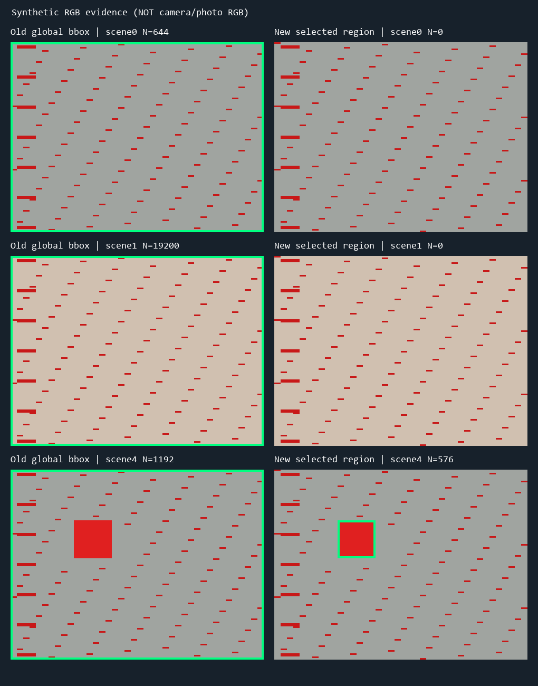

# TRACK_REGION_FIX_V1 诊断与修复报告

本轮 MAIN 基于 PR28 的真实上板失败，修复“无物品也有巨大跳框、红物体不能被框住”。
未修改其他功能。**数字回归与完整TD通过；本bit尚待用户真实上板，不宣称已经实板修好。**

## 根因与证据等级

- **代码确认**：旧检测统计全画面红点的极值，64点即可有目标；没有空间主体选择。
  所以远处杂点也能把框扩到四边。X/Y是框中心而非质心，巨大框因此常停在639/359。
- **模型+旧RTL复现**：160x120无目标、644散点时，旧框0..159/0..119；同数据新N=0。
  加入24x24红目标与远处散点，旧框仍全屏，新框40..63/32..55，支持面积576。
- **代码/合成输入确认**：RGB208/192/176偏暖中性也满足旧色相/绝对彩度判据。
  新相对红通道优势判定拒绝它。不能据此宣称已测得现场AWB/照明各自贡献率。
- **坐标接线验证**：现有bbox44位打包/解包、1280源坐标、每帧锁存及2像素绿线
  在独立及实际31拍路径中正确；没有发现导致本次整屏框的接线错误。
  拍屏不作为相机原始RGB，不虚构现场精确误检率。

## 本版变化与边界

只修改 `vision_source_observer.v`：保持原红色判据，并要求G/B<=R-floor(R/4)；固定红色/30度的硬件表达经过全部16777216种RGB等价检查，
4像素中至少3红点才构成支持块；每行保留最长连续段，至少8px；相邻行段接续形成
至少4行、64支持像素的区域，选支持面积最大者。不是通用连通域或多物体识别。
内部去掉重复结果寄存器，LAST仍由MAIN原子发布。无新增图像RAM、DSP或反压。
共同像素流水线仍31拍；结果在EOF后一拍发布，保持LAST语义。

X为4像素分组边界，Y为原始行，X/Y显示框中心。N改为选中连续区域的支持面积，
不是全画面命中总数，也不是精密面积。FRAME/VALID/ERR、按键、开关和阈值UI保留。
极浅粉、红细线、空心红环、反光切断、多件相近大小红物体仍可能漏检或换选。
本版以非红背景上的单个哑光实心红瓶盖为验收对象。

## 验证与资源

15组native ModelSim回归通过，使用真实厂商ERAM/GSR模型：独立模型16帧与7帧720p
（含末行末拍目标、921600全红支持计数）、旧RTL同数据失败复现、实际MAIN TRACK
31拍逐像素对照、无目标/移动/消失/圆形/暗红/散点/小干扰、提前和同行SOF、valid间隙、
异常帧；旧/新V5共18帧720p ISP/DDR打包验证4147200有效拍/3110400打包字。
背景、尺寸绘图/格式、配置RAM、复位、长按选择、字库回归亦重跑通过。
这是post-AWB/同步UI边界验证，不冒充真实MIPI/DDR控制器/HDMI物理验证。

|资源|旧候选|本版|差值|
|---|---:|---:|---:|
|slice|21103|20942|-161|
|lut6|19809|19498|-311|
|ff|20499|20368|-131|
|eram|105|105|+0|
|dsp|25|25|+0|

- 最终布局布线 Setup WNS +0.137ns / Hold +0.020ns，TNS均0。
- STA覆盖95.67%；Slice余量274，ERAM余量3。
- 完整SYN→PHY→最终STA→bitgen通过。SDC、PLL、Sensor/AWB与TARGET文件冻结。
- 关键warning ['PHY-5060', 'PHY-5079']；新增类型[]。
  既有FIFO稳态溢出、Gray覆盖、热/长期可靠性尚未由本轮实板排除。
- 前两轮打包21312/21226>21216；保留失败证据，没有生成或发布失败bit。

## 交付与上板

- Version `TRACK_REGION_FIX_V1`；Branch `codex/main/track-region-fix-v1`。
- 实际TD源码commit `0e054712064041a18047f13c8ee76c57ad8e29f8`；Tag `track-region-fix-v1-candidate`。
- bit `artifacts/bitstreams/TRACK_REGION_FIX_V1/camera_to_dsi_display.bit`。
- SHA256 `049adbf16065b6ce0b7d9d0d32eb318573c872df1b8a7a1aa4350efbfc583a99`。
- Board Test `NOT_RUN`。归档commit/PR/远程实推以REMOTE_RECEIPT为准。
- [简明上板流程](TRACK_REGION_FIX_V1_BOARD_TEST.md)：SW0000/TRACK，空台面→单红瓶盖
  →左右上下移动→取走，各观察10秒；再抽查颜色比对、尺寸、模式与B/S稳态。
- 回退 `inspection-shape-track-v1-candidate`，全部旧bit/tag保留。新Draft依赖未合并PR28，
  不自动合并、不改main，完成候选后等待上板。
