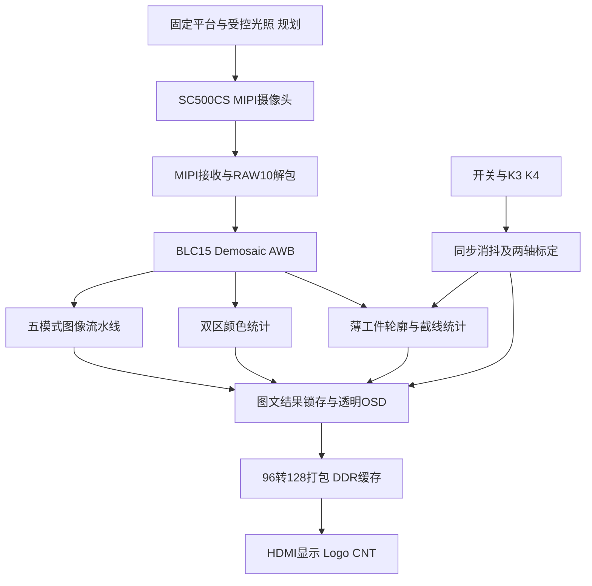
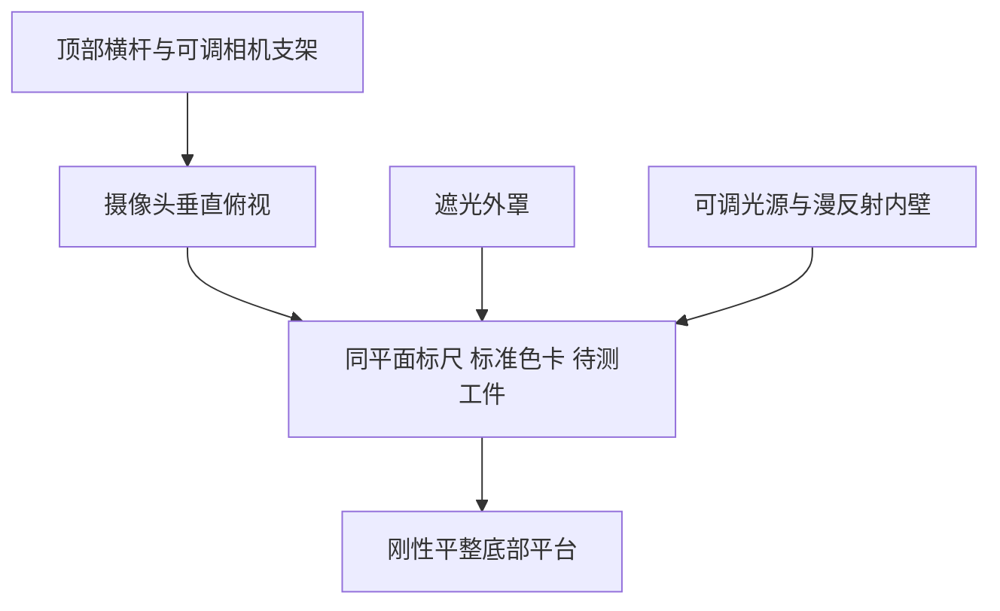
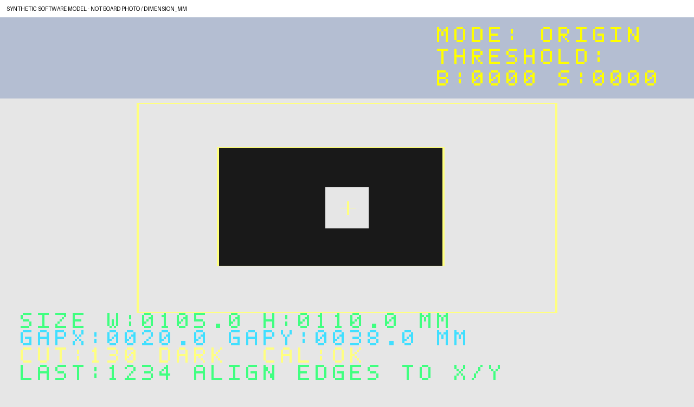
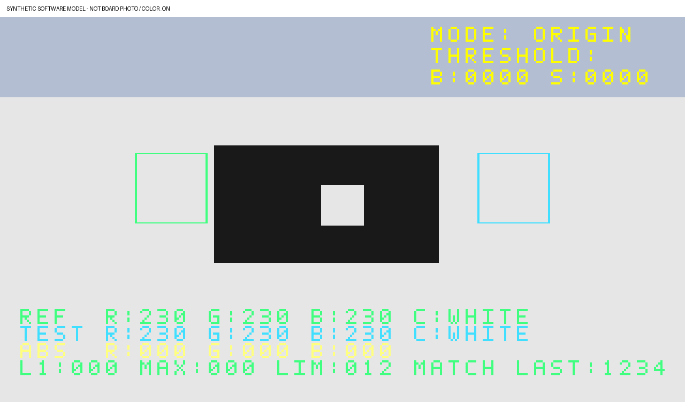

# 基于安路 PH1P35 的固定平台颜色比对与二维工件视觉测量系统

技术文档 V0.1 初步版本｜2026年10月31日

本稿按《技术文档模板.docx》的五部分编排，用于团队审查和后续补证。作品名称不含学校信息。当前成果为候选系统，不是最终比赛交付版。

**状态基准：**代码/文档快照 `7cffe56c384340f59a526da80a2ac3f3018bf209`；实际TD构建源码 `d26a591a399f70259944671956c7a801d9674b6d`；candidate归档 `dfbec5818de58925852e06554c1d8fa0c8bf1d31`。2026年10月30日实板反馈为 **PARTIAL**，优先于构建时记录的 NOT_RUN。没有重写历史 BUILD_INFO。

阅读入口：[模块注意事项和代码对应](MODULE_NOTES.md) · [最终作品需求摘录](FINAL_WORK_REQUIREMENTS.md) · [来源清单](SOURCE_MANIFEST.json)。

## 摘要

本作品面向固定工位的颜色一致性观察和薄工件二维测量，以安路PH1P35MDG324为核心，构建MIPI摄像头采集、FPGA图像处理、DDR缓存、OSD叠加和HDMI输出链路。系统保留原图、灰度、二值、边缘和风格化五种模式；在风格化前的彩色流上并行提取两个固定区域的RGB均值及通道差，并对限定工作区内单个薄工件的轮廓进行统计。通过同平面100毫米标尺分别标定X、Y方向比例，提供轴对齐外包宽高和中心截线间隙显示。

最终装置规划为顶部俯视摄像头、底部平整载物平台、铝型材框架及受控遮光照明。当前已完成应用RTL、独立模型/仿真、完整布局布线及候选bit归档，实板已观察到颜色、标定和尺寸界面；物理开关对应、颜色显隐、有效工件测量及长期稳定性仍待验收。RGB码值差不是标准色差ΔE，一位小数不是0.1毫米测量准确度。高度、任意CAD参数、自动圆拟合和计量级色彩校准未实现。

## 第一部分 作品概述

### 1.1 功能与特性

系统提供连续视频采集和五模式显示，叠加安路Logo、模式、阈值及状态信息。颜色应用在同一帧的参考区和待测区计算RGB均值、绝对差、L1距离与最大通道差，给出九类粗颜色名称和演示容差判断。尺寸应用支持单个薄工件的外包宽高及固定中心截线间隙；两轴手动标定前显示像素，标定后换算毫米。测量无效时显示横线或无有效对象，应用统计不阻塞视频。

注意：上述为代码能力；实板界面局部可见不代表所有功能或精度已验收。

### 1.2 应用领域

面向教学实验、固定工位色卡比对、薄片工件粗尺寸观察及低成本视觉算法演示。固定高度、正对平面、受控光照和哑光背景可减少环境变化，便于重复操作。当前不定位为商业色差仪、自动影像测量仪或具备溯源能力的计量设备；反光金属、曲面、多件叠放、复杂孔形和不同高度工件需额外处理。

### 1.3 主要技术特点

FPGA以每拍四个RGB888像素并行处理，图像通路无采集反压。颜色和尺寸统计取自效果处理前的彩色输入，五模式切换不改变取样来源。窗口/行缓存支持Gaussian、Sobel、NMS、有界弱边连接及单帧时间保持；应用统计采用有界累加器和共享串行换算。数据、有效与行帧通知等长对齐，结果以最近完成采样帧展示，并保留源码、bit与构建证据关联。

### 1.4 主要性能指标

| 指标 | 当前口径 |
|---|---|
| 图像及观察流 | 1280×720；RGB888，96bit/4PPC |
| HDMI像素时钟 | PLL配置75MHz，非板上实测值 |
| 两颜色ROI | 各128×128，全像素统计 |
| 尺寸显示 | 未标定PX；标定后0.1mm显示步长，准确度待测 |
| 候选资源 | Slice 20042/21216，ERAM85/108，DSP23/40 |
| 最终STA | Setup +0.152ns；Hold +0.020ns |
| 实板验收 | PARTIAL；误差、帧率、端到端延迟、长稳待测 |

注意：不把720p60格式目标写成实测60fps，也不将31拍内部对齐写成整机延迟。

### 1.5 主要创新点

1. 在统一视频链路中融合图像效果展示、双区颜色观察和薄工件二维量化。
2. 复用同平面标尺与原按键进行两轴比例标定，明确标定状态和失效边界。
3. 通过透明OSD、无效结果标识及版本化证据，区分算法输出、统计年龄与真实精度。

创新性为本作品设计归纳，尚无行业领先或精度优势对比结论。

### 1.6 设计流程

明确赛题与固定工位需求，先稳定采集显示，再逐步增加图像模式、颜色统计、尺寸标定及界面；每阶段完成模型、RTL、构建和版本归档。当前进入实板操作与精度验证阶段，按已记录失败现象修订操作流程；机械装配、标定数据和最终验收材料继续补齐。

## 第二部分 系统组成及功能说明

### 2.1 整体介绍

图为代码与规划关系图，不是实物安装照片。颜色/尺寸读取真实彩色或亮度统计，不能从STYLE渲染后的像素反推材料颜色或几何。统计结果来自前一完整采样帧，标记LAST；未建立本应用的严格DDR同帧身份测量，不宣传同帧动态跟踪。

实际入口为 `in_out_example/lab_ex3_osd_SC500_720P/lab_ex3_osd/td_project/camera_to_dsi_display.al`，顶层为 `design_top_wrapper`。构建必须以入口列出的实际源码为准，不能仅按目录中的同名模块判断启用情况。

### 2.2 硬件系统介绍

#### 2.2.1 硬件整体介绍

核心器件为PH1P35MDG324，平台参考HX1P35A，摄像头经MIPI输入，DDR缓冲解耦采集和显示，HDMI连接显示器。项目接口依据厂商参考工程、当前TD约束和本地原理图核对，不另行设计或接入非安路FPGA。

注意：平台推荐型号与本地原理图文件名HX1P35B不能直接视为同一硬件版本；比赛交付需补实板型号、版本和序列记录。显示器、MIPI线和电源的具体型号待实物清单补齐。

#### 2.2.2 机械设计介绍

依据最终作品说明，规划铝型材长方体框架，顶部横杆安装俯视摄像头，底部为平整载物面，外层遮光，内部可调照明及反光材料改善均匀性。已有600毫米立方框架材料估算，但600毫米外框尺寸不等于镜头工作距离；相机高度应先按视场、对焦和工件尺寸试定。

注意：这是装配概念图，未提供已装配CAD、载荷/挠度证明或成品照片。反光内壁不能直接产生镜面高光或不均匀照明。移动相机、焦距、工作面或工件高度后应重新标定。

#### 2.2.3 电路各模块介绍

| 模块 | 关键输入输出 | 当前依据与注意事项 |
|---|---|---|
| MIPI/RAW解包 | 高速差分视频、RAW10数据及帧通知 | 官方接口链路；异常汇总和长期稳定性仍需实板验证 |
| ISP | 40bit四像素RAW10至96bit RGB | BLC减15、Demosaic、AWB；不能为颜色演示随意更改曝光/白平衡 |
| DDR | 128bit写入/读出及握手 | 正常每帧172800个128bit字；历史FIFO/Gray约束风险仍记录 |
| HDMI | RGB888、DE/同步及TMDS | 像素时钟配置75MHz；不是实测频率或完整约束覆盖证明 |
| 人机输入 | K3/K4及I_switch[3:0] | 逻辑引脚A4/B4/E11/D11；实板物理路数和极性仍待核对 |

原理图中的K1/K2电压问题已有审计，候选标定复用原K4，不新增这两个按键。逻辑SW0～3不能直接标为实板第1～4路；第四物理开关显隐未通过，禁止无证据重分配引脚。

### 2.3 软件系统介绍

#### 2.3.1 软件整体介绍

图像处理、颜色统计、尺寸换算及OSD均部署于FPGA RTL。PC端Python脚本用于离线模型、仿真驱动、格式/源清单检查和报告归档，不承担实时核心处理。目前没有交付运行中的云平台或PC测量上位机。

注意：软件模型图用于解释算法；未经标注的预览不能充当实拍。本文引用的历史仿真是归档证据，本次文档整理没有重跑RTL、TD或板测。

#### 2.3.2 软件各模块介绍

**基础五模式与边缘算法。** 原图保留RGB；灰度/二值分支按既有亮度与阈值处理；边缘分支包含3×3 Gaussian、Sobel幅值、NMS和四步有界弱边传播，并保留非递归单帧梯度支持。不是完整递归Canny，也不是1280点全采样Sobel：边缘内核按像素对处理，输出复制回原视频宽度。STYLE V2采用保守同色均值、共享明度量化、中性保护和暗侧描边，属于局部风格化，不是全局闭合区域填充。

**颜色比对。** REF区x256～383/y256～383、TEST区x896～1023/y256～383。每区16384像素，逐通道累加并计算 `mean=(sum+8192)>>14`。通道绝对差 `dC=|TEST_C-REF_C|`，`L1=dR+dG+dB`，`MAX=max(dR,dG,dB)`；各通道差均不大于12时显示MATCH，否则DIFF。粗颜色为BLACK/WHITE/GRAY/RED/GREEN/BLUE/YELLOW/CYAN/MAGENTA。

注意：12为演示容差，不是工业合格阈值；RGB差不是CIE Lab/ΔE。两ROI应被样品完整覆盖，避免框内混入背景、反光和阴影。固定双ROI应用是MAIN当前实现，不等同于队友TARGET动态目标检测已整机接入。

**二维工件测量。** 以真实RGB亮度的二值轮廓统计ROI x256～1023/y160～543内单件工件。小于3像素连续段、行内不足8个有效像素等被过滤；至少3个合格行和64个像素，触ROI边界或几何异常时拒绝。外包W/H由轴对齐极值给出；固定x640/y352截线上的背景间隙给出GAPX/GAPY。

注意：旋转工件的外包宽高不是其固有CAD长宽；GAP是截线间隙，不是自动圆拟合或多孔识别。圆孔居中、薄片平放且姿态正确时才可作内径对照。高度及三维重建未实现。

**标定与换算。** 使用同一工作平面上的100毫米已知刻度，分别调整X、Y像素跨度；像素尺寸换算到0.1毫米单位为 `round(pixel_span*1000/calibration_span)`。K4标定步进4像素；初始256像素不是已校准比例，复位后需重做。

注意：CAL:OK仅表示访问两轴后退出标定，不能检测尺子是否存在或刻度是否对齐。屏幕上一位小数不保证0.1毫米准确度。

**界面与有效性。** 开关先同步消抖再帧边界更新；尺寸优先于颜色，空白字点透明。无效测量不阻断视频写入。结果保留一采集帧年龄及DDR原延迟，不可拿LAST/CNT直接证明采集活性、同帧匹配或端到端低延迟。

## 第三部分 完成情况及性能参数

### 3.1 整体介绍

当前候选完成视频、算法、颜色比对和尺寸界面RTL及构建。板测已观察到CAL、颜色和尺寸工作区，但尚未得到有效工件尺寸、标尺对齐证据、误差统计或30分钟稳定记录。整机正面和45度照片、内部光路与走线照片列为待补，不以概念图代替。

### 3.2 工程成果

| 分类 | 已有成果 | 待补与限制 |
|---|---|---|
| 机械成果 | 固定工位文字需求、材料和框架规划 | CAD/下料确认、装配实物、光照均匀性、工作距离与平面度 |
| 电路成果 | 主工程、IP/约束、候选bit和完整路由报告 | 实板型号、接线照片、开关实际对应、电气/环境验收 |
| 软件成果 | 五模式、颜色统计、平面测量、透明OSD及工具 | 精度、颜色显隐、无效恢复、实际用户操作验证 |
| 团队扩展 | TARGET和LATENCY独立任务另有来源 | 不能以本候选或目录存在宣称它们全部整机完成 |

以下为**软件合成界面示意，不是实物照片或实测数值**：

### 3.3 特性成果

历史报告记录：颜色218组/2398字段；轮廓160帧/91459周期；换算240组；最终六帧720p共1382400个四像素拍、1036800个128bit字；旧新mixer1857588周期等价。测试包含post-AWB输入/控制替身，不等同真实摄像头、DDR PHY和HDMI电气签核。

候选bit SHA256：`2003bbcc9f205b488ba566d7606e16416335b28dec738810827e296d62b62adc`。资源为Slice20042/21216、LUT6 18668、FF18560、ERAM85/108、DSP23/40；Setup/Hold WNS为+0.152/+0.020ns，不能据此推导测量准确度或长期稳定性。

实板问题：全部OFF曾显示CAL Y；第一物理路影响轴/极性，第二路影响尺寸显示，第三路影响CAL/RUN；第四路未能关闭颜色。以上是行为推断，不是GPIO电平测量。当前NO VALID OBJECT及默认SPAN0256不能记为尺寸通过。

后续须使用独立已知尺寸工件，逐件至少10次读数，报告均值误差、最大绝对误差、极差、姿态/位置/光照条件与失败样本。颜色采用固定样品、固定光源做重复性和漂移对照。所有未测指标填“待测”，不以0或理论值补齐。

## 第四部分 总结

### 4.1 可扩展之处

后续优先闭合实际开关映射、测量标定和长期稳定性，再考虑光照均匀性、畸变/透视补偿、标准色彩校准、轮廓拟合、独立多目标和同帧延迟。高度测量另行立项，需要光学/几何模型与真实标定。当前Slice使用率约94.47%，新增功能须重新评估资源与时序，不能以独立模块资源简单相加。

### 4.2 心得体会

从已记录开发过程可见，数值显示、模型通过、时序收敛和实际测量是不同层次。颜色处理中，光照和ISP变化会影响RGB码值；尺寸处理中，平面、姿态、阈值和标尺对齐共同决定误差。已完成的Logo地址重定时表明，关键路径可能位于既有显示混合逻辑，而不一定来自新增测量模块。早期错误引脚方案和负时序构建均已保留，不能用后来的成功覆盖失败证据。

界面名称也必须对应真实能力：CAL:OK是操作状态，MATCH是演示阈值判断，GAP是截线间隙。只有清楚区分这些语义，才能形成可重复的现场演示和可信技术说明。下一阶段应补齐实板数值、照片和环境条件，再收敛最终作品结论。

## 第五部分 参考文献

以下均为内部实现/原始资料，版本绑定见SOURCE_MANIFEST；厂商样本仅借鉴应用布局，不引用其性能作为本作品指标。

1. 竞赛主办方及安路科技. 2026 FPGA创新设计赛道选题指南[Z]. 2026，第16—18页. 仓库docs/赛题。
2. 本项目. AGENTS.md及TEAM_AI_WORK_PROTOCOL.md[Z]. 2026.
3. 用户. 关于最终作品实现.txt[Z]. 本地固定平台与两项应用需求，摘录见本目录。
4. 本项目. COLOR_COMPARE_V1_DESIGN.md及REPORT.md[EB/OL]. 2026.
5. 本项目. INSPECTION_UI_DIMENSION_V1_DESIGN.md及REPORT.md[EB/OL]. 2026.
6. 本项目. INSPECTION_UI_DIMENSION_V1_BOARD_FEEDBACK_2026-10-30.md[EB/OL]. 2026-10-30.
7. 本项目. EDGE_STYLE_FILL_V2_DESIGN.md及REPORT.md[EB/OL]. 2026.
8. 本项目. EDGE_NMS_V1_DESIGN.md及EDGE_QUALITY_V1_DESIGN.md[EB/OL]. 2026.
9. 本项目. INSPECTION_UI_DIMENSION_V1 BUILD_INFO及build_evidence[Z]. 2026.
10. 厂商. IM-X1000系列全自动影像仪产品样本[Z]. 本地AS_164100_IM-X1000_C_643775_KC_CN_2115_3.pdf，40页，仅应用展示参考，具体出版信息待核实。

### 初稿更新清单

- 补作品成员/版本信息时不出现模板禁止的学校信息。
- 补机械实物和CAD、实板型号/接线、可靠开关对应和相机工作参数。
- 完成100mm两轴真实标定、独立工件误差与重复性测试、颜色显隐与光照试验。
- 补真实照片与视频时间点，区分软件预览、拍屏和原始输入。
- 完成30分钟长稳及FIFO/CDC风险复核；补逐项赛题验收表。
- 确认后的新结果另建结果提交；不移动旧tag、不修改旧bit或把本稿当最终通过证明。
