# 基于安路FPGA的
实时图像处理与颜色目标检测系统

技术文档 独立提交稿
2026年11月4日  对应最终代码 V1.2

### 摘要

本作品面向固定俯拍、可控照明的桌面视觉检测，基于安路PH1P35 FPGA、HX1P35A开发板与SC500CS摄像头，完成MIPI RAW10采集、RGB888四像素并行处理、DDR缓存和720p HDMI显示。系统提供原图、灰度、二值、边缘、风格化、红目标跟踪及运动检测七模式，并在彩色观察流上实现双区RGB比较、厘米标尺定尺度、薄工件宽高与中心间隙、手选圆片直径半径及轴对齐T/L分段标注。操作者可在画面中同时查看检测区域、数值和输入状态，完成颜色筛查或尺寸辅助复核。目标框按上一完整采集帧结果成组更新；内部计时另以帧身份和缓存代次关联同一帧的RAW首有效拍与HDMI首DE。通过配置存储、行RAM及帧级AWB精确除法复用，保持31拍公共像素流水，容纳最终功能。独立解压重建完成综合、布局布线、时序检查与bit生成，使用19177/21216 Slice、105/108 ERAM，Setup/Hold WNS为+0.137/+0.020ns。实物视频展示了模式切换、标定、尺寸标注、颜色状态、红框、运动点阵和变光显示。尺寸误差、真实内部延迟和连续运行时长的量化记录尚未形成，本文按实现、实物展示与测量记录分别评价。

关键词  安路FPGA  固定平台检测  背景参照  平面尺寸  颜色目标

## 第一部分  作品概述

### 1.1 功能与特性

系统支持按键循环七种视频模式并显示安路Logo。固定双ROI比较RGB及亮度有效条件；厘米标尺建立平面比例，输出薄工件W/H、中心间隙及手选圆片D/R。最终代码支持轴对齐T/L分段尺寸同时标注。红目标使用LAST外框与坐标，运动检测用橙红点阵提示变化块；同帧内部计时已接入实际视频路径。

### 1.2 应用领域

用于可控照明下的教学实验、样品颜色一致性筛查与单个薄型零件外形辅助复核。固定相机、同一标定平面、遮光和可调照明便于重复放置样品，观察位置、姿态和反光对检测结果的影响。颜色与尺寸任务可分别操作。

### 1.3 主要技术特点

RGB888采用96bit、4PPC无反压流水，公共深度31拍。颜色、几何、背景参照和帧差共享彩色观察流；LAST图形与文字共同锁存。计时路径将像素和身份放入同一FIFO数据字跨域，并按DDR槽位写代次匹配首次显示的新帧。AWB两路帧级除法精确串行复用，保留采样、增益及复位语义。

### 1.4 主要性能指标

| 项目 | 配置或归档结果 |
| --- | --- |
| 输入与并行度 | 1280×720；RGB888、96bit、4PPC |
| 公共像素流水 | 31拍；不含曝光、DDR及显示器 |
| 整机P&R | Slice19177/21216；ERAM105/108；DSP25/40 |
| 最终WNS | Setup +0.137ns；Hold +0.020ns |
| 实物功能 | 七模式/标定/颜色/尺寸/红框/运动/变光已展示 |

### 1.5 主要创新点

在单FPGA彩色通路上组合双区比较、背景参照尺寸和动态观察，用区域、状态及尺寸线解释检测结果。配置存储、行RAM和帧级除法复用使最终功能在器件内实现；整机Slice较表列前版减少1654，约7.94%，公共像素流水仍为31拍。

### 1.6 设计流程

先建立MIPI采集、缓存和HDMI显示基线，再统一像素与同步流水，逐步接入颜色、尺寸及动态观察。根据实物反馈修正标尺提取、前景分割和标注方式，用独立模型与原生RTL回归验证正常及异常输入；冻结源码后完整构建，归档bit和报告，最后组织实物展示与性能评价。

## 第二部分  系统组成及功能说明

### 2.1 整体介绍

平台在同一显示端提供颜色筛查和尺寸辅助复核。颜色任务把参考样品与待测样品放入固定双区；尺寸任务按标尺定尺度、学习空台面、放入工件的顺序操作。TRACK与MOTION展示动态观察能力。它们共享视频采集和显示底座，各任务保留各自的输入条件。

| 任务 | 操作者流程 | 输出与操作依据 |
| --- | --- | --- |
| 颜色筛查 | 覆盖双ROI→等待完整统计→交换样品复核 | 两区RGB、原始差/比例差与MATCH等状态 |
| 尺寸测量 | 厘米标定→移走尺→学习空台面→放工件 | CAL与BG状态、外框、W/H和中心间隙 |
| 圆片测量 | 完整圆片正俯视→长按K4选择D/R | 水平外径D、R=D/2及半径线 |
| 动态观察 | 切TRACK或MOTION→移动/移出/恢复 | LAST外框和坐标，或变化块和状态 |

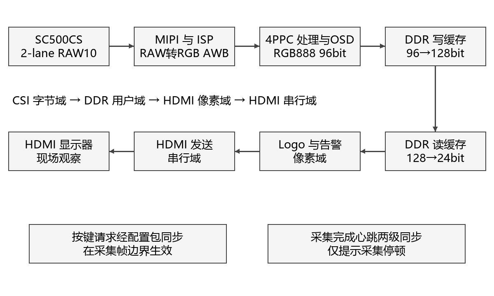

图1 视频闭环与主要时钟边界示意

厂商参考工程提供D-PHY、MIPI、PLL、DDR和HDMI接口；自定义Verilog实现像素算法、应用统计、帧资格管理与OSD。运行时由FPGA独立处理视频，PC用于开发和下载。图1说明主要数据路径与时钟边界。

| 时钟域 | 最终STA约束频率 | 职责 |
| --- | --- | --- |
| CSI字节 | 59.995MHz | 图像处理、统计与缓存写出 |
| DDR用户 | 66.667MHz | 读写调度 |
| HDMI像素 | 75.002MHz | 读出、Logo及告警 |
| HDMI串行 | 375.094MHz | TMDS发送 |
| 外设控制 | 23.810MHz | 按键与相机控制相关逻辑 |

应用统计及LAST标注在CSI域随像素进入DDR。延迟测量另传递帧身份、时间和槽位代次，在HDMI实际首DE记录显示事件。整包FIFO和保持元数据握手承担跨域传递；采集心跳经两级同步后提供停顿提示。表中频率取自STA约束，用于说明配置[18]。

### 2.2 硬件系统介绍

### 2.2.1 硬件整体介绍

硬件由安路PH1P35MDG324、HX1P35A开发板、米联客MLK-CAM001 V1.0 SC500CS模组、板载DDR和HDMI显示器组成。摄像头按当前寄存器使用2-lane MIPI RAW10；RGB处理端采用4PPC，两者分属传输接口和像素并行度。相机以实际配套FFC连接板卡。

### 2.2.2 机械设计介绍

顶部铝型材横梁固定相机，外部遮光布与反光内衬围成观察空间。侧面两条补光灯配有控制器，板卡与显示器置于外部台面，便于放样与操作。固定视场和标定平面服务于颜色比较及平面尺寸任务。

相机、工作台或照明位置改变后，应重新确认比例并学习背景。图5、6展示外部布置与内部安装；成品机械尺寸和照明均匀度未独立测量，概念结构与实物照片分别记录。

### 2.2.3 电路各模块介绍

| 模块 | 关键输入输出 | 工程边界 |
| --- | --- | --- |
| 相机控制 | O_cam_scl、IO_cam_sda / O_cam_24m、O_cam_rst | 配置、时钟与复位；AE请求关闭 |
| MIPI输入 | IO_rx_clk_pad_p/n / IO_rx_data_pad_p/n[3:0] | D-PHY与解码沿用参考IP |
| DDR | addr[12:0]、dq[15:0]、dqs/ck等 | 既有多帧缓存与控制器 |
| HDMI | O_tmds_ch0/1/2_p、O_tmds_clk_p | 有效1280×720，总时序1650×750 |
| 操作 | I_button[1:0]、I_switch[3:0] | 实体映射用屏幕SW与资料核对 |

系统利用开发板既有供电、时钟、MIPI、DDR和HDMI电路，新增成果集中于RTL及接口集成。实物板卡丝印为HX1P35A；仓库HX1P35B_FT_40P参考图纸与实板尚未逐页匹配，因此本节采用实物连接和接口表说明硬件组成。

1280×720图像每行320个4PPC有效拍，每帧230400拍，RGB有效载荷2764800字节。按表中HDMI像素约束频率和1650×750总时序折算约60.61Hz；这是配置折算值。HDMI刷新、摄像头采集和首次显示的新图像帧率分别统计，重复读出DDR帧保留原身份。

observer把提前或内联SOF归一到真实有效首拍，核对320拍/行与720行后发布完整观测。错误行尾、提前新帧和截断使该次结果失效。接口名及其生效位置以生产适配器为准，帧通知与首有效像素分别处理。

### 2.3 软件系统介绍

### 2.3.1 软件整体介绍

工程软件包括RTL、约束、参考模型、原生仿真和构建脚本。post-AWB观察流每拍输入四个RGB888像素，算法选择、应用与状态层保持共同31拍深度。背景分支内部增加2拍并在公共流水内对齐；曝光、DDR调度和显示器处理属于其他延迟组成。

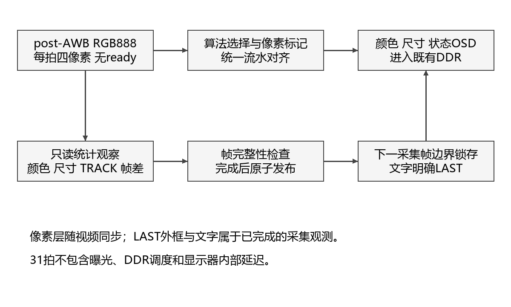

图2 像素流水与完整观测发布流程

资源优化把23bit配置延迟改为移位链，将Gaussian/NMS行历史共享至双口RAM。在720行配置下，两路帧级48/32位AWB除法按商位串行复用，49拍完成，保留原50拍图像RAM延迟及在途复位行为；小于64行和默认配置继续使用原IP。原生逐拍对照验证精确结果、采样与增益语义一致[18][19]。

### 2.3.2 软件各模块介绍

### 2.3.2.1 基础处理与接口

| 模块 | 实现方法 | 适用范围 |
| --- | --- | --- |
| GRAY / / BINARY | Y=(77R+150G+29B+128)>>8；Y≥阈值为白 | 整数定点亮度及阈值分割 |
| EDGE | 高斯、Sobel、非极大值抑制和有界弱边传播 | 水平成对取样后复制，有界弱边传播 |
| STYLE | 局部色彩均值、亮度量化、暗线保护 | 局部风格化，保留暗线 |
| AWB | 沿用既有帧统计白平衡 | 保留帧统计AWB；AE关闭 |
| 应用与 / observer | 颜色/尺寸统计、TRACK、块均值帧差 | 共享彩色观察流，每拍四像素 |

| 模块 | 关键输入 | 关键输出 |
| --- | --- | --- |
| ruler_area_calibration | gray[31:0]、valid/user/last、请求 | span[10:0]、calibrated、status[2:0] |
| measure_background | gray[31:0]、回退前景、帧标记、learn/clear | pixels[3:0]、对齐标记、applied/ready/status |
| planar_measure_stats | 4路前景、帧标记、极性/ROI | 外框、尺寸与中心间隙端点/有效状态 |
| vision_source_observer | rgb[95:0]、gray[31:0]、帧标记 | LAST目标结果、变化标记、帧身份与错误 |

### 2.3.2.2 固定双区域颜色比对

参考样品与待测样品在同一完整采集帧中分别统计1024个像素的RGB。参考ROI为x=304…335、y=304…335，测试ROI为x=944…975、y=304…335，边界均包含。四lane共同累加，完成两个区域后发布比较，避免用不同采集时刻的数据配对。

| 量或状态 | 含义 | 适用范围 |
| --- | --- | --- |
| 均值 RGB | 各通道(sum+512)>>10，四舍五入 | 码值依赖sensor、AWB、曝光和照明 |
| ABS、L1、MAX | 逐通道绝对差、差的和、最大通道差 | MAX≤12为当前原始RGB接近阈值 |
| CHR、DV | 归一化通道比例最大差、maxRGB亮度代理差 | 用于解释差异，不是ΔE或照度 |
| 亮度及饱和检查 | 两区均sumRGB≥96、maxRGB≥32且<254 | 排除过暗与近饱和输入 |
| MATCH | 可靠且原始MAX≤12 | 当前原始RGB码值接近 |
| LIGHT | 可靠、原始不匹配、归一化CHR≤6 | 通道比例接近，可能含亮度差 |
| DIFF、CHECK、WAIT | 明显差异、可靠性不足、数据未完整 | 分别显示差异/输入检查/等待 |

系统以原始RGB接近程度筛查样品，并用归一化通道比例辅助解释亮度差。亮度及饱和条件检查决定是否接受比较输入；MATCH、LIGHT、DIFF和CHECK分别保留判断原因。区域内背景、纹理和高光会影响均值，使用时应让样品覆盖ROI。

表中的“可靠”专指sumRGB与maxRGB满足门槛，不是统计置信度。LIGHT表示原始RGB有差异而通道比例接近，其原因仍可能包含样品明度、照明或材质。现有实拍展示了颜色名和状态变化，重复交换实验的结果未形成统计；评价记录集中见3.3.4。

### 2.3.2.3 厘米粗标定与平面尺寸

在ORIGIN、DIM与CAL条件下短按K4发起标定。AREA标题应为1CM RULER LONG TICKS。搜索区x=256…1023、y=192…479，宽768、高288，复用12行缓存扫描27个重叠带，约需54个采集帧及分析等待。输入必须是水平、清晰、黑色公制厘米长刻线，至少五条长线；尺与工件同平面，背景尽量干净浅色。算法不识别数字或单位[2][3]。

每行灰度对比度至少16，暗阈值取low+(high−low)/4；提取未裁断、宽1…4px的笔画中心，采用加倍坐标保留半像素信息。接受12…120px/cm的连续间距，相对首间距容差约25%+1px，至少四个间隔；先求行内平均，再平均同一完整捕获帧内的相邻两条有效行，两行容差约12.5%+1.2px/cm。全27带搜索结束后优先较大稳定间距，以减少过早选中半厘米线的风险。

| 界面状态 | 含义与边界 | 操作者动作 |
| --- | --- | --- |
| R0 / R1 / R2 | 未标定 / 等待采样 / 分析 | 保持标尺静止，不连续重按K4 |
| R3 / CAL:OK | 周期一致，发布平面比例 | 关闭CAL，独立工件复核，再测尺寸 |
| R4 / R5 | 对比度不足 / 间距未通过 | 留存原图、刻线条件和失败画面 |
| R6 / R7 | 帧几何错误 / 取消 | 检查链路或重试，不能沿用失败候选 |

相邻厘米长线平均d像素，对应10mm，因此旧接口S100=10d像素/100mm，有效范围120…1200。例如d=34px时S100=340，170px工件跨度对应50mm。新请求先撤销旧尺度，复位清尺度，错误帧不接受缓存候选，取消不确认。成功后关闭CAL、保留DIM；屏幕SW通常0101→0100，实体拨码顺序与极性须现场核对[4]。

X/Y共用比例S100，要求工件与标尺同平面、相机近似正俯拍。周期选择仍可能受半厘米线或背景纹理干扰，因此R3后用独立已知尺寸确认X/Y尺度，再读取工件。显示分辨率与实物误差在3.3.4分别记录。

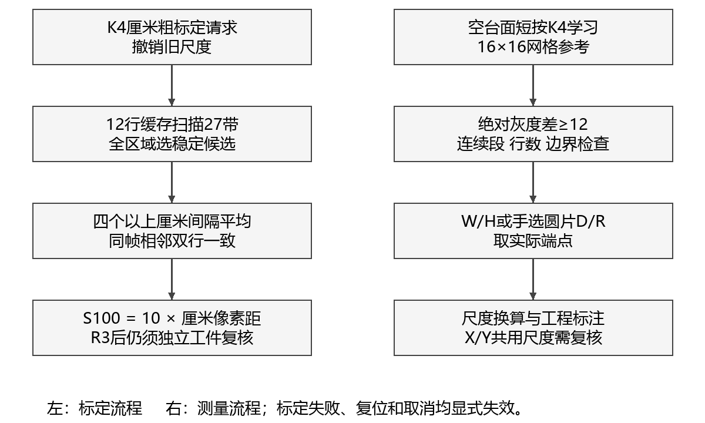

图3 标尺定尺度与背景参照测量流程

尺寸ROI为x=256…1023、y=160…543。单个薄、平、轴对齐工件应完全落在区域内。最终实现过滤不足3个连续前景像素的段；每行至少6个合格像素，至少3行、64像素形成范围，触ROI边界则无效。宽高为轴对齐外接跨度；GAPX/Y只沿x=640、y=352的固定中心截面寻找至少3个背景像素，不是任意孔检测。阴影或反光造成的空段不能直接认定为真实间隙。

将像素跨度P按100mm等效跨度S100换算，先计算以0.1mm为单位的整数q，再显示q/10毫米。式中比例取自厘米刻线；显示小数位保留换算分辨率，实际误差另由独立样品测量评价。

换算公式 q = round(1000 × P / S100)，q单位0.1mm；Word保留原生公式。

### 2.3.2.4 空台面学习与显式圆片档

针对单阈值遗漏接近背景亮面的反馈，系统在ORIGIN测量RUN下短按K4学习空台面。768×384像素ROI按16×16像素单元划分，形成48×24=1152格；每格在中心行取间隔4像素的四个灰度样本建立参照，占1 ERAM。逐像素绝对灰度差≥12即判前景，使比背景亮或暗的区域均可参与分割[12]。

学习必须收齐完整帧、正确行尾并写满1152格，才发布BG:OK；否则不确认。BG:NEED/WAIT/OK/FAIL说明参照状态，AUTO12表示最近完成的测量帧使用背景差，CUT表示回退固定阈值。复位、进入CAL和重新学习会清除背景就绪；帧中clear/request在后续SOF生效，避免学习与读取混杂。BINARY仍显示固定阈值二值图，不能当作AUTO12前景掩码。

操作顺序为标尺定尺度、移走尺和工件、学习空台面、放入工件。相机、桌面或照明变化后重新学习。纹理、阴影、AWB变化及过曝会影响参照与前景差异；合成测试验证了明暗前景和阈值边界，实物对照结果见3.3.4。

在ORIGIN测量RUN下长按K4约1秒，一次切换W/H或D/R。操作者为完整正俯视圆片选择D/R：D取水平外径，R=D/2，画面同时绘制半径线。未标定显示PX，已标定显示MM。自动近圆分类SHAPE_ENABLE=0，最终使用显式选档，其他轮廓按W/H读取。

### 2.3.2.5 红色目标与LAST外框

最终生产观察器采用HSV颜色判据，并在TRACK_REGION_FIX_V1中增加相对红优势条件G/B≤R−floor(R/4)。四像素中至少三点匹配构成支持块；保留每行最长且至少8px的连续段，接续至少4行、64支持像素，选择支持面积最大的一处区域。该规则用于单个主要红目标，并通过tracker及guard管理连续观测[17]。

归一化观测EOF后下一拍发布区域结果，在后续采集帧边界将外框、框中心、支持面积、帧号和有效状态共同锁存为LAST。绿色外框宽2像素，横向按4px分组；X/Y为框中心，N为支持面积，HEX格式显示。浅粉、细线、空心环或多个相近红物体可能引起漏检或换选；最终动态跟踪以红色为范围。

session/frame由采集事件建立，guard去除重复或乱序观测，并处理取消及年龄。CSI域64bit时间计数在时钟继续运行时检测无输入超时，6000000周期在名义60MHz下约100ms。坏行、提前新帧与截断撤销可信状态；HDMI域另由采集心跳监测停止更新。

目标框对应上一完整采集帧，快速移动会出现帧级滞后。当前观测无目标或无效时撤销后续标注；DDR若重复旧图像，也可能重复其中的旧框。内部延迟路径用同帧身份关联采集与实际显示，其身份管理服务于计量，与LAST目标框的结果时刻分别定义。

实拍展示了红瓶盖移动时外框及坐标变化、移出后转SEARCH。当前未对定位误差或响应时间量化；YCbCr到HSV的变化属于实现选型，文档不据此比较两者准确率。

### 2.3.2.6 块均值帧差与采集心跳

MOTION将1280×720划为32×16像素单元，形成40×45共1800块。每块512像素求8bit灰度均值，前后完整连续帧绝对差≥12记为变化，至少3块置MOTION。最终把稀疏洋红提示改为FF3000橙红、8px间距的3×3实心点，每块最多8点/72px；显示上一完整有效变化图，约滞后一采集帧[6][19]。图14展示当前点阵和静止回落。

| 状态或结构 | 定义 | 输出解释 |
| --- | --- | --- |
| 双缓冲历史 | 两组各1800项均值及变化位，仍用2个ERAM | 历史均值与变化位存储 |
| 提交 | 仅完整有效帧交换缓冲角色，要求连续采集ID | 截断帧不作为可信历史 |
| WARMUP / INVALID | 历史未建立 / 帧错误、取消或超时 | 此时参考尚未有效 |
| LAST CHANGED | 最近完整采集帧变化块数 | 计数单位为块 |
| STILL / MOTION | 变化块少于3 / 至少3 | STILL可能仍有1—2个变化块 |
| GLOBAL | 超过75%块发生变化 | 表示大范围画面变化 |
| 新版橙红点阵 | LAST完整变化图；8px间距、3×3点 | 提示变化区域 |

复位、丢行、帧中断、非连续身份或观测过期时清除历史并重新WARMUP。只有完整有效帧可交换双缓冲角色，避免半帧写入成为新参考。两组ERAM分开读写，原生模型验证同步读语义。

块平均降低历史存储量，适合固定相机下的明显移动。小目标、慢速位移或块内明暗抵消可能减弱变化；大范围照明改变也会触发GLOBAL。系统输出变化块及状态，物体数量与精细运动轮廓属于其他评价目标。

采集完整帧产生1bit翻转心跳，经HDMI域两级同步。无新心跳达到15000000个像素周期后显示SOURCE STALE，名义75MHz下约200ms；启动及复位也置过期。该指示用于发现采集停顿，显示帧新旧另由计时路径的读帧身份管理。

| 路径 | 采样及发布 | 显示结果的时刻 |
| --- | --- | --- |
| 颜色与尺寸 | 完整彩色观测后发布，在后续帧边界锁存 | LAST结果随CSI像素进入DDR |
| 红目标 | 连续红区域选择→tracker/guard→整组锁存 | 上一完整采集帧的框/中心/面积 |
| 运动 | 连续完整帧的块均值差→双缓冲交换 | 上一完整有效变化图与块计数 |
| 内部计时 | RAW身份/时间→同字FIFO→DDR槽代次→读租约 | 匹配同一帧的实际HDMI首DE |

图4 最终应用观察与内部计时的结果关系

### 2.3.2.7 操作与异常判读

| 条件 | K4短按释放 | K4长按 |
| --- | --- | --- |
| BINARY / EDGE | 阈值减10 | 阈值加10，按既有重复语义 |
| ORIGIN测量CAL | 发起厘米标定 | 不作为D/R切换 |
| ORIGIN测量RUN | 学习空台面 | 约1秒切换W/H与D/R，一次一切 |
| TRACK / MOTION | 不调整检测阈值 | 不调整检测阈值 |

K3循环七模式；拨码负责颜色显隐、尺寸/CAL与极性等既有操作，先用屏幕逻辑SW确认映射。标定时通常SW0101，成功后关CAL留DIM为0100；TRACK先SW0000。不能猜物理左右编号。复位后尺度与背景都需重新取得；CAL:OK不表示背景已就绪，BG:OK也不表示尺度正确。

屏幕B/S是HEX饱和计数：B统计前600采集帧中含write-valid且FIFO-full事件的帧数，S统计之后的此类帧数，上限FFFF。它们不是亮度/饱和度，也不是溢出的像素数。启动B非零不自动等于稳态丢帧；S增长应优先排查吞吐和缓存。SW是逻辑开关状态，R是读尺状态，R3才是最近标定成功。源帧号、HDMI计数与B/S须各按本义记录。

### 2.3.2.8 同帧内部计时与资源复用

同帧计时从LATENCY_PERFORMANCE_V1建立：解码后RAW首有效4PPC拍生成身份与时间，87bit标签和128bit像素使用同一FIFO字跨域。DDR四槽按写代次记录，完整172800打包字才提交；选读时锁存身份与时间，经握手送往HDMI，在首个真实DE打点，收齐921600像素并通过边界检查后发布。最新LATENCY_FRAME_FIX_V1修正RAW错误归属，避免随后消隐期PHY错误误取消尚在ISP尾部打包的完整帧；有效数据期间的错误仍须拒绝[18]。

真实计时参考为配置75MHz、10us量化，尚未物理校准；包含ISP和缓存等待，不含曝光、摄像头内部及显示器延迟。LAT/MIN/MAX仅统计合格不同帧首次显示，AGE为图像年龄；NEW/REP区别新帧与重复，BAD/WAIT或N0不是有效测量。F/N/E为HEX，BAD可能保留旧数；模式共享固定流水，切换后LAT接近不反常。新增C/W/D为采集拒绝掩码、实时槽状态和显示拒绝掩码，用于定位，不是延迟[18]。

最终代码使用真实完整性和身份判据。实物录像仍包含历史DEMO面板，其10—30ms为模拟界面数字；当前未取得真实路径有效N增长的清晰板测记录。3.3.4列出测量状态，图18保留DEMO原画面及判读说明，不以该模拟值报告实测性能[18][20]。

### 2.3.2.9 T与L形薄工件分段尺寸

最终T/L实现同时标注W/H、竖段宽S、横梁厚T、左右伸出A/B及外部竖段长V，零伸出侧隐藏。算法复用行包络，要求两稳定嵌套水平段各至少6行；工件应薄、同平面、正俯视及轴对齐，T横梁水平。复杂或旋转轮廓回退W/H，横向分段按4px量化。该路径已有原生测试与最终整机构建，实物记录见3.3.4[19]。

### 2.3.2.10 方案演进与取舍

作品的MIPI采集、缓存、基础处理、HDMI和OSD主线延续初版目标，应用逐步聚焦固定工位颜色比较与薄工件尺寸。实际操作采用K3循环七模式；颜色判据由初拟YCbCr改为HSV主红区域。用户反馈推动厘米长线、空台面参照、D/R显式选档和LAST外框；T/L分段、密集运动标注及内部计时在资源复用后进入最终代码。登记名称保持原样，最终能力按本报告对应说明。

| 历史问题或约束 | 采用的方案及理由 | 使用条件与取舍 |
| --- | --- | --- |
| 手动100mm操作繁琐；密集毫米线实拍R5 | 改为厘米长线多间隔、双行平均，符合粗比例需求 | 可能倍数误认；R3后独立X/Y复核 |
| 反光外廓漏分割的实物反馈 | 空台面网格绝对差，兼顾亮暗前景 | 需要平滑固定背景；变光后重学 |
| 圆片只有W/H；资源余量不足 | 手选D/R，保留明确几何前提 | 不是自动识圆；验证外径真值与姿态 |
| 旧TRACK整块绿覆盖、缺外框 | 复用边界结果画LAST框，与文字成组 | 帧级滞后；断流可能显示旧DDR框 |
| 多个全功能尝试超器件容量 | 配置存储、共享行RAM与精确串行AWB | 余2039 Slice、3 ERAM；维持31拍公共流水 |

方案取舍围绕本项目的实物反馈、资源容量和实现记录展开。每次调整保留触发问题、具体措施和评价范围，便于把功能演示、数字验证与性能测量相互对应。

## 第三部分  完成情况及性能参数

### 3.1 整体介绍

最终交付为final-submission-v1.2，主线6055a56；独立TD重建源码6432c91，bit为FINAL_SUBMISSION_REBUILD_V1。独立解压副本已完成SYN、PHY、最终STA及bitgen。实物材料展示采集至标注显示的操作过程，归档报告给出资源、时序及原生回归结果，两类证据共同说明当前成果[18][20]。

图5展示显示端与板卡的正视及斜视，图6补充顶部相机和侧面灯具。固定俯拍、遮光和可调照明形成桌面检测工位，操作者可在同一显示端完成设置、放样及状态判读。

实物图组一 外部显示与板卡安装

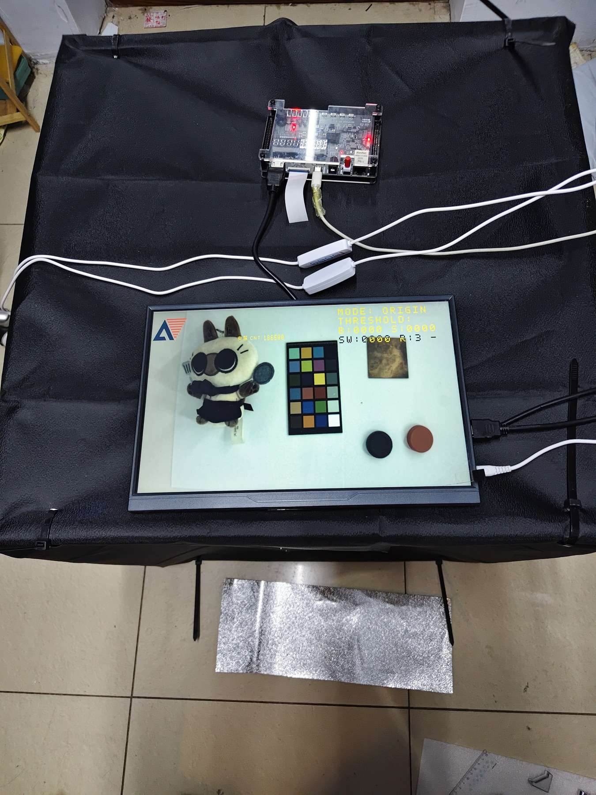

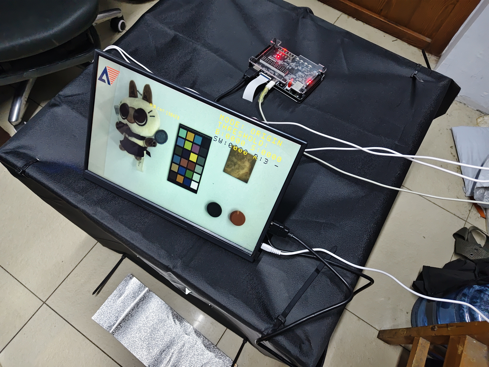

图5 显示器与板卡台面正视及斜视实拍。原照片230024、230130。

### 3.2 工程成果

### 3.2.1 机械成果

封罩将工作台与外部光线部分隔离，顶部相机经支架固定，内衬与侧置灯具提供照明。外部台面容纳板卡和显示器，便于接线与操作。相机、平台或照明改变后需重新确认比例和背景；实物照片记录装配，概念图记录结构设想。

实物图组二 相机固定与补光

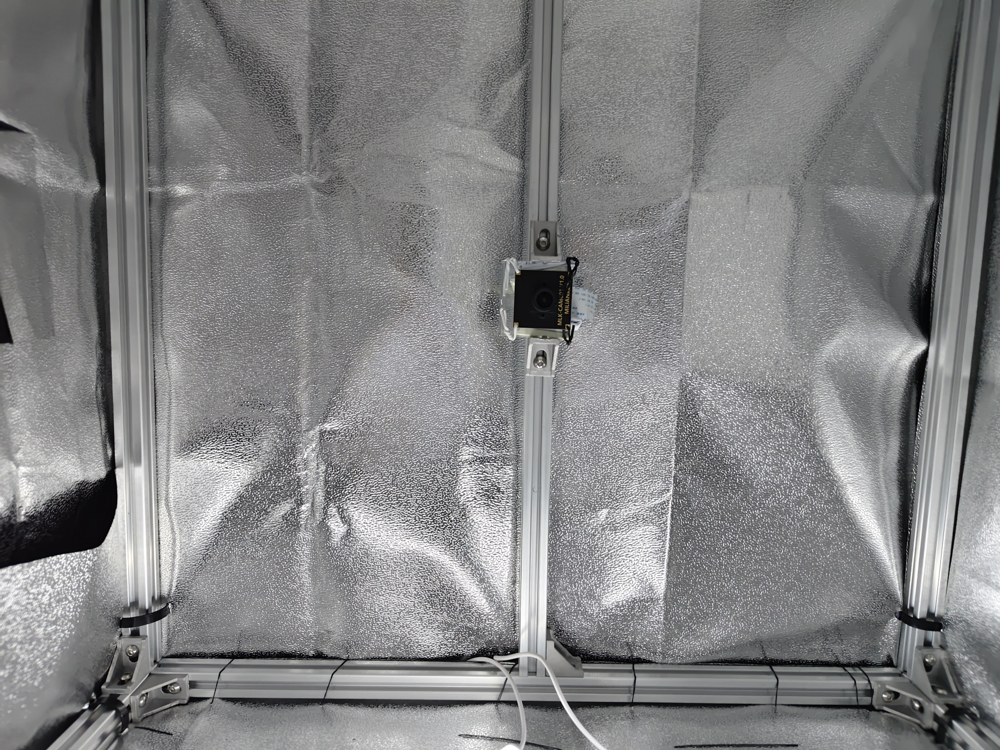

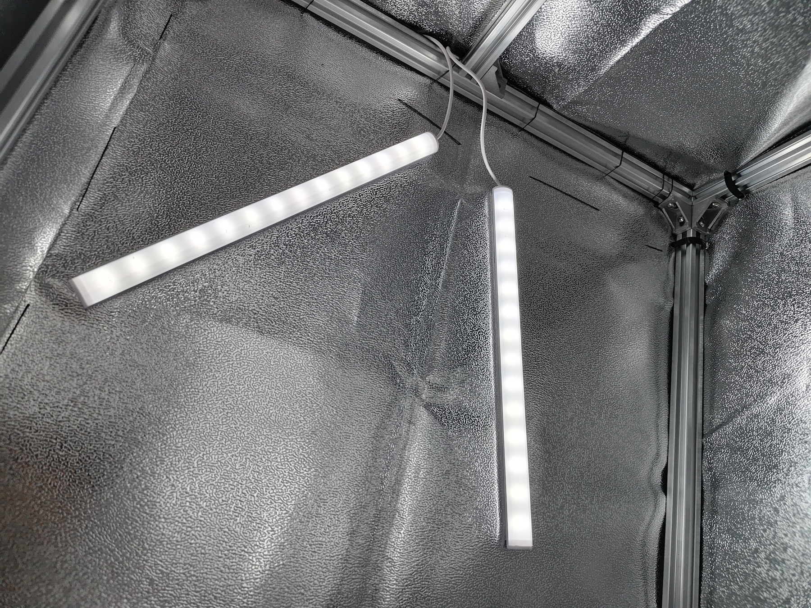

图6 顶部相机固定和侧面补光局部。原照片230048、230218。

### 3.2.2 电路成果

系统以开发板接口连接SC500CS、DDR和HDMI显示端。图7可辨HX1P35A丝印及线缆。厂商PHY、PLL、DDR和HDMI资源提供接口基础，自定义RTL实现像素处理、统计、帧管理与标注；本作品采用既有开发板集成方案。

实物图组三 开发板与连接

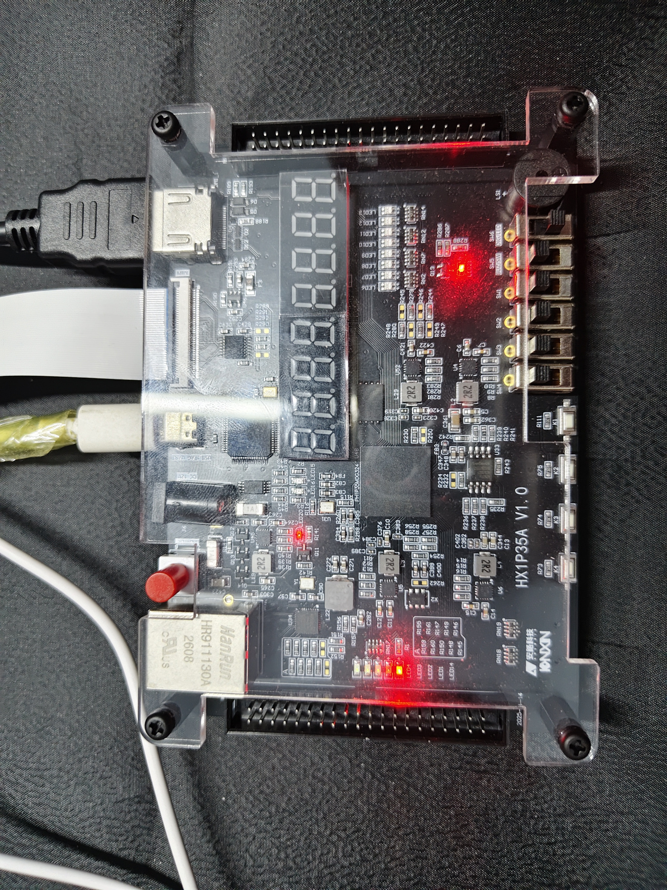

图7 HX1P35A开发板与实际线缆连接。原照片230319。

### 3.2.3 软件成果与已有实物现象

最终展示文件时长171.20秒，组织为整机、基础处理、标定、尺寸、颜色、动态观察、变光与延迟界面等十个主题。图8、9呈现模式与阈值操作，图10—15呈现应用结果；来源、时间点与各项结果的验证范围在3.3.4—3.3.6内完整列明[20]。

基础处理与操作展示

图8将原图、灰度、二值及STYLE成组排列，便于比较输出类型。各图来自原始实拍的不同时刻，模式名和Logo保留。

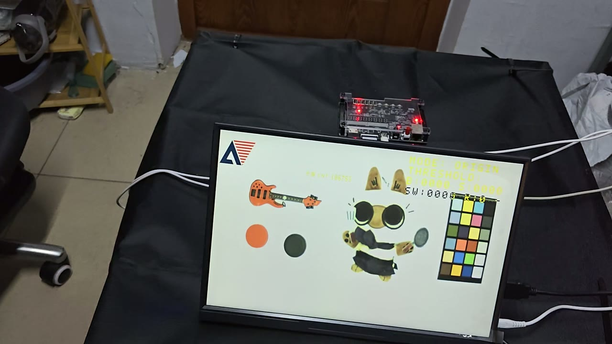

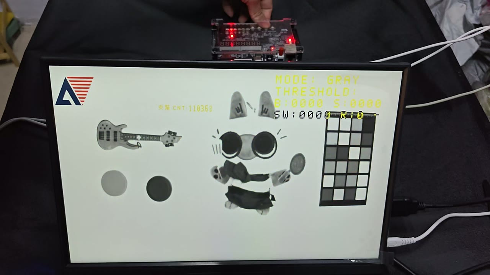

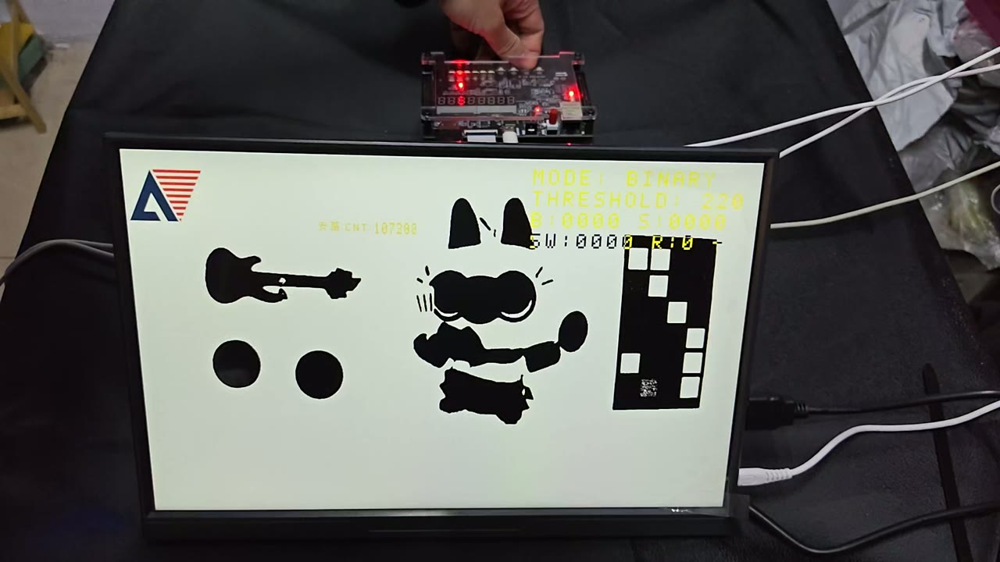

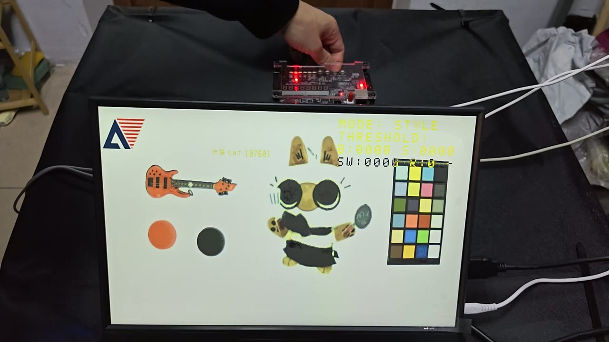

图8 左上原图、右上灰度、左下二值、右下STYLE。214915约14/23/28秒，215017约12秒。

边缘输出与阈值操作

EDGE画面可见工件和测试图边缘，THRESHOLD随按键操作变化。示例保留阈值070及主状态区，其他应用结果集中于图10—15。

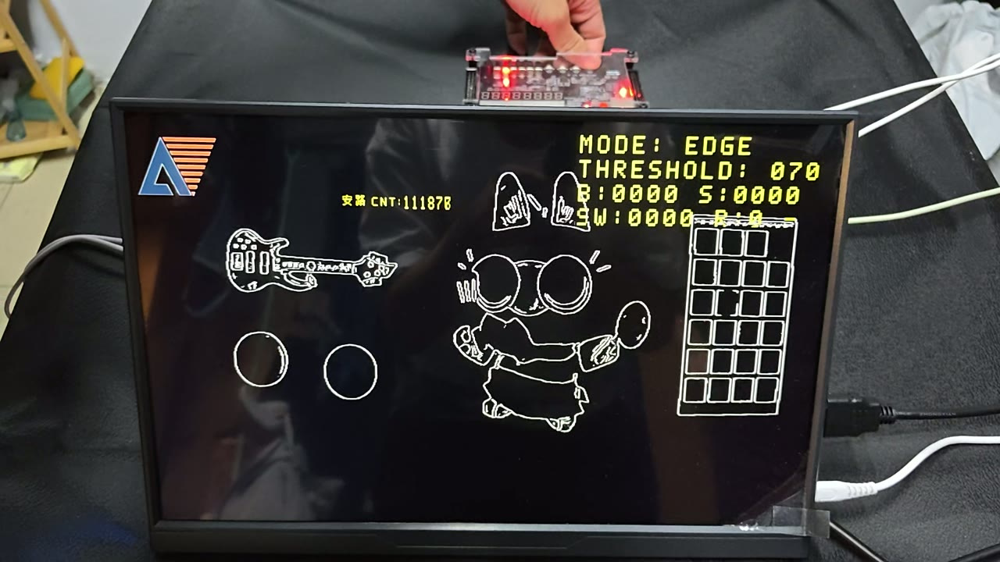

图9 EDGE输出与阈值。215017约37秒。

### 3.3 特性成果

### 3.3.1 赛题要求与完成程度

| 赛题项目 | 实现及证据 | 验证状态与适用范围 |
| --- | --- | --- |
| 基础1 采集显示 | MIPI→ISP→DDR→HDMI实拍 | 实物展示；720p配置，独立新帧率未测 |
| 基础2 图像处理 | 灰度、二值、边缘等硬件处理 | 已有灰度、二值、边缘等实物输出 |
| 基础3 连续显示 | 演示所选帧清晰、无明显错行 | 实物片段显示；连续运行记录见3.3.4 |
| 基础4 OSD | Logo、模式、阈值、状态与尺寸线 | 实物可见安路Logo与应用OSD |
| 评分 系统稳定 | 变光时仍有画面与OSD | 变光操作已有；长稳记录见3.3.4 |
| 扩展1 视觉增强 | EDGE与STYLE实物输出 | 局部风格化与有界边缘处理 |
| 扩展2 检测识别 | RGB比较、单主红框、几何范围 | 双区RGB及单主要红区域 |
| 扩展3 应用场景 | 固定俯拍、照明、置物与显示 | 固定桌面工位，无外部机电执行 |
| 扩展4 性能优化 | 共享RAM/AWB除法；最终P&R | 归档整机P&R及原生等价性验证 |
| 扩展5 自主创意 | 厘米粗标定与工程尺寸标注 | 实物尺寸标注；误差记录见3.3.4 |
| 进阶1 多算法切换 | K3七模式与阈值变化实拍 | 实物模式及阈值切换 |
| 进阶2 目标跟踪 | 红目标LAST框、坐标和SEARCH | 实物移动/SEARCH，LAST语义 |
| 进阶3 延迟可视化 | 同帧真实功能集成并构建 | 实现、仿真、整机构建；实测见3.3.4 |
| 进阶4 硬件运动 | 块帧差与橙红点阵实拍 | 实物运动点阵及静止回落 |
| 进阶5 图像自动调节 | AWB保留；变光画面展示 | AWB实现保留；变光显示已有 |

表中逐项对应安路选题二指南物理页16—18[1]。“实物展示”表示录像或照片可见功能操作，“实现与构建”表示已有RTL、数字验证和整机产物；尺寸误差、真实延迟及长稳等测量记录在3.3.4统一列明。

### 3.3.2 资源时序与实现取舍

| 整机最终P&R | 优化前延迟版 | 最终V1.2重建版 | 增量 |
| --- | --- | --- | --- |
| Slice / 21216 | 20831 | 19177（90.39%） | −1654 |
| LUT6 | 19532 | 18498 | −1034 |
| FF / 42432 | 21337 | 16374 | −4963 |
| ERAM20K / 108 | 105 | 105 | 0 |
| DSP / 40 | 25 | 25 | 0 |
| Setup WNS / ns | +0.175 | +0.137 | −0.038 |
| Hold WNS / ns | +0.020 | +0.020 | 0 |

最终bit使用19177/21216 Slice（90.39%）、18498 LUT6、16374 FF、105/108 ERAM、25/40 DSP，Setup/Hold WNS为+0.137/+0.020ns，TNS均0。较表列前版减少1654 Slice，约7.94%，仍保持31拍公共像素流水。对照包含多项实现调整，节省量按整机版本报告。最终构建仍记录PHY-5060/5079两类继承警告及约束覆盖缺口；正裕量只评价已分析路径，不等同全部CDC、所有PVT工况或长期实板验证[18][19]。

早期T/L同时标注及轮巡尝试均遇容量或拥塞问题，随后通过配置存储、共享行RAM和串行AWB除法复用收敛。串行AWB先修正了在途复位行为，再通过原厂IP逐拍对照；最终RAW错误归属修复后完成当前构建。失败路径及中止日志继续归档，表中仅比较各自已完成的整机P&R。

### 3.3.3 数字验证与覆盖范围

验证按模块、真实流水接线和完整构建分层组织。SHAPE历史规模列于下表；parts/motion另有58项门禁，包含9帧运动、7帧原生720p同时标注、8帧实际31拍链路及AWB对照。真实计时修复涵盖消隐错误归属、单元、OSD、诊断和实际视频路径五组，保留旧失败/新通过以及12次提交、10个有效模型样本。V1.2再由独立解压目录完成全TD流程[18][19]。

| SHAPE历史归档测试 | 规模与结果 | 边界 |
| --- | --- | --- |
| 新/旧ISP与打包 | 各9帧720p；合计4147200有效拍、3110400字一致 | 实际ISP/OSD/原生存储/打包；post-AWB与同步UI起点；读尺搜索高度限定12 |
| 背景学习 | 4帧完整720p、1152格及±11/12/13阈值边界 | 含梯度、亮暗、帧中clear；不代表实物反光改善率 |
| D/R绘图 | 2帧720p，标准字库及径向线 | 已知数字圆片与显示，不是自动圆弧拟合 |
| TRACK生产路径 | 128×96、31拍，移动/消失/本体红色/同步 | 实际路径缩小尺寸测试，不是720p动态板测 |
| 几何与控制 | 160帧、91459周期、240换算组；2000随机配置及复位等 | 该仿真组覆盖控制输入；实体去抖/长短按边界未量化 |
| 实验及继承项 | 4096字形行；历史厘米单元19项与全ROI27443319周期 | 实验字体/自动形状未启用；全ROI读尺是独立实例，不是整机全区域仿真 |

表中规模和通过结果对应归档测试范围。RAW消隐归属已通过构造输入复现并修复；此前实板N0/BAD仍需有效实测定位，不能从源码修复推定唯一物理原因。长期供电、温度及接口稳定性由独立运行记录评价。

### 3.3.4 实物结果与测量记录

图10—15呈现现有实物操作，尺寸和颜色图同时保留完整帧与局部放大，读数在表中转录。3.3.5列出图示来源、版本和核对范围，3.3.6以标定失败、运动改进和DEMO画面说明设计取舍。本文内的图、表及说明共同支持完成程度判断[20]。

| 项目 | 当前已有记录 | 量化及版本范围 |
| --- | --- | --- |
| 尺寸与T/L | R3/CAL OK、W/H及手选D/R实拍；T/L有原生测试与构建 | 显示0.1mm；独立误差/重复性与T/L实物记录未提供 |
| 背景与颜色 | 图11为BG:NEED/CUT；图12展示RGB与CHECK/LIGHT | AUTO12实物对照、同色交换及重复统计未提供 |
| 内部延迟 | 真实同帧路径、仿真及整机构建；录像含历史DEMO | DEMO数字为模拟；真实有效样本和毫秒值未确认 |
| 稳定性及图像调节 | 变光时画面/OSD可见；AWB保留、AE关闭 | 无连续长稳时窗/计数汇总及AWB响应曲线 |
| 拍摄版本 | 实物录像含多个拍摄片段，用户确认使用当时最新版 | 下载bit SHA未随片段记录；不统一归为重建bit验收 |

厘米标尺与标定状态

画面显示厘米长线搜索区域，标尺进入视场后发布R3/CAL OK，表明比例提取流程完成。该状态与独立量具误差属于不同评价；图16补充R5/CAL FAIL与R3/CAL OK的状态对照。

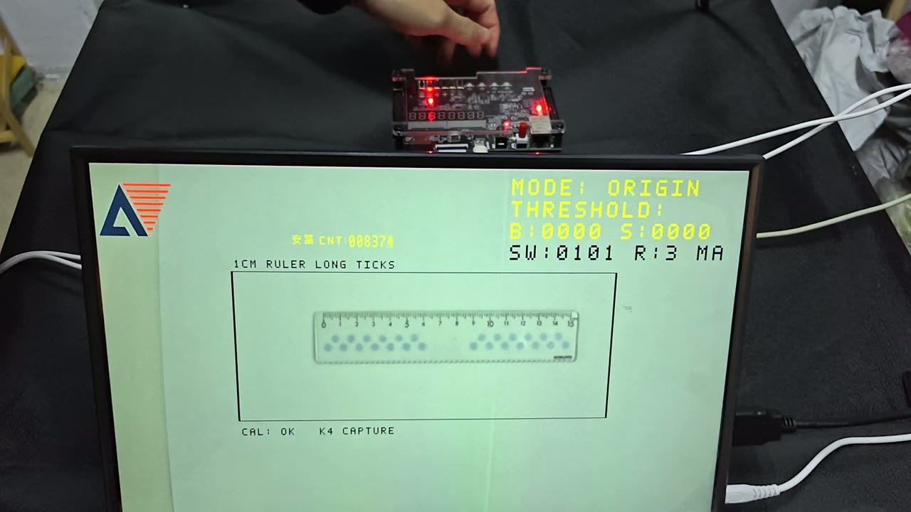

| 观察项 | 截图记录 | 含义 |
| --- | --- | --- |
| 屏幕状态 | SW0101、R3、CAL OK | 完成厘米周期提取并发布比例 |
| 后续操作 | 关闭CAL，保留DIM | 重新学习空台面后放入工件 |

图10 厘米标尺及标定成功。221102约23秒；完整帧。

宽高与圆片尺寸标注

上排保留两幅完整帧，下排放大各自测量区域。W/H与D/R对应不同样品和片段，图中仍为BG:NEED/CUT。

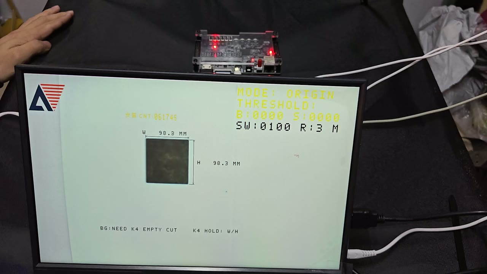

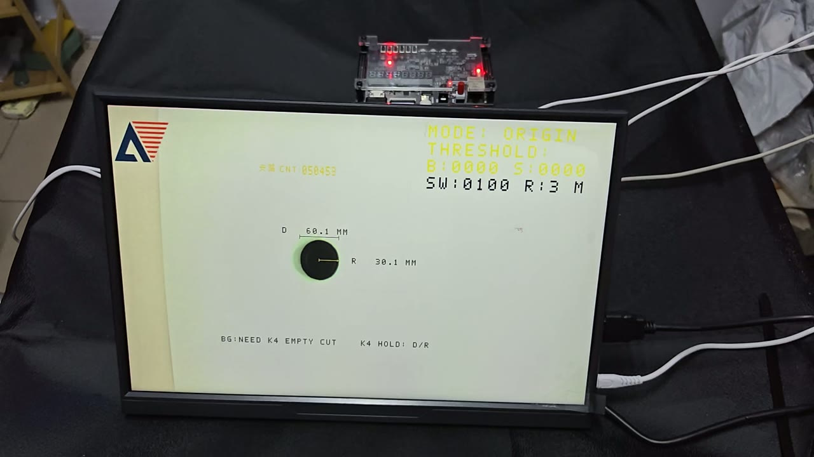

[Word内局部放大，查看原图](figures/width_height.jpg)

[Word内局部放大，查看原图](figures/diameter.jpg)

| 样品与位置 | 原屏幕读数 | 该帧状态 |
| --- | --- | --- |
| 矩形片 222541约24秒 | W=98.3MM；H=98.3MM | R3，BG:NEED/CUT |
| 圆片 222216约43.5秒 | D=60.1MM；R=30.1MM | R3，D/R显式选档 |

图11 宽高与手选圆片。下排为上排原图的局部放大，读数按原始画面转录。

双区RGB与输入状态

上排显示ROI与样品位置，下方保留原始面板局部。颜色名用于说明类别，数值接近程度与输入有效性由RGB及状态共同判断。

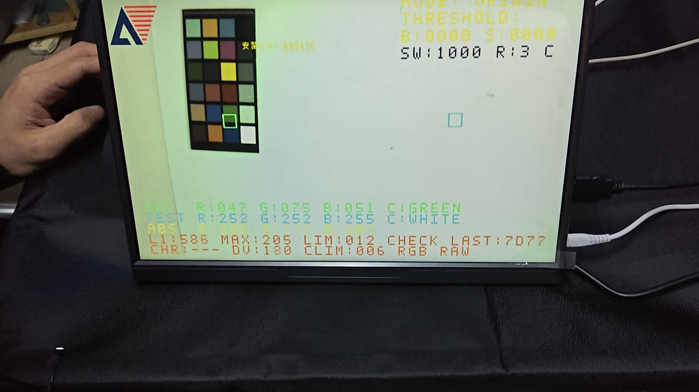

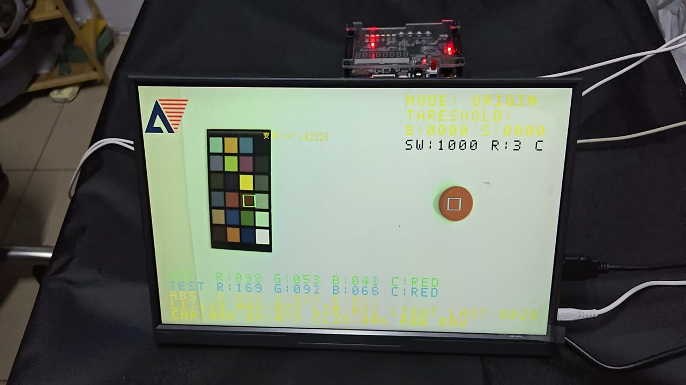

[Word内局部放大，查看原图](figures/color_check.jpg)

[Word内局部放大，查看原图](figures/color_light.jpg)

| 状态 | 参考RGB / 测试RGB | 画面含义 |
| --- | --- | --- |
| CHECK | 047/075/051 / 252/252/255 | 测试区近饱和，比较输入需检查 |
| LIGHT | 092/053/041 / 168/092/066 | 原始RGB有差异、归一化比例接近 |

图12 223541约46秒CHECK与约92秒LIGHT。面板为Word原生裁剪，亮度与字符保持原样。

红目标移动与失去

红瓶盖进入视场时可见绿色外框及X/Y，移出后撤销有效目标并显示SEARCH。图组说明定位状态随观测更新，框的时刻遵循LAST定义。

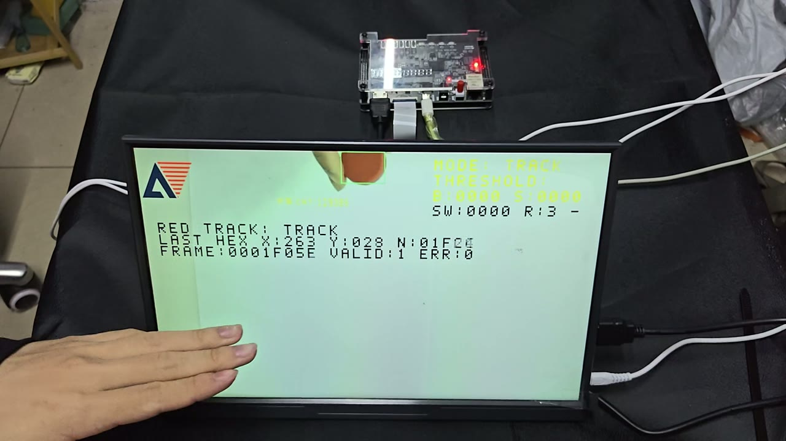

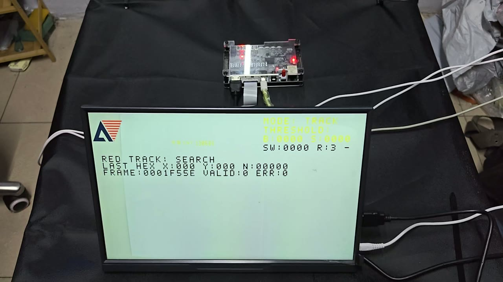

图13 224420约21.5秒TRACK、VALID1；约43秒SEARCH、N0、VALID0。

运动点阵与静止回落

手进入场景后出现橙红密集点阵，离开后回到STILL。CHANGED 06B为107个变化块；点阵改进的是显示方式，网格和检测阈值保持原定义。

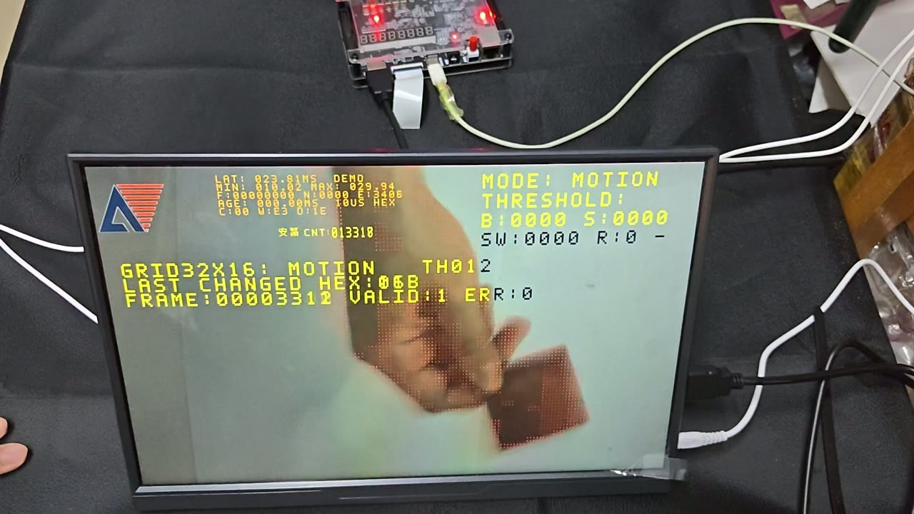

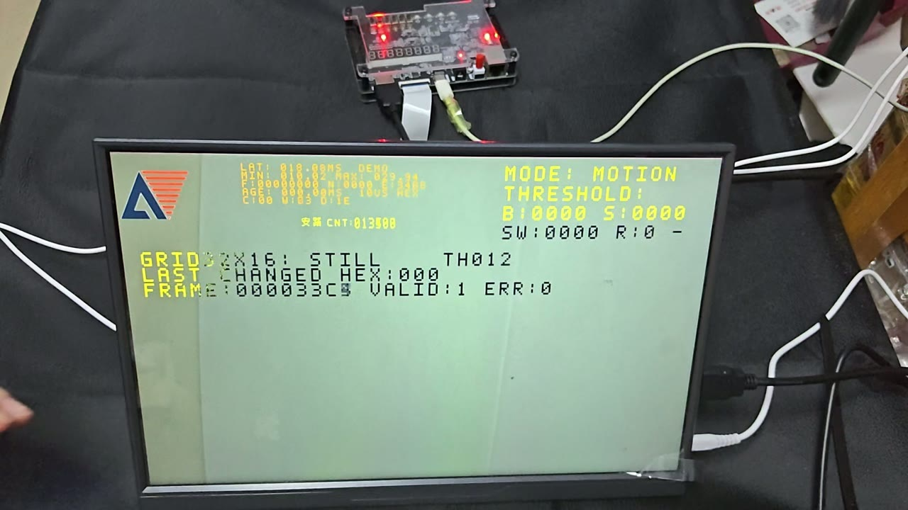

图14 N04约13.5秒MOTION、VALID1/ERR0；约16.5秒STILL。顶部DEMO为历史延迟演示，计量状态见本节表。

明暗变化中的画面输出

照明控制器操作前后，画面亮度发生变化，原图、Logo和OSD仍可见。图组记录变光过程的显示现象，运行时长及白平衡响应按本节表分别评价。

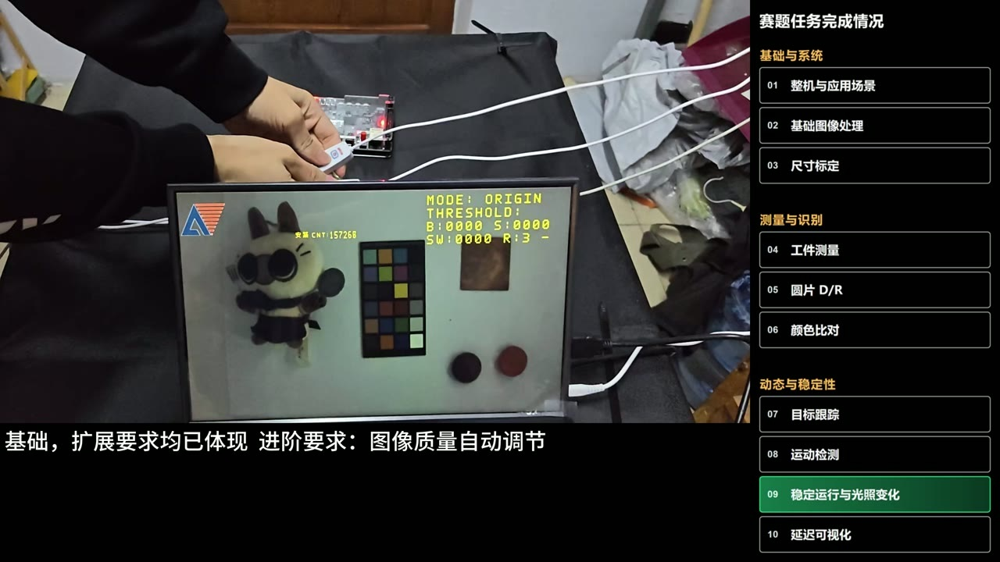

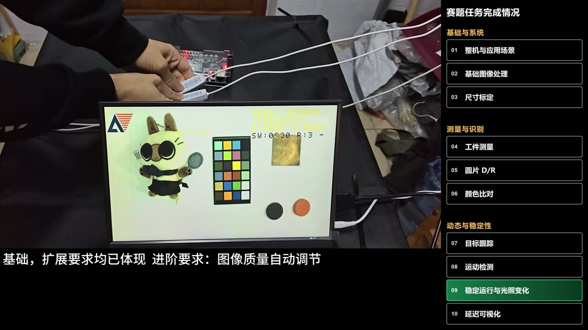

图15 F01约152秒与155秒。完整抽帧保留剪辑导航及字幕，亮度保持原样。

### 3.3.5 版本与复现

| 身份 | 固定值 |
| --- | --- |
| 最终交付 | final-submission-v1.2 / 6055a56 |
| 独立TD重建源码 | 6432c918fea3b8ea25d65f5c5fe3816400b0cbfe |
| 硬件版本 | FINAL_SUBMISSION_REBUILD_V1 |
| bit SHA-256 | ce6d17efe38297709ff71f24fd57f260 / 270e16ff1bb6ed7031f5a03adc866515 |

最终工程交付包P35.rar保留原.al、IP、SDC、引脚及ROM层次，使用Tang Dynasty 6.2和PH1P35MDG324 speed3环境。复现流程为解压至短路径，核对交付包清单与bit SHA，运行原TD工程的综合、布局布线、时序检查和bit生成。归档独立解压重建四阶段均通过；本文资源与时序表取自该整机结果[18]。

交付6055a56与独立重建源码6432c91的191项输入及.al具有相同Git内容，最终bit SHA与上表一致。逐项核对范围及未闭合内容如下。精确重建bit的板测字段NOT_RUN表示尚未归档该bit身份绑定的验收记录；已有实物功能录像按下文列出的拍摄材料记录，不能统一绑定为该重建bit验收。

| 核对对象 | 范围与结论 |
| --- | --- |
| 源码与工程入口 | 95项正式输入、96项辅助IP，共191项及.al在交付和重建源码间Git内容一致；不替代原始构建字节核验 |
| 原始构建字节 | 184/191项可直接或按LF/CRLF换行匹配，7项未闭合；未作全部原始字节一致结论 |
| 构建与实物 | 独立解压SYN、PHY、STA、bitgen均PASS；精确bit板测NOT_RUN，录像片段未绑定下载bit SHA |
| 静态与动态指标 | 整机资源时序见3.3.2、动态现象见3.3.4；无独立尺寸误差、真实有效延迟及连续长稳统计 |

7项未闭合文件：mc_to_user_interface.v、ph1p35_324_ddr_wrapper.v、hdmi_tx.v、measure_background.v、camera_to_dsi_display.sdc，以及w128_d512_fifo和w155_d512_fifo目录内的soft_fifo_al_4057d6b76aa6.v、soft_fifo_al_f58e8b3e1f3d.v。

实拍素材与图示来源

图注中的六位数字是2026年11月2日原片文件名的时间尾码；N04为2026年11月3日运动原片，F01为最终剪辑。下表给出完整文件名与图内现象，时间为原片名义位置；照片及截图已嵌入本文，理解结果无需访问原文件。

| 本文位置 | 来源文件与名义位置 |
| --- | --- |
| 图5 | IMG_20261102_230024.jpg、IMG_20261102_230130.jpg；台面正视与斜视 |
| 图6 | IMG_20261102_230048.jpg、IMG_20261102_230218.jpg；相机与补光 |
| 图7 | IMG_20261102_230319.jpg；板卡与线缆 |
| 图8三模式 | video_20261102_214915.mp4；14、23、28秒，原图、二值、STYLE |
| 图8灰度、图9 | video_20261102_215017.mp4；12、37秒，灰度、EDGE |
| 图10、图16右 | video_20261102_221102.mp4；约23秒，R3/CAL OK |
| 图16左 | video_20261102_220402.mp4；约23秒，R5/CAL FAIL |
| 图11矩形 | video_20261102_222541.mp4；约24秒，W/H示例 |
| 图11圆片 | video_20261102_222216.mp4；约43.5秒，手选D/R示例 |
| 图12 | video_20261102_223541.mp4；约46、92秒，CHECK、LIGHT |
| 图13 | video_20261102_224420.mp4；约21.5、43秒，红目标与SEARCH |
| 图17左 | video_20261102_224747.mp4；约24秒，旧运动提示 |
| 图14、17右、18 | N04：video_20261103_221113.mp4；约13.5、16.5、11.5秒，新点阵、STILL及DEMO |
| 图15 | F01：11月3日(1).mp4；约152、155秒，照明操作前后 |

F01为370429410字节、171.20秒。SHA-256两行顺序连接：
827b845f55a19fba82c38e98c72657b1
f570f7ed8860f9fabaa968201cc0d091

F01已解码到片尾，按2Hz抽样342帧，图15取152与155秒。剪辑含历史DEMO，其时长不能代替连续稳定性、独立帧率或真实延迟。拍摄未逐片段记录下载bit SHA，功能现象与精确bit验收分别评价。

### 3.3.6 关键现象与设计取舍

标定有效性与失败状态

标定先决定像素到毫米的比例是否有效。图16保留一次R5/CAL FAIL和一次R3/CAL OK，说明失败时不应沿用未确认比例；成功后仍须关闭CAL并按尺寸流程操作。两图来自不同操作片段，不据此认定某个参数是唯一失败原因，也不将CAL OK作为量具误差合格证明。

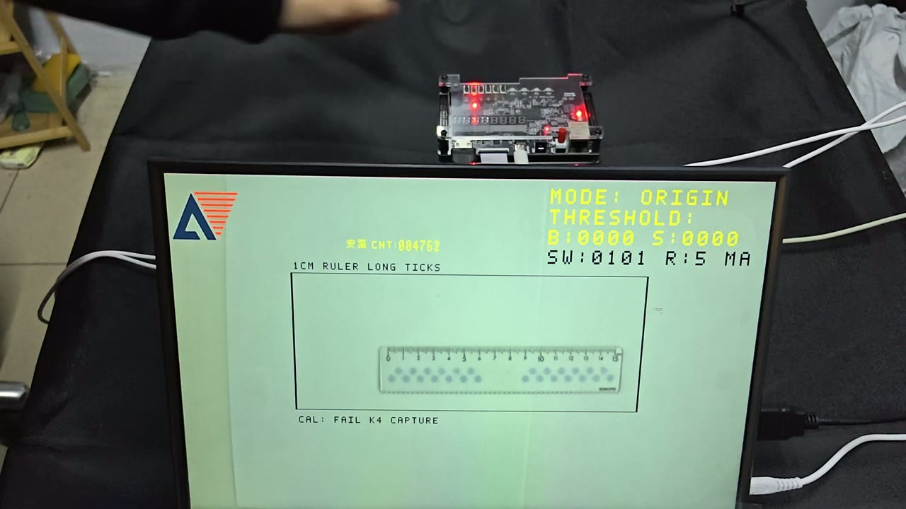

图16 左：220402约23秒R5/CAL FAIL；右：221102约23秒R3/CAL OK。

| 可见状态 | 允许的判断 | 后续操作 |
| --- | --- | --- |
| R5 / CAL FAIL | 本次比例提取未通过有效性条件 | 调整标尺覆盖与摆放后重新采集 |
| R3 / CAL OK | 本次比例提取完成 | 退出CAL、学习空台面、放入同平面工件 |

运动提示的显示改进

旧片已显示MOTION和变化块计数，新片增加覆盖运动区域的橙红密集点阵。两者按32×16像素单元划分，TH012含义沿用原定义；改进集中于变化区域的可见性。不同片段的动作与背景不同，因此不比较块数高低或声称检测率提升；图14另示离开后回到STILL。

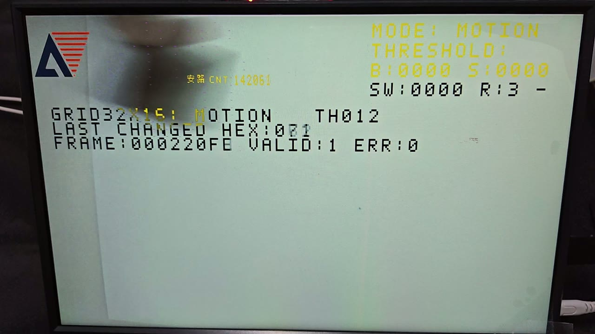

图17 左：224747约24秒旧提示；右：N04约13.5秒新点阵。均为不同输入片段。

延迟界面与真实计量

图18把历史DEMO原画面与面板局部同时保留。DEMO临时生成10—30ms的界面数字；该帧N0000，没有合格的真实延迟样本。最终代码另按完整性、帧身份及缓存代次建立真实计时路径，其仿真和构建结果见3.3.3；尚缺同一最终bit下有效样本持续增长的实物记录。

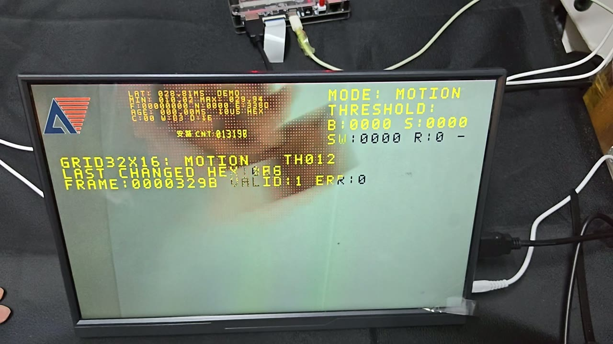

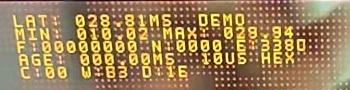

图18 N04约11.5秒完整帧及同帧面板局部。局部来自原帧x255—605、y175—265，基于1280×720画面，未改字符或亮度。

| 项目 | 该图可见内容 | 结论 |
| --- | --- | --- |
| DEMO与N | DEMO；N0000 | 仅证明界面可显示，不能接受为真实计量 |
| 10—30ms | 临时模拟数字范围 | 不计入性能指标或真实最小/最大值 |
| 真实计时口径 | 同一帧RAW首有效拍至HDMI首DE | 不含摄像头曝光及显示器内部处理 |
| 当前完成程度 | 真实路径有RTL、仿真和整机构建 | 真实毫秒值、误差与长期统计未确认 |

## 第四部分  总结

### 4.1 可扩展之处

在固定工位内可进一步用独立样品评估尺寸误差、位置、畸变及高光影响，补充有效内部延迟和明确时长的运行记录。后续若扩展双轴尺度、蓝色动态跟踪或复杂轮廓，应在剩余2039 Slice和3 ERAM预算内保持无反压吞吐，重新检查整机实现和实物效果。

### 4.2 心得体会

从单一颜色框选走向固定工位应用后，我们逐步把检测结果与操作条件一起呈现。RGB比较给出样品差异及亮度状态，尺寸任务区分比例有效与背景就绪。操作者由画面确认何时应放样、重新学习或改变选档，结果的用途也随输入条件得到限定。

实物反馈改变了具体实现。厘米长线替代密集毫米线，空台面参照补充固定阈值，显式D/R选档满足已知圆片的操作需求。红区域选择和成组LAST外框改善了原显示方式，运动点阵提高了变化区域的可见性。这些调整优先解决展示中可观察的问题。

集成过程中，帧与结果的时刻、跨域数据关联和资源容量同样影响作品能否运行。我们保留LAST标注语义，为计时单独建立同帧身份；通过配置存储、共享RAM及精确串行除法容纳最终功能。独立解压重建提供了交付可复现的实例，后续物理测量继续按各项指标形成记录。

公开竞赛报告[16]帮助我们组织成组图片和实验记录；本作品的技术取舍由自身场景与构建约束决定。最终报告将输入条件、实现方法、实物现象和测量状态对应起来，使读者既能复现操作，也能判断各项结果适用的范围。

## 第五部分  参考文献

[1] 上海安路信息科技股份有限公司. 2026 FPGA创新设计赛道选题指南[Z]. 2026: 选题二 基于安路PH1P35的实时数字图像处理系统，物理页16—18。

[2] AnlogicTrack2项目组. RULER_CM_CAL_V1设计说明[EB/OL]. [2026-11-02]. [GitHub 固定提交4d0f779 docs/RULER_CM_CAL_V1_DESIGN.md](https://github.com/Philid14/anlogic-ph1p35-image-processing/blob/4d0f779cefd680363b8a3f0d4d5c33a42d81197f/docs/RULER_CM_CAL_V1_DESIGN.md)

[3] AnlogicTrack2项目组. RULER_CM_CAL_V1构建报告[EB/OL]. [2026-11-02]. [GitHub 固定提交4d0f779 docs/RULER_CM_CAL_V1_REPORT.md](https://github.com/Philid14/anlogic-ph1p35-image-processing/blob/4d0f779cefd680363b8a3f0d4d5c33a42d81197f/docs/RULER_CM_CAL_V1_REPORT.md)

[4] AnlogicTrack2项目组. RULER_CM_CAL_V1板测方案[EB/OL]. [2026-11-02]. [GitHub 固定提交4d0f779 docs/RULER_CM_CAL_V1_BOARD_TEST.md](https://github.com/Philid14/anlogic-ph1p35-image-processing/blob/4d0f779cefd680363b8a3f0d4d5c33a42d81197f/docs/RULER_CM_CAL_V1_BOARD_TEST.md)

[5] AnlogicTrack2项目组. RULER_CM_CAL_V1构建信息[DS/OL]. [2026-11-02]. [GitHub 固定提交4d0f779 artifacts/bitstreams/RULER_CM_CAL_V1/BUILD_INFO.json](https://github.com/Philid14/anlogic-ph1p35-image-processing/blob/4d0f779cefd680363b8a3f0d4d5c33a42d81197f/artifacts/bitstreams/RULER_CM_CAL_V1/BUILD_INFO.json)

[6] AnlogicTrack2项目组. VISION_TRACK_MOTION_V1设计说明[EB/OL]. [2026-11-02]. [GitHub 固定提交4d0f779 docs/VISION_TRACK_MOTION_V1_DESIGN.md](https://github.com/Philid14/anlogic-ph1p35-image-processing/blob/4d0f779cefd680363b8a3f0d4d5c33a42d81197f/docs/VISION_TRACK_MOTION_V1_DESIGN.md)

[7] AnlogicTrack2项目组. COLOR_COMPARE_V1设计说明[EB/OL]. [2026-11-02]. [GitHub 固定提交4d0f779 docs/COLOR_COMPARE_V1_DESIGN.md](https://github.com/Philid14/anlogic-ph1p35-image-processing/blob/4d0f779cefd680363b8a3f0d4d5c33a42d81197f/docs/COLOR_COMPARE_V1_DESIGN.md)

[8] AnlogicTrack2项目组. INSPECTION_UI_DIMENSION_V1实板反馈转录[EB/OL]. [2026-11-02]. [GitHub 固定提交4d0f779 docs/INSPECTION_UI_DIMENSION_V1_BOARD_FEEDBACK_2026-10-30.md](https://github.com/Philid14/anlogic-ph1p35-image-processing/blob/4d0f779cefd680363b8a3f0d4d5c33a42d81197f/docs/INSPECTION_UI_DIMENSION_V1_BOARD_FEEDBACK_2026-10-30.md)

[9] AnlogicTrack2项目组. 图像调试日志[EB/OL]. [2026-11-02]. [GitHub 固定提交4d0f779 docs/IMAGE_TUNING_LOG.md](https://github.com/Philid14/anlogic-ph1p35-image-processing/blob/4d0f779cefd680363b8a3f0d4d5c33a42d81197f/docs/IMAGE_TUNING_LOG.md)

[10] AnlogicTrack2项目组. TARGET颜色检测与年龄保护源码[CP/OL]. [2026-11-02]. [GitHub 固定提交ee2edc5 features/color_target/](https://github.com/Philid14/anlogic-ph1p35-image-processing/blob/ee2edc581877e6a0c7f85073f04e9b7d79277c1b/features/color_target/)

[11] 竞赛技术文档模板[Z]. 2026. 本文沿用官方五部分结构，图表与细分小节纳入对应部分。

[12] AnlogicTrack2项目组. INSPECTION_SHAPE_TRACK_V1设计说明[EB/OL]. [2026-11-02]. [GitHub 固定提交4d0f779 docs/INSPECTION_SHAPE_TRACK_V1_DESIGN.md](https://github.com/Philid14/anlogic-ph1p35-image-processing/blob/4d0f779cefd680363b8a3f0d4d5c33a42d81197f/docs/INSPECTION_SHAPE_TRACK_V1_DESIGN.md)

[13] AnlogicTrack2项目组. INSPECTION_SHAPE_TRACK_V1构建验证报告[EB/OL]. [2026-11-02]. [GitHub 固定提交4d0f779 docs/INSPECTION_SHAPE_TRACK_V1_REPORT.md](https://github.com/Philid14/anlogic-ph1p35-image-processing/blob/4d0f779cefd680363b8a3f0d4d5c33a42d81197f/docs/INSPECTION_SHAPE_TRACK_V1_REPORT.md)

[14] AnlogicTrack2项目组. INSPECTION_SHAPE_TRACK_V1板测方案[EB/OL]. [2026-11-02]. [GitHub 固定提交4d0f779 docs/INSPECTION_SHAPE_TRACK_V1_BOARD_TEST.md](https://github.com/Philid14/anlogic-ph1p35-image-processing/blob/4d0f779cefd680363b8a3f0d4d5c33a42d81197f/docs/INSPECTION_SHAPE_TRACK_V1_BOARD_TEST.md)

[15] AnlogicTrack2项目组. INSPECTION_SHAPE_TRACK_V1构建与原始证据[DS/OL]. [2026-11-02]. [GitHub 固定提交4d0f779 artifacts/bitstreams/INSPECTION_SHAPE_TRACK_V1/BUILD_INFO.json](https://github.com/Philid14/anlogic-ph1p35-image-processing/blob/4d0f779cefd680363b8a3f0d4d5c33a42d81197f/artifacts/bitstreams/INSPECTION_SHAPE_TRACK_V1/BUILD_INFO.json)

[16] WangBaren02项目组. 基于FPGA的图像识别与机械臂控制系统技术文档[EB/OL]. 2025[2026-11-02]: 5—8, 12, 43—49. [作者公开技术文档 固定提交cfa5611](https://github.com/WangBaren02/Image-acquisition-and-recognition-robotic-arm-analysis-and-control-system-based-on-FPGA/blob/cfa5611b2d89d852fe2f456b313c6fb9c42ea955/docs/technical_report.pdf)

[17] AnlogicTrack2项目组. TRACK_REGION_FIX_V1诊断与修复报告[EB/OL]. [2026-11-03]. [GitHub 固定提交072bc0f](https://github.com/Philid14/anlogic-ph1p35-image-processing/blob/072bc0f8858ceb3009659f8df7cb02b9da05ed36/docs/TRACK_REGION_FIX_V1_REPORT.md)

[18] AnlogicTrack2项目组. 内部计时与最终V1.2独立重建资料[EB/OL]. [2026-11-04]. [计时设计 6ad4f7c；](https://github.com/Philid14/anlogic-ph1p35-image-processing/blob/6ad4f7cd70b5614240c07db2a16775aa492d9f14/docs/LATENCY_PERFORMANCE_V1_REPORT.md)[资格修复 6055a56；](https://github.com/Philid14/anlogic-ph1p35-image-processing/blob/6055a560b020373e77328e7518d200e358401363/docs/LATENCY_FRAME_FIX_V1.md)[模拟说明 e2c37e2；](https://github.com/Philid14/anlogic-ph1p35-image-processing/blob/e2c37e23e2ce4a1d506105727f5303186cc3e757/docs/LATENCY_DEMO_V1.md)[独立重建 6055a56；](https://github.com/Philid14/anlogic-ph1p35-image-processing/blob/6055a560b020373e77328e7518d200e358401363/artifacts/bitstreams/FINAL_SUBMISSION_REBUILD_V1/BUILD_INFO.json)[最终交付 6055a56；](https://github.com/Philid14/anlogic-ph1p35-image-processing/blob/6055a560b020373e77328e7518d200e358401363/submission/PACKAGE_README.md)

[19] AnlogicTrack2项目组. INSPECTION_PARTS_MOTION_V1最终构建与验证报告[EB/OL]. [2026-11-03]. [固定报告 793c9d3；](https://github.com/Philid14/anlogic-ph1p35-image-processing/blob/793c9d3de58420524007474bafb2125cbad104f1/docs/INSPECTION_PARTS_MOTION_V1_REPORT.md)

[20] AnlogicTrack2项目组. 系统实物照片与功能展示视频[DS]. 2026-11-02—2026-11-04整理. 图示来源和成片身份见3.3.5，操作与DEMO对照见图10—18。
