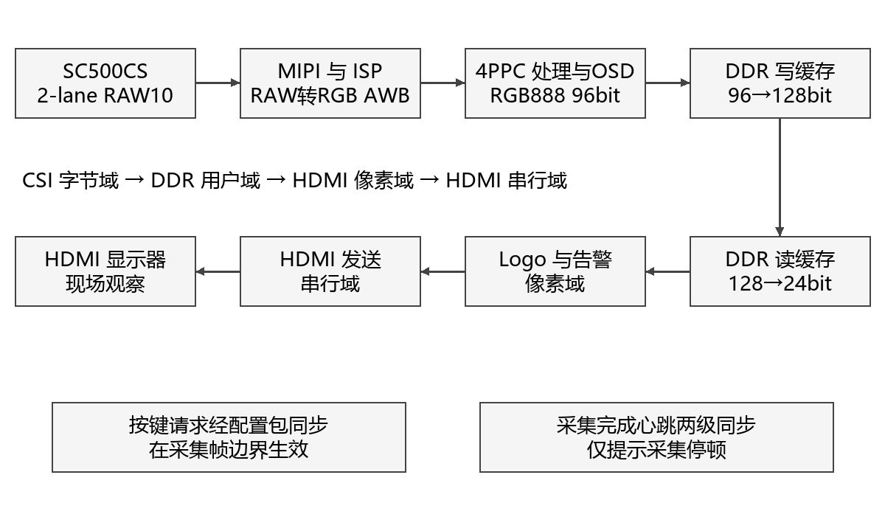
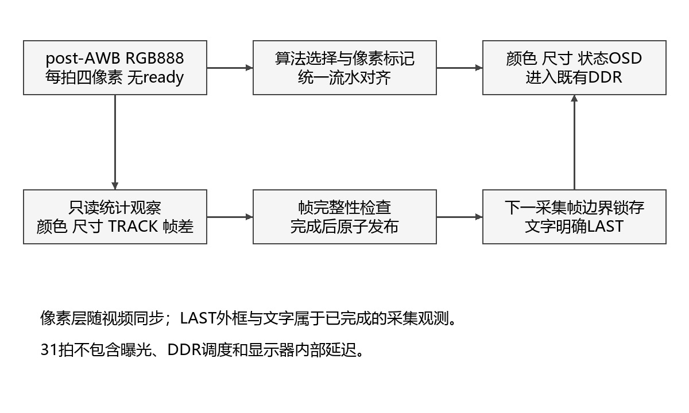
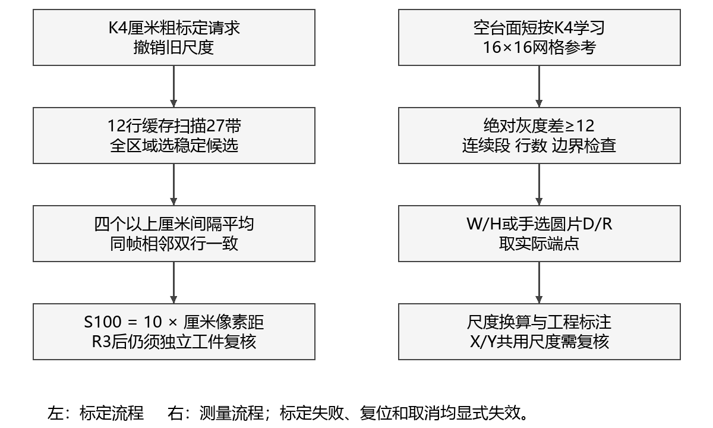
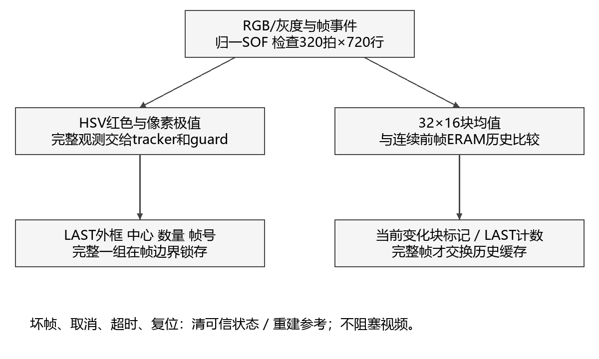

# 基于安路FPGA的实时图像处理与颜色目标检测系统

技术文档第五稿  INSPECTION_SHAPE_TRACK_V1候选
2026年11月2日  工程4d0f779  板测NOT_RUN

### 摘要

本作品面向固定俯拍、可控照明的桌面视觉检测，将样品颜色比较、薄工件二维外形测量与动态观察直接呈现在HDMI画面中。操作者把参考与待测样品放入双区域查看RGB一致性状态，用厘米标尺建立粗尺度，再学习空台面背景，放置工件读取外接宽高与中心间隙；对已知完整圆片可手动选择直径和半径档。TRACK显示红色目标的最近完整观测外框及坐标，MOTION提示变化块。系统采用安路PH1P35 FPGA、HX1P35A开发板和SC500CS摄像头，完成MIPI RAW10采集、RGB888每拍四像素处理、DDR缓存与连续显示，保留原图、灰度、二值、边缘及风格化模式。针对实拍反光漏分割，最新候选增加网格背景绝对差，同时检查完整帧、边界与观测年龄；通过显式ERAM与随像素配置延迟，在不增加31拍公共流水深度的条件下接入扩展。候选归档了18帧720p ISP及打包回归与完整TD布局布线，Slice占用99.47%，Setup WNS为+0.111ns。历史资料已有基础显示和应用界面反馈；本候选背景学习、厘米标定成功、尺寸与D/R误差、动态框效果及长稳仍待实测，不以构建通过替代现场验收。

关键词  安路FPGA  固定平台检测  背景参照  平面尺寸  颜色目标

## 第一部分  作品概述

### 1.1 功能与特性

作品把连续视频处理与固定台检测结合：原图、灰度、二值、边缘、风格化、TRACK和MOTION七模式可切换；双区域提供RGB一致性筛查；厘米长刻线建立粗比例尺；空台面学习后测单个薄工件外接宽高及固定中心截面间隙；已知圆片可手动切换D/R档。红色LAST外框、中心、像素数和采集帧号成组显示，运动模式给出块均值帧差与状态。应用读数由FPGA形成，运行时无需PC图像处理。最新候选已完成数字与构建归档，现场效果待验收。

### 1.2 应用领域

适用于教学实验、样品颜色一致性筛查和单个薄型零件外形复核。固定相机、同一标定平面、遮光与可调照明使条件可重复，便于研究反光、位置与姿态的影响。当前定位为嵌入式视觉展示与验证平台，尚无工业现场或计量准确度认证。

### 1.3 主要技术特点

96bit、4PPC流水无ready，不阻塞视频；像素、配置和行帧标记按实际时钟深度对齐。颜色与几何统计完整后发布，LAST外框和文字在帧边界共同锁存。空台面灰度网格同时检测正负亮度差，减少固定单极性漏分割；保留无背景参照时的阈值回退。复用视频DDR，以ERAM承载背景、运动历史及配置延迟；结果可信度由帧完整性、身份与年龄共同约束。

### 1.4 主要性能指标

| 项目 | 配置或归档结果 |
| --- | --- |
| 输入与并行度 | 1280×720；RGB888、96bit、4PPC |
| 公共像素流水 | 31拍；不含曝光、DDR及显示器 |
| 整机P&R | Slice21103/21216；ERAM105/108；DSP25/40 |
| 最终WNS | Setup +0.111ns；Hold +0.020ns |
| 实板性能 | 刷新、新帧率、误差、延迟与长稳待测 |

### 1.5 主要创新点

把颜色状态、尺度、工件端点与尺寸线组织成画面内可操作的检测流程；结合背景参照与明确手选圆片档回应实际样品问题；以完整帧发布、身份年龄保护及外框文字原子锁存限制错误传播，并通过ERAM资源交换完成紧预算集成。以上是面向本场景的工程组合创新，不主张基础算法原创。

### 1.6 设计流程

先建立采集显示与流水对齐基线，再接入应用统计；用独立模型验证正常、边界和异常输入，冻结实际TD源码后构建归档。根据失败反馈调整读尺、分割和显示方式。上板先核版本与基础画面，再测标定、背景、尺寸及动态，最后做量化、恢复和长稳。

## 第二部分  系统组成及功能说明

### 2.1 整体介绍

平台把实时画面与检测依据放在同一显示端。颜色任务采用参考样品与待测样品的固定双区比较；尺寸任务先定尺度、再取得空台面参照、最后放置工件。两项任务可按展示需要分别操作，不要求每个样品都经过全部模式。TRACK和MOTION用于说明动态观察能力，与静态尺寸测量分开评价。

| 任务 | 操作者流程 | 画面应提供的信息 |
| --- | --- | --- |
| 颜色筛查 | 覆盖双ROI→等待完整统计→交换样品复核 | 两区RGB、原始差/比例差与MATCH等状态 |
| 尺寸测量 | 厘米标定→移走尺→学习空台面→放工件 | CAL与BG状态、外框、W/H和中心间隙 |
| 圆片测量 | 完整圆片正俯视→长按K4选择D/R | 水平外径D、R=D/2及半径线 |
| 动态观察 | 切TRACK或MOTION→移动/移出/恢复 | LAST外框和坐标，或变化块和状态 |

图1 视频闭环与主要时钟边界示意

厂商参考工程提供D-PHY、MIPI、PLL、DDR和HDMI底座，自定义Verilog在既有彩色流上实现算法、统计与OSD。运行时无PC或云端算法参与像素处理。结构图用于解释功能关系，不代替真实接线与电路图。

| 时钟域 | 最终STA约束频率 | 职责 |
| --- | --- | --- |
| CSI字节 | 59.995MHz | 图像处理、统计与缓存写出 |
| DDR用户 | 66.667MHz | 读写调度 |
| HDMI像素 | 75.002MHz | 读出、Logo及告警 |
| HDMI串行 | 375.094MHz | TMDS发送 |
| 外设控制 | 23.810MHz | 按键与相机控制相关逻辑 |

以上是约束口径，不是频率计实测。CSI、DDR与HDMI分属不同时钟域，沿用既有FIFO和缓存跨域。新统计先叠加到CSI像素流，再随像素进入DDR；不把坐标各位独立异步采样。采集完成心跳两级同步只用于停顿告警，不能证明显示的是最新采集帧。

### 2.2 硬件系统介绍

#### 2.2.1 硬件整体介绍

核心器件为安路PH1P35MDG324，使用HX1P35A开发板、米联客MLK-CAM001 V1.0 SC500CS模组、板载DDR和HDMI显示器。相机采用当前寄存器配置的2-lane MIPI RAW10；顶层引出四对数据焊盘，不表示当前启用四lane，亦不等于4PPC。模组供电与针脚以实际配套连接和匹配原理图为准，不依据通用SC500CS商品名推定。

#### 2.2.2 机械设计介绍

项目已有框架、顶部俯拍、置物平台、遮光与可调照明完成的确认。固定安装旨在减少相机姿态和样品平面变化；最新背景参照还要求学习后相机、桌面和照明保持一致。厚件离面、倾斜、镜头畸变与不均匀照明会改变尺度或前景，不能仅靠软件阈值补偿。

待补真实机械尺寸图和安装局部图：框架外形、相机到测量面距离、镜头视场、平台平整度、支架及光源位置。曾讨论60cm框架及15…30cm线材采购，但尚无最终实测配置；本文不将方案尺寸直接写为成品尺寸。

#### 2.2.3 电路各模块介绍

| 模块 | 关键输入输出 | 工程边界 |
| --- | --- | --- |
| 相机控制 | O_cam_scl、IO_cam_sda O_cam_24m、O_cam_rst | 配置、时钟与复位；AE请求关闭 |
| MIPI输入 | IO_rx_clk_pad_p/n IO_rx_data_pad_p/n[3:0] | D-PHY与解码沿用参考IP |
| DDR | addr[12:0]、dq[15:0]、dqs/ck等 | 既有多帧缓存与控制器 |
| HDMI | O_tmds_ch0/1/2_p、O_tmds_clk_p | 有效1280×720，总时序1650×750 |
| 操作 | I_button[1:0]、I_switch[3:0] | 实体映射用屏幕SW与资料核对 |

仓库原理图包含HX1P35B_FT_40P_2/3/8，尚需确认与现用HX1P35A实物版次的关系。提交前补入匹配板卡的MIPI、DDR、HDMI、供电/时钟片段，并标注关键网络和方向；接口表不能替代官方模板要求的电路模块图。未发现可宣称完成的自制PCB成果。

一行320个4PPC有效拍，一帧230400拍；RGB有效载荷为2764800字节。行帧总时序下75.002MHz/(1650×750)约60.61Hz，仅说明配置值，实测刷新、采集帧率和独立新帧率须分别记录。DDR重复显示不会成为新的采集观测。

现有提前帧通知与首有效像素不同。新增observer将提前/内联SOF归一到真实有效首拍，核对每行长度与全帧拍数后发布结果；错误行尾、提前新帧和截断使该次观测无效。不得将协议草案中的EOF、abort或缓存代次接口视为主线已普遍提供。

### 2.3 软件系统介绍

#### 2.3.1 软件整体介绍

工程软件包括RTL、约束、独立参考模型、原生仿真与构建脚本。实时处理全部在FPGA进行。post-AWB的RGB888观察流为96bit、每拍四像素，无ready；算法选择、应用层和状态层保持共同31拍深度。新增背景分支内部增加2拍，但不增加公共视频延迟。31拍不能代表采集到屏幕的总延迟。

图2 像素流水与完整观测发布流程

23bit配置与UI在CSI域逐拍延迟，采用32地址环形原生双口存储的首段/空间段/末段抽头，综合映射2 ERAM。它是随像素配置延迟，不是新增异步FIFO。有效、SOF、EOL及活动状态按复位协议清除，未对无效RGB负载加大规模复位链；首个有效拍必须完整替换自己的负载，复位数字回归检查了这一条件[12][13]。

#### 2.3.2 软件各模块介绍

##### 2.3.2.1 基础处理与接口

| 模块 | 实现方法 | 解释边界 |
| --- | --- | --- |
| GRAY/BINARY | Y=(77R+150G+29B+128)>>8；Y≥阈值为白 | 整型定点计算；不是显示器亮度计量 |
| EDGE | 高斯、Sobel、非极大值抑制和有界弱边传播 | 水平成对取样后复制；非1280独立Sobel，也非完整递归Canny |
| STYLE | 局部色彩均值、亮度量化、暗线保护 | 保守风格化；不承诺全局闭合区域填充 |
| AWB | 沿用既有帧统计白平衡 | 无新AE闭环；不等同标准色彩校正 |
| 应用与observer | 颜色/尺寸统计、TRACK、块均值帧差 | 作用于未风格化彩色流；不降低视频吞吐 |

| 模块 | 关键输入 | 关键输出 |
| --- | --- | --- |
| ruler_area_calibration | gray[31:0]、valid/user/last、请求 | span[10:0]、calibrated、status[2:0] |
| measure_background | gray[31:0]、回退前景、帧标记、learn/clear | pixels[3:0]、对齐标记、applied/ready/status |
| planar_measure_stats | 4路前景、帧标记、极性/ROI | 外框、尺寸与中心间隙端点/有效状态 |
| vision_source_observer | rgb[95:0]、gray[31:0]、帧标记 | LAST目标结果、变化标记、帧身份与错误 |

##### 2.3.2.2 固定双区域颜色比对

颜色比对将标准样品和待测样品同时置于画面固定区域，在同一完整采集帧分别统计1024个像素的RGB，减少跨帧曝光变化引入的差异。参考区x=304…335、y=304…335；测试区x=944…975、y=304…335，边界均包含。四lane均参与统计，区域未完整采集则不发布有效比较。

| 量或状态 | 含义 | 界限 |
| --- | --- | --- |
| 均值 RGB | 各通道(sum+512)>>10，四舍五入 | 码值依赖sensor、AWB、曝光和照明 |
| ABS、L1、MAX | 逐通道绝对差、差的和、最大通道差 | MAX≤12为当前原始RGB接近阈值 |
| CHR、DV | 归一化通道比例最大差、maxRGB亮度代理差 | 用于解释差异，不是ΔE或照度 |
| 可靠性门槛 | 两区均sumRGB≥96、maxRGB≥32且<254 | 排除过暗和接近饱和；不保证无反光 |
| MATCH | 可靠且原始MAX≤12 | 当前码值相近，不证明标准色度一致 |
| LIGHT | 可靠、原始不匹配、归一化CHR≤6 | 可能受亮度因素影响；不自动等同颜色相同 |
| DIFF、CHECK、WAIT | 明显差异、可靠性不足、数据未完整 | 保留原因，不能统一记为检测失败或成功 |

平均值使单像素噪声影响减弱，固定区域便于现场复现；代价是区域内背景、纹理和高光会改变均值。归一化可提示近似乘性亮度变化，但材质、反射谱、相机响应和真实样品明度也会产生类似现象。系统未引入色度计标定、标准光源光谱、CCM或CIE ΔE计算，文档使用“RGB颜色一致性筛查”，不写“工业色差测量”。

颜色实验以同色交换、异色、单侧变光、过暗和近饱和为独立组别，保存双区RGB与全部状态。阈值MAX≤12、CHR≤6沿用源码，未据未经验证的照片改参；LIGHT只能提示可能亮度因素。相同黄纸左右读数不同的旧反馈，尚不足以唯一归因照明或证明归一化判别正确。

##### 2.3.2.3 厘米粗标定与平面尺寸

在ORIGIN、DIM与CAL条件下短按K4发起标定。AREA标题应为1CM RULER LONG TICKS。搜索区x=256…1023、y=192…479，宽768、高288，复用12行缓存扫描27个重叠带，约需54个采集帧及分析等待。输入必须是水平、清晰、黑色公制厘米长刻线，至少五条长线；尺与工件同平面，背景尽量干净浅色。算法不识别数字或单位[2][3]。

每行灰度对比度至少16，暗阈值取low+(high−low)/4；提取未裁断、宽1…4px的笔画中心，采用加倍坐标保留半像素信息。接受12…120px/cm的连续间距，相对首间距容差约25%+1px，至少四个间隔；先求行内平均，再平均同一完整捕获帧内的相邻两条有效行，两行容差约12.5%+1.2px/cm。全27带搜索结束后优先较大稳定间距，以减少过早选中半厘米线的风险。

| 界面状态 | 含义与边界 | 操作者动作 |
| --- | --- | --- |
| R0 / R1 / R2 | 未标定 / 等待采样 / 分析 | 保持标尺静止，不连续重按K4 |
| R3 / CAL:OK | 周期一致并发布粗尺度，尚非精度证明 | 关闭CAL，独立工件复核，再测尺寸 |
| R4 / R5 | 对比度不足 / 间距未通过 | 留存原图、刻线条件和失败画面 |
| R6 / R7 | 帧几何错误 / 取消 | 检查链路或重试，不能沿用失败候选 |

相邻厘米长线平均d像素，对应10mm，因此旧接口S100=10d像素/100mm，有效范围120…1200。例如d=34px时S100=340，170px工件跨度对应50mm。新请求先撤销旧尺度，复位清尺度，错误帧不接受缓存候选，取消不确认。成功后关闭CAL、保留DIM；屏幕SW通常0101→0100，实体拨码顺序与极性须现场核对[4]。

X/Y共用S100，Y依赖正俯拍和近似等比例成像。本版是粗比例尺，不承诺精密计量；最大稳定间距仍可能误认半厘米、其他周期或背景纹理。R3后必须用独立量具量过的工件分别验证X/Y，并排除约2倍、5倍等尺度错误。0.1mm显示分辨率不是0.1mm准确度。旧密集1mm规则属于历史方案，不作为本版输入要求。

图3 标尺定尺度与背景参照测量流程

尺寸ROI为x=256…1023、y=160…543。单个薄、平、轴对齐工件应完全落在区域内。最新候选过滤不足3个连续前景像素的段；每行至少6个合格像素，至少3行、64像素形成范围，触ROI边界则无效。宽高为轴对齐外接跨度；GAPX/Y只沿x=640、y=352的固定中心截面寻找至少3个背景像素，不是任意孔检测。阴影或反光造成的空段不能直接认定为真实间隙。

以100mm等效像素跨度S100换算跨度P，先求0.1mm整数q，再显示q/10mm。原生公式如下。显示到0.1mm只代表显示分辨率；精度受像素量化、刻线选择、畸变、阈值、姿态和离面高度共同影响。静置读数，X/Y必须分别用独立真值检验。

q = round(1000P / S100)，显示毫米值为q/10。

##### 2.3.2.4 空台面学习与显式圆片档

旧固定阈值加单极性会遗漏接近背景的反光亮面，导致外廓缩小。新候选在ORIGIN测量RUN下短按K4学习空台面：ROI划成16×16网格，共48×24=1152格；每格在中心行取间隔4像素的四个灰度样本形成参照，占1 ERAM。它不是整格256像素平均，要求背景平滑。逐像素绝对灰度差≥12即判前景，可同时保留相对背景较亮或较暗的区域[12]。

学习必须收齐完整帧、正确行尾并写满1152格，才发布BG:OK；否则不确认。BG:NEED/WAIT/OK/FAIL说明参照状态，AUTO12表示最近完成的测量帧使用背景差，CUT表示回退固定阈值。复位、进入CAL和重新学习会清除背景就绪；帧中clear/request在后续SOF生效，避免学习与读取混杂。BINARY仍显示固定阈值二值图，不能当作AUTO12前景掩码。

正确顺序是先用尺标定，移走尺和工件，再对空台面学习，最后放入工件。移动相机、桌面或照明后应重新学习。纹理、阴影、AWB变化、过曝或物体边缘与背景无对比仍可能失败；背景差不恢复已经消失的光学边缘，不应宣传为万能消反光。合成模型中70px漏分割改为140px只证明构造输入下逻辑符合预期，不是实板改善率。

ORIGIN测量RUN下长按K4约1秒，在W/H和D/R档间切换，一次长按只切一次。D/R用于操作者已知的完整正俯视圆片，D取水平外径，R=D/2，并画中心到右边界的半径线；未标定显示PX，已标定显示MM。自动近圆分类SHAPE_ENABLE=0，最终未启用，W≈H也不是圆的充分条件。该功能不拟合任意局部圆弧、不测厚度，异形件应回W/H。

##### 2.3.2.5 红色目标与LAST外框

TRACK复用TARGET固定交付的HSV红色分类、计数极值、tracker及guard，由MAIN观察适配器建立采集身份。HSV红色中心±30°、chroma≥24、maxRGB≥32；完整帧匹配数≥64构成正观测，3次可靠正观测进入TRACK，缺失15次及独立时钟超时共同保护。多个红色区域合并为一个外接框，不产生独立多目标ID；蓝色尚未集成，support3保持默认关闭[10][12]。

新候选缓存已有44bit边界结果，与LAST中心、像素数、帧号和有效状态一起发布，下一采集帧SOF原子锁存。显示2像素绿色外框，取消旧绿色整块覆盖，保留红色本体。X/Y是外接框中心而非质心，N是匹配像素数而非物体数；X/Y、N与FRAME使用十六进制。例如27F/167/028BB对应639/359/10427。ERR为视频协议错误sticky，不是置信度。

session/frame由采集侧事件建立，HDMI重复显示不能成为独立正观测。observer检查320拍/行与720行，坏行、提前新帧、取消和停止输入使可信状态失效或进入恢复。guard使用64bit CSI域时间计数，6000000周期在名义60MHz下约100ms；这不是精密实测毫秒门槛。未依赖输入继续前进的像素计数代替停止输入超时。

框属于上一完整采集观测，快速移动存在帧级滞后。无目标或无效完成结果撤销框；框与文字同组且随像素进入DDR，但观测身份不保证与当前显示原图严格同帧。尚无整套DDR帧事务租约与同帧选择。源停止时，重复DDR画面可能连同旧框持续出现，应结合SOURCE STALE告警判读，不能声称停止输入必然清除屏幕旧框。

实验应分别观察慢移、快移、静止、移出、重现、第二红物体及红背景，区分延后框、合并框、误检与显示冻结。当前没有同场YCbCr/HSV准确率对照，因此只说明颜色判据变化，不宣称已证明HSV更优。

##### 2.3.2.6 块均值帧差与采集心跳

MOTION将全图划为32×16像素块，形成40×45、共1800个块。对块内全部512像素求四舍五入的8bit灰度均值，与前一完整连续采集帧的同块均值比较。绝对差≥12为变化块；结果在该块右下角最后四个像素上标洋红色，同帧像素经原DDR显示[6]。

| 状态或结构 | 定义 | 不能推导的结论 |
| --- | --- | --- |
| 双缓冲历史 | 各1800字节，映射4096×8安路双口ERAM | 没有新增整帧RGB缓存 |
| 提交 | 仅完整有效帧交换缓冲角色，要求连续采集ID | 截断帧不作为可信历史 |
| WARMUP / INVALID | 历史未建立 / 帧错误、取消或超时 | 不能把无参考时的0变化当成静止 |
| LAST CHANGED | 最近完整采集帧变化块数 | 计数单位是块，不是运动物体 |
| STILL / MOTION | 变化块少于3 / 至少3 | STILL可能仍有1—2个变化块 |
| GLOBAL | 超过75%块发生变化 | 不能区分灯变、相机移动和大物体 |
| 当前洋红标记 | 变化块末拍四像素提示 | 不是运动目标轮廓或完整区域填充 |

复位、丢行、帧中断、非连续身份或观测过期时清除运动历史，重新WARMUP。只有完整帧可以成为下一次参考，避免半帧写入破坏旧参考后仍产生“有效”运动结果。两组缓存分开读写，原生ERAM模型验证同步读语义；仿真不能代替板上供电、温度和CDC验证。

块平均减少存储量和噪声敏感性，适合固定相机观察较明显移动。小目标只占少量块内像素时可能被稀释；块内明暗变化相互抵消、慢速位移或纹理相近会漏检。全局亮度变化会触发大量块，不以GLOBAL告警宣称已识别光照原因。

采集完整帧产生1bit翻转心跳，经HDMI域两级同步。无新心跳达到15000000个像素周期后显示SOURCE STALE，名义75MHz下约200ms，启动/复位也视为过期。它检测采集完成是否停顿；若DDR重复旧帧但采集继续，心跳仍可能正常，故该告警不能证明显示新鲜度，也不是采集至HDMI延迟测量。

图4 目标和运动观察的完整提交与失效边界

##### 2.3.2.7 操作与异常判读

| 条件 | K4短按释放 | K4长按 |
| --- | --- | --- |
| BINARY / EDGE | 阈值减10 | 阈值加10，按既有重复语义 |
| ORIGIN测量CAL | 发起厘米标定 | 不作为D/R切换 |
| ORIGIN测量RUN | 学习空台面 | 约1秒切换W/H与D/R，一次一切 |
| TRACK / MOTION | 不调整检测阈值 | 不调整检测阈值 |

K3循环七模式；拨码负责颜色显隐、尺寸/CAL与极性等既有操作，先用屏幕逻辑SW确认映射。标定时通常SW0101，成功后关CAL留DIM为0100；TRACK先SW0000。不能猜物理左右编号。复位后尺度与背景都需重新取得；CAL:OK不表示背景已就绪，BG:OK也不表示尺度正确。

屏幕B/S是HEX饱和计数：B统计前600采集帧中含write-valid且FIFO-full事件的帧数，S统计之后的此类帧数，上限FFFF。它们不是亮度/饱和度，也不是溢出的像素数。启动B非零不自动等于稳态丢帧；S增长应优先排查吞吐和缓存。SW是逻辑开关状态，R是读尺状态，R3才是最近标定成功。源帧号、HDMI计数与B/S须各按本义记录。

##### 2.3.2.8 方案演进与取舍

已登记名称不变，PH1P35/HX1P35A、SC500CS、采集缓存显示、基础算法、硬件流水与OSD主线延续。应用重点扩展为固定台颜色与尺寸检测；控制从拨码选模式调整为K3循环。YCbCr改为HSV红色，蓝色仍缺；原计划上一帧包围框现已接入LAST完整外框，但不是严格同显示帧结果。初版与当前逐项差异及阶段依据另见APPLICATION_EVOLUTION.md。

| 问题或约束 | 采用的方案及理由 | 代价和剩余验证 |
| --- | --- | --- |
| 手动100mm操作繁琐；密集毫米线实拍R5 | 改为厘米长线多间隔、双行平均，符合粗比例需求 | 可能倍数误认；R3后独立X/Y复核 |
| 反光外廓漏分割的实物反馈 | 空台面网格绝对差，兼顾亮暗前景 | 需要平滑固定背景；变光后重学 |
| 圆片只有W/H；资源余量不足 | 手选D/R，保留明确几何前提 | 不是自动识圆；验证外径真值与姿态 |
| 旧TRACK整块绿覆盖、缺外框 | 复用边界结果画LAST框，与文字成组 | 帧级滞后；断流可能显示旧DDR框 |
| 多个全功能尝试超器件容量 | 保留基础字库，配置改原生ERAM延迟 | Slice/ERAM余量极少，长稳与CDC仍需测试 |

这些取舍以本项目的用户反馈、资源和构建记录为依据。没有对应对照实验的选型不补造优越性结论，也不为模仿其他作品加入机械臂、CNN或复杂候选分离。

## 第三部分  完成情况及性能参数

### 3.1 整体介绍

本稿评审最新INSPECTION_SHAPE_TRACK_V1候选：工程HEAD 4d0f779，实际TD源码517697c，归档8fe9dbb。数字回归和完整TD构建已有记录，Board Test仍为NOT_RUN。成果按历史实物反馈、本版源码与数字证据、未取得的实测三层说明，避免把旧版现象归入最新bit。

待补整机正面与斜45°实物照片，同场看到框架、相机、平台、光源、板卡与显示器。现有相机/排线局部照片和概念结构图不能代替官方模板要求的成品全景。正式提交还需将最新板测数据与真实图片回填；本文是待验收工程稿。

### 3.2 工程成果

#### 3.2.1 机械成果

已有固定平台和照明完成的确认，尚缺最终尺寸、相机高度、视场、平台倾斜与光照均匀性的测量。应在机械尺寸图上标出标定平面，解释相机固定与薄件限制，而不是仅放外观效果图。

#### 3.2.2 电路成果

已有MLK-CAM001 V1.0、FFC与板端MIPI口实物照片，支持模组和连接形式说明。完整供电/HDMI接线、板卡版次与原理图对应仍需确认，最终线长须记录实测。当前继承厂商板卡与IP，不把参考原理图描述为自研电路。

#### 3.2.3 软件成果与已有实物现象

下表记录已有现场信息的最小结论。部分原拍屏因人物反射未入库，只能引用文字转录[8][9]；尚无最新bit SHA绑定的成组实拍。

| 阶段 | 已有现象 | 能说明与不能说明 |
| --- | --- | --- |
| 基础平台 | 基础出图、原五模式、Logo和部分操作已有确认 | 支持基础演示曾运行；不是本版七模式与长稳验收 |
| V1颜色/尺寸 | 双区RGB约22/20/19与20/18/17、BLACK；SPAN0256、NO VALID OBJECT | 界面出现；无颜色准确率、真实100mm标定或有效尺寸 |
| V2/V3及读尺 | 透明尺CAL FAIL；小色框可见；同黄纸左右RGB不同；近期1MM/R5 | 存在真实失败和差异；版本/单一原因未确定 |
| 本轮需求反馈 | 反光金属漏测；圆瓶盖仅W/H；TRACK绿色覆盖且缺框 | 说明新分割、D/R与框的改动动机；不是新功能成功证据 |

目前没有：本候选厘米标定成功、BG学习后真实轮廓改善、有效W/H/GAP/D/R及独立误差、LAST框动态实拍、长稳/恢复统计和实测延迟。不能用合成图或旧CAL:OK补齐。

### 3.3 特性成果

#### 3.3.1 赛题要求与完成程度

| 赛题项目 | 当前实现证据 | 验收缺口 |
| --- | --- | --- |
| 基础采集显示 | MIPI→ISP→DDR→HDMI；已有历史基础出图 | 本bit连续性、实际新帧与缓存状态 |
| 基础算法/OSD/Logo | 五基础模式、阈值/状态及Logo已实现 | 本版同场图组与实体切换 |
| 稳定性 | 错误/复位数字测试及最终STA | 长稳、变光、温度与异常恢复 |
| 风格化及应用检测 | STYLE、RGB筛查、背景参照与平面尺寸 | 真实效果、失败边界与误差 |
| 多算法切换 | 七模式去抖、帧边界配置 | 操作连续性和冻结/撕裂观察 |
| 跟踪与坐标 | HSV红色LAST框/中心/数量/身份年龄保护 | 动态框滞后、丢失重现与杂红干扰 |
| 帧差运动 | 32×16块均值、STILL/MOTION/GLOBAL | 静态误报、移动/灯变与恢复 |
| 延迟可视化 | 有帧计数与采集心跳 | 内部同帧采集至HDMI计时未集成 |
| 图像自动调节 | 沿用AWB，AE请求关闭 | 白平衡适应实测；不宣称自动曝光 |

对应本届安路选题二原指南物理页16…18[1]。手选D/R与背景参照属于应用扩展，不能替代缺失的蓝色目标、自动曝光或内部同帧延迟。指南与模板的要求优先于往年作者经验；建议实验次数不是官方固定门槛。

#### 3.3.2 资源 时序与失败尝试

| 整机最终P&R | 厘米候选 | 最新候选 | 增量 |
| --- | --- | --- | --- |
| Slice / 21216 | 20726 | 21103（99.47%） | +377 |
| LUT6 | 19445 | 19809 | +364 |
| FF / 42432 | 20230 | 20499 | +269 |
| ERAM20K / 108 | 102 | 105 | +3 |
| DSP / 40 | 25 | 25 | 0 |
| Setup WNS / ns | +0.145 | +0.111 | −0.034 |
| Hold WNS / ns | +0.020 | +0.020 | 0 |

最新候选SYN、PHY、最终STA与bitgen已归档，Setup/Hold TNS均0，STA覆盖95.69%。CSI WNS +0.111ns、HDMI像素域+0.164ns，现有SDC未放宽。仅剩113 Slice与3 ERAM，关键warning仍含PHY-5060/5079；约束覆盖、FIFO/Gray、温度及板上长稳风险尚未消除[13][15]。

历史Logo无损字典的21761→19849 Slice来自独立综合检查点，不是整机P&R。此次四轮全功能尝试分别需21727、21529、21651、21367 Slice，均超过21216而未生成bit；另一次字体ERAM版在长时间布线中主动停止，只有阶段报告，没有最终STA。最后恢复COMPACT_FONT=0原共享字库，关闭自动形状分类，改用手选D/R；字形等价测试通过不表示最终启用了实验字库。失败记录说明设计取舍，不应混入最终通过指标。

#### 3.3.3 数字验证与覆盖边界

本次撰稿只读复核归档JSON、固定源码、最终资源/时序报告及bit字节SHA，未重跑仿真、TD或板测。测试输入由数字模型构造，原生仿真使用安路ERAM/GSR；没有覆盖镜头、真实Sensor与显示器。

| 归档测试 | 规模与结果 | 边界 |
| --- | --- | --- |
| 新/旧ISP与打包 | 各9帧720p；合计4147200有效拍、3110400字一致 | 实际ISP/OSD/原生存储/打包；post-AWB与同步UI起点；读尺搜索高度限定12 |
| 背景学习 | 4帧完整720p、1152格及±11/12/13阈值边界 | 含梯度、亮暗、帧中clear；不代表实物反光改善率 |
| D/R绘图 | 2帧720p，标准字库及径向线 | 已知数字圆片与显示，不是自动圆弧拟合 |
| MAIN TRACK路径 | 128×96、31拍，移动/消失/本体红色/同步 | 实际路径缩小尺寸测试，不是720p动态板测 |
| 几何与控制 | 160帧、91459周期、240换算组；2000随机配置及复位等 | 含模式选择、RAM回绕与首拍有效；物理按键未测 |
| 实验及继承项 | 4096字形行；历史厘米单元19项与全ROI27443319周期 | 实验字体/自动形状未启用；全ROI读尺是独立实例，不是整机全区域仿真 |

十二份新候选归档结果JSON均passed=true。厘米单元和全ROI为继承证据，不能算成本轮重跑；18帧汇总仅含新/旧ISP两组，不混入另外的背景、绘图或历史帧。全部通过只能证明指定数字输入与检查项，不等于现场60fps、测量准确度或无花屏。

#### 3.3.4 实物图组与量化实验安排

应用成果应展示连续因果链，而不是散放成功截图。每组用同版本、同条件的输入场景、操作、最终OSD和一个边界/失败例组成；未取得的实拍留待补充，不生成替代性现场图片。

| 图组 | 应补实拍 | 对应数据 |
| --- | --- | --- |
| 颜色 | 参考/样品位置、左右交换、异色、单侧变光及CHECK | 双区RGB、状态分布、重复数与错误类型 |
| 尺寸/背景 | 尺与1CM→R3、空台面BG:OK、工件外框/读数、触边/反光失败 | 标定耗时/成功率；背景前后外廓；分轴误差 |
| 圆片 | 完整正俯视圆片、W/H→D/R、径向线；斜放/异形负例 | 独立外径、D/R原值、姿态与重复性 |
| 动态 | 红卡慢/快移、移出/重现、双红合并；静置/灯变 | 框偏差/滞后、FRAME、像素/块数、恢复 |
| 整体稳定 | 整机前/45°、开机与切换、长稳末屏和异常 | 版本、时间窗、B/S增量、异常次数与恢复 |

原始记录一行对应一次摆放或观察窗，绑定run、bit SHA、样品、标定/背景ID、条件、真值、显示原值和证据文件。尺寸按X/Y和位置分别汇总有符号误差、最大/平均绝对误差及重复性范围；无效、失败与未测单列。仪器名称、分辨率、方法与真值不确定性必须注明。颜色按分组报状态数量，长稳按时长及事件计数，不编造统一“准确率”。

| 优先级 | 最先补的实验 | 当前已有程度 |
| --- | --- | --- |
| P0 E00/E01/E02 | 版本/全景、七模式、B/S与长稳录像 | 旧基础有反馈；本版未验收 |
| P0 E04→E11→E05 | 厘米成功→空台面学习→独立W/H/GAP | 新流程无实物闭环 |
| P0 E12/E06 | 手选圆片D/R、红色LAST外框 | 已有需求反馈和数字测试，新效果未测 |
| P1 E03/E07/E08/E09 | 颜色分组、运动、恢复、基础画质/AWB | 历史局部现象，缺同场成组实验 |
| P2 E10 | 实测刷新/新帧率、高速录像光学延迟 | 均未测，内部同帧计时未完成 |

附件MAIN_EXPERIMENT_LIST.md提供E00…E12的输入、独立预期、失败条件与回填字段。EXPERIMENT_STATUS.md注明已有/缺失与来源；EXPERIMENT_RECORD_TEMPLATE.csv为空白记录，不含虚构样本。建议30分钟起步等次数和时长为团队实验安排，不是官方验收阈值。

#### 3.3.5 版本身份与复现

| 身份 | 固定值 |
| --- | --- |
| 候选 | INSPECTION_SHAPE_TRACK_V1；Draft PR28，依赖未合并PR27 |
| 工程HEAD | 4d0f779cefd680363b8a3f0d4d5c33a42d81197f |
| 实际TD源码 | 517697c7f3ad3328ed62a976867b5185fbcb7df0 |
| 归档与tag | 8fe9dbbf65d0d1f606d1c5ae05bbbc646b897cb3 inspection-shape-track-v1-candidate |
| bit | artifacts/bitstreams/INSPECTION_SHAPE_TRACK_V1/ camera_to_dsi_display.bit |
| bit SHA256 | 5d93f2ec5b80ee288455bc942a654de841 66ecb202cda7b139b7a4f701b13f9a |
| 回滚厘米候选SHA | 6372f765f61ec31d8a18923596c8326ce 84a0fd7637850847d5ac364cc3aebc2 |
| 板测状态 | NOT_RUN；未签发最终板测结论 |

复现先检出固定tag，核对BUILD_INFO、bit SHA和89个实际TD输入，再按归档工具入口执行SYN→PHY→最终STA→bitgen并保留原始warning。回归复用各目录原命令及原生primitive；不要把独立架的综合、被中止构建或历史通过结果替代本版整机结论。本文SOURCE_EVIDENCE.json固定只读核验的文件与SHA。

只读核对确认89个TD输入在源码提交、归档和候选HEAD中内容相同；28项原始字节哈希直接匹配，56项转Windows换行后匹配，5项归档字节哈希本机未复现，待构建方补规范化内容清单。不能把哈希未复现直接判为RTL改动，也不宣称全部89项原始字节已独立复核。详情见TD_INPUT_HASH_CHECK.json。

## 第四部分  总结

### 4.1 可扩展之处

先完成版本绑定的厘米标定、背景学习、尺寸/D/R误差与LAST框动态验收，再做颜色分组、长稳及异常恢复。资源仅余113 Slice和3 ERAM，后续应优先审视逻辑/时序与CDC余量；严格显示帧身份、蓝色和同帧延迟计时另列计划。双轴标定、畸变校正、标准色彩测量或复杂检测须由实测需求驱动，不为增加算法数量而扩展。

### 4.2 心得体会

视频闭环的可靠性决定应用读数是否可信。四像素并行、无ready输入和多时钟域要求先对齐像素、配置与帧事件，再讨论检测效果。完整帧提交、年龄保护和LAST说明让错误可观察，但不能替代DDR同帧匹配或真实延迟测量。

本项目的改动由现场问题推动。密集毫米刻线失败后，采用厘米长线平均满足粗尺度需求；反光漏分割后增加空台面参照；圆片只有宽高、自动分类又超资源时，选择具有明确几何前提的手动D/R；TRACK绿色覆盖改为边界结果复用。每项选择都改变了适用条件：背景需固定、圆片需人工确认、LAST有滞后、厘米尺度仍需独立真值。把这些条件写清比叠加未经验证的算法更有价值。

资源优化需要同口径证据。Logo字典、运动历史、背景与配置延迟在逻辑和ERAM间交换，最终虽完成整机布局布线，却已接近容量上限。我们保留未装入器件及中止布线的尝试，以便解释最终方案；不把阶段时序或独立综合包装成整机成功。

参考相关公开竞赛报告的应用流程和原始数据组织方法[16]，本稿将历史现象、数字测试与待实测拆开陈述。借鉴只改善论证，不移用对方硬件、数据和结论。接下来应取得同版本、条件可重复、真值独立的成组实验与失败样本，用实测替换性能表中的待测项，完成从相机输入到HDMI正确标注的证据链。

## 第五部分  参考文献

[1] 上海安路信息科技股份有限公司. 2026 FPGA创新设计赛道选题指南[Z]. 2026: 物理页16—18. 仓库docs/赛题原PDF.

[2] AnlogicTrack2项目组. RULER_CM_CAL_V1设计说明[EB/OL]. [2026-11-02]. https://github.com/Philid14/anlogic-ph1p35-image-processing/blob/4d0f779cefd680363b8a3f0d4d5c33a42d81197f/docs/RULER_CM_CAL_V1_DESIGN.md.

[3] AnlogicTrack2项目组. RULER_CM_CAL_V1构建报告[EB/OL]. [2026-11-02]. https://github.com/Philid14/anlogic-ph1p35-image-processing/blob/4d0f779cefd680363b8a3f0d4d5c33a42d81197f/docs/RULER_CM_CAL_V1_REPORT.md.

[4] AnlogicTrack2项目组. RULER_CM_CAL_V1板测方案[EB/OL]. [2026-11-02]. https://github.com/Philid14/anlogic-ph1p35-image-processing/blob/4d0f779cefd680363b8a3f0d4d5c33a42d81197f/docs/RULER_CM_CAL_V1_BOARD_TEST.md.

[5] AnlogicTrack2项目组. RULER_CM_CAL_V1构建信息[DS/OL]. [2026-11-02]. https://github.com/Philid14/anlogic-ph1p35-image-processing/blob/4d0f779cefd680363b8a3f0d4d5c33a42d81197f/artifacts/bitstreams/RULER_CM_CAL_V1/BUILD_INFO.json.

[6] AnlogicTrack2项目组. VISION_TRACK_MOTION_V1设计说明[EB/OL]. [2026-11-02]. https://github.com/Philid14/anlogic-ph1p35-image-processing/blob/4d0f779cefd680363b8a3f0d4d5c33a42d81197f/docs/VISION_TRACK_MOTION_V1_DESIGN.md.

[7] AnlogicTrack2项目组. COLOR_COMPARE_V1设计说明[EB/OL]. [2026-11-02]. https://github.com/Philid14/anlogic-ph1p35-image-processing/blob/4d0f779cefd680363b8a3f0d4d5c33a42d81197f/docs/COLOR_COMPARE_V1_DESIGN.md.

[8] AnlogicTrack2项目组. INSPECTION_UI_DIMENSION_V1实板反馈转录[EB/OL]. [2026-11-02]. https://github.com/Philid14/anlogic-ph1p35-image-processing/blob/4d0f779cefd680363b8a3f0d4d5c33a42d81197f/docs/INSPECTION_UI_DIMENSION_V1_BOARD_FEEDBACK_2026-10-30.md.

[9] AnlogicTrack2项目组. 图像调试日志[EB/OL]. [2026-11-02]. https://github.com/Philid14/anlogic-ph1p35-image-processing/blob/4d0f779cefd680363b8a3f0d4d5c33a42d81197f/docs/IMAGE_TUNING_LOG.md.

[10] AnlogicTrack2项目组. TARGET颜色检测与年龄保护源码[CP/OL]. [2026-11-02]. https://github.com/Philid14/anlogic-ph1p35-image-processing/blob/ee2edc581877e6a0c7f85073f04e9b7d79277c1b/features/color_target/.

[11] 竞赛技术文档模板[Z]. 用户提供的官方DOCX原件；SHA256 d15a2aa186f600cb9c234bffd9deff0c4e9b05c569643d8a81d536f66f424f0c.

[12] AnlogicTrack2项目组. INSPECTION_SHAPE_TRACK_V1设计说明[EB/OL]. [2026-11-02]. https://github.com/Philid14/anlogic-ph1p35-image-processing/blob/4d0f779cefd680363b8a3f0d4d5c33a42d81197f/docs/INSPECTION_SHAPE_TRACK_V1_DESIGN.md.

[13] AnlogicTrack2项目组. INSPECTION_SHAPE_TRACK_V1构建验证报告[EB/OL]. [2026-11-02]. https://github.com/Philid14/anlogic-ph1p35-image-processing/blob/4d0f779cefd680363b8a3f0d4d5c33a42d81197f/docs/INSPECTION_SHAPE_TRACK_V1_REPORT.md.

[14] AnlogicTrack2项目组. INSPECTION_SHAPE_TRACK_V1板测方案[EB/OL]. [2026-11-02]. https://github.com/Philid14/anlogic-ph1p35-image-processing/blob/4d0f779cefd680363b8a3f0d4d5c33a42d81197f/docs/INSPECTION_SHAPE_TRACK_V1_BOARD_TEST.md.

[15] AnlogicTrack2项目组. INSPECTION_SHAPE_TRACK_V1构建与原始证据[DS/OL]. [2026-11-02]. https://github.com/Philid14/anlogic-ph1p35-image-processing/blob/4d0f779cefd680363b8a3f0d4d5c33a42d81197f/artifacts/bitstreams/INSPECTION_SHAPE_TRACK_V1/BUILD_INFO.json.

[16] WangBaren02项目组. 基于FPGA的图像识别与机械臂控制系统技术文档[EB/OL]. 2025[2026-11-02]: 5—8, 12, 43—49. https://github.com/WangBaren02/Image-acquisition-and-recognition-robotic-arm-analysis-and-control-system-based-on-FPGA/blob/cfa5611b2d89d852fe2f456b313c6fb9c42ea955/docs/technical_report.pdf.
