# 基于安路FPGA的
实时图像处理与颜色目标检测系统

技术文档第七稿  改进运动标注与新增延迟功能
2026年11月3日  真实延迟与独立精度待板测

### 摘要

本作品面向固定俯拍、可控照明的桌面视觉检测，将颜色比较、薄工件平面尺寸和动态观察直接呈现在HDMI画面中。基于安路PH1P35 FPGA、HX1P35A开发板与SC500CS摄像头，实现MIPI RAW10采集、RGB888每拍四像素处理、DDR缓存及HDMI显示，提供原图、灰度、二值、边缘、风格化、TRACK和MOTION。双区RGB筛查颜色差异，厘米长线建立粗尺度；平面测量包含W/H、固定中心间隙、手选圆片D/R及轴对齐T/L分段尺寸。红色外框与运动标注采用LAST观测。新视频显示改进后的橙红密集运动点阵，移动时出现、停止后回到STILL；外部封罩、板卡显示端和内腔相机补光亦有实物记录。新增内部延迟功能以身份和缓存代次匹配同一帧RAW首有效拍与HDMI首DE。最新交付恢复真实测量，最终整机占19177/21216 Slice，Setup WNS +0.137ns；通过帧级AWB除法资源共享等保持31拍公共像素流水。新视频的延迟数字明确标为DEMO，仅为模拟演示，不能作为实测；本版真实延迟修复、T/L实物效果、尺寸误差、背景学习改善及连续长稳仍待验收。拍摄bit精确身份未绑定，不将界面数值或构建通过代替物理性能。

关键词  安路FPGA  固定平台检测  背景参照  平面尺寸  颜色目标

## 第一部分  作品概述

### 1.1 功能与特性

系统支持七模式视频和安路Logo，提供双区RGB颜色筛查、厘米粗标定、薄工件W/H与中心间隙、手选D/R以及轴对齐T/L七项同步尺寸标注。TRACK显示单主红区域的LAST框与坐标；MOTION以橙红密集点阵提示变化块，新视频已有移动到静止的变化过程。新增内部同帧延迟面板已完成源码集成与构建；所拍DEMO数字属模拟值，真实测量仍待板测。尺寸精度和连续长稳未测，T/L尚缺实物记录。

### 1.2 应用领域

适用于教学实验、样品颜色一致性筛查和单个薄型零件外形复核。固定相机、同一标定平面、遮光与可调照明使条件可重复，便于研究反光、位置与姿态的影响。当前定位为嵌入式视觉展示与验证平台，尚无工业现场或计量准确度认证。

### 1.3 主要技术特点

96bit、4PPC无ready流水保持31拍公共深度；完整观测后发布统计，LAST图形和文字共同锁存。颜色与几何、背景参照、连续红区域及块帧差共享既有彩色观察流。同字身份标签与DDR缓存代次关联实际读帧，重复显示不增加独立有效样本；RAW错误按有效数据区间归属。两路帧级AWB除法改为精确串行复用，保留原增益语义，为T/L同时标注与延迟集成腾出资源。

### 1.4 主要性能指标

| 项目 | 配置或归档结果 |
| --- | --- |
| 输入与并行度 | 1280×720；RGB888、96bit、4PPC |
| 公共像素流水 | 31拍；不含曝光、DDR及显示器 |
| 整机P&R | Slice19177/21216；ERAM105/108；DSP25/40 |
| 最终WNS | Setup +0.137ns；Hold +0.020ns |
| 实板性能 | 改进运动已有实拍；真实延迟/误差/长稳待测 |

### 1.5 主要创新点

在固定台面形成颜色状态、粗尺度和尺寸标注的画面内检测流程；用完整帧、LAST原子显示及同帧身份约束结果传播；通过精确等价资源共享容纳T/L同步标注与内部延迟诊断。运动点阵提高提示可见性。创新体现在场景与工程整合，精度和真实延迟仍待验证。

### 1.6 设计流程

先建立采集显示与流水对齐基线，再接入应用统计；用独立模型验证正常、边界和异常输入，冻结实际TD源码后构建归档。根据失败反馈调整读尺、分割和显示方式。上板先核版本与基础画面，再测标定、背景、尺寸及动态，最后做量化、恢复和长稳。

## 第二部分  系统组成及功能说明

### 2.1 整体介绍

平台把实时画面与检测依据放在同一显示端。颜色任务采用参考样品与待测样品的固定双区比较；尺寸任务先定尺度、再取得空台面参照、最后放置工件。两项任务可按展示需要分别操作，不要求每个样品都经过全部模式。TRACK和MOTION用于说明动态观察能力，与静态尺寸测量分开评价。

| 任务 | 操作者流程 | 画面应提供的信息 |
| --- | --- | --- |
| 颜色筛查 | 覆盖双ROI→等待完整统计→交换样品复核 | 两区RGB、原始差/比例差与MATCH等状态 |
| 尺寸测量 | 厘米标定→移走尺→学习空台面→放工件 | CAL与BG状态、外框、W/H和中心间隙 |
| 圆片测量 | 完整圆片正俯视→长按K4选择D/R | 水平外径D、R=D/2及半径线 |
| 动态观察 | 切TRACK或MOTION→移动/移出/恢复 | LAST外框和坐标，或变化块和状态 |

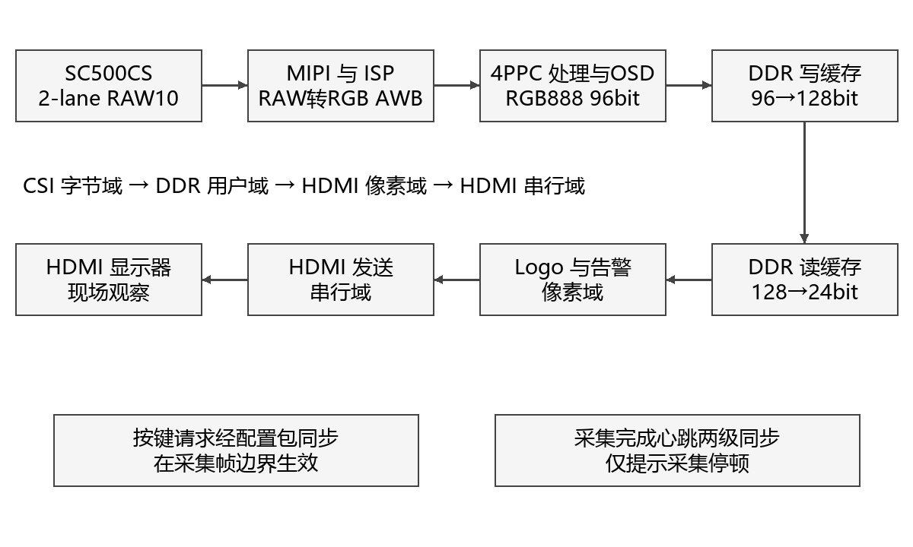

图1 视频闭环与主要时钟边界示意

厂商参考工程提供D-PHY、MIPI、PLL、DDR和HDMI底座，自定义Verilog在既有彩色流上实现算法、统计与OSD。运行时无PC或云端算法参与像素处理。结构图用于解释功能关系，不代替真实接线与电路图。

| 时钟域 | 最终STA约束频率 | 职责 |
| --- | --- | --- |
| CSI字节 | 59.995MHz | 图像处理、统计与缓存写出 |
| DDR用户 | 66.667MHz | 读写调度 |
| HDMI像素 | 75.002MHz | 读出、Logo及告警 |
| HDMI串行 | 375.094MHz | TMDS发送 |
| 外设控制 | 23.810MHz | 按键与相机控制相关逻辑 |

CSI、DDR与HDMI分属不同时钟域，约束频率不是频率计实测。应用统计及LAST标注随CSI像素进入DDR；采集心跳只用于停顿提示。最新延迟候选另建立帧身份、时间和缓存代次关联，通过整包FIFO与保持元数据握手跨域，在实际HDMI首DE记录时间；不以采集心跳证明显示的是最新图像[18]。

### 2.2 硬件系统介绍

### 2.2.1 硬件整体介绍

核心器件为安路PH1P35MDG324，使用HX1P35A开发板、米联客MLK-CAM001 V1.0 SC500CS模组、板载DDR和HDMI显示器。相机采用当前寄存器配置的2-lane MIPI RAW10；顶层引出四对数据焊盘，不表示当前启用四lane，亦不等于4PPC。模组供电与针脚以实际配套连接和匹配原理图为准，不依据通用SC500CS商品名推定。

### 2.2.2 机械设计介绍

实物照片显示顶部铝型材横梁固定相机，周围覆有反光内衬与外部遮光布，侧面安装两条补光灯，配有控制器。显示器和板卡置于外部台面。固定结构有利于重复摆放，但反光、阴影及亮度变化仍会影响前景与颜色；材料可见不等于光照均匀性已经测得。

已有封罩外观与外部板卡/显示器、内腔相机与灯具的视频巡览（图16），补足整体搭建的可复查记录。仍缺将整套装置完整纳入的清晰正面/45°定帧照、实际机械尺寸图、镜头到样品面距离、视场与线长；不以既往60cm概念尺寸当成品实测。

### 2.2.3 电路各模块介绍

| 模块 | 关键输入输出 | 工程边界 |
| --- | --- | --- |
| 相机控制 | O_cam_scl、IO_cam_sda / O_cam_24m、O_cam_rst | 配置、时钟与复位；AE请求关闭 |
| MIPI输入 | IO_rx_clk_pad_p/n / IO_rx_data_pad_p/n[3:0] | D-PHY与解码沿用参考IP |
| DDR | addr[12:0]、dq[15:0]、dqs/ck等 | 既有多帧缓存与控制器 |
| HDMI | O_tmds_ch0/1/2_p、O_tmds_clk_p | 有效1280×720，总时序1650×750 |
| 操作 | I_button[1:0]、I_switch[3:0] | 实体映射用屏幕SW与资料核对 |

最新交付已纳入HX1P35B_FT_40P的多张原理图；其与实物HX1P35A版次的关系仍需确认。最终材料应选匹配的MIPI、DDR、HDMI、供电/时钟片段并标注网络和方向，接口表不能替代官方模板的电路模块图。沿用厂商板卡，不宣称自制PCB。

一行320个4PPC有效拍，一帧230400拍；RGB有效载荷为2764800字节。行帧总时序下75.002MHz/(1650×750)约60.61Hz，仅说明配置值，实测刷新、采集帧率和独立新帧率须分别记录。DDR重复显示不会成为新的采集观测。

现有提前帧通知与首有效像素不同。新增observer将提前/内联SOF归一到真实有效首拍，核对每行长度与全帧拍数后发布结果；错误行尾、提前新帧和截断使该次观测无效。不得将协议草案中的EOF、abort或缓存代次接口视为主线已普遍提供。

### 2.3 软件系统介绍

### 2.3.1 软件整体介绍

工程软件包括RTL、约束、独立参考模型、原生仿真与构建脚本。实时处理全部在FPGA进行。post-AWB的RGB888观察流为96bit、每拍四像素，无ready；算法选择、应用层和状态层保持共同31拍深度。新增背景分支内部增加2拍，但不增加公共视频延迟。31拍不能代表采集到屏幕的总延迟。

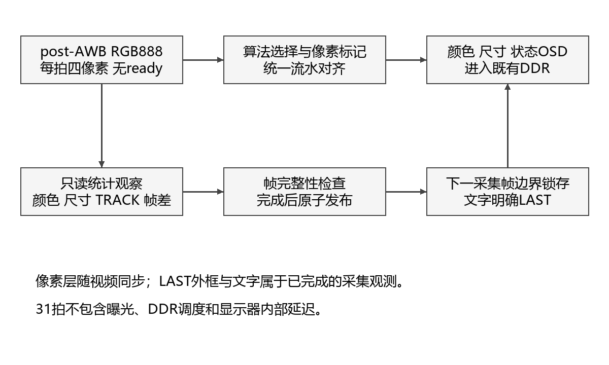

图2 像素流水与完整观测发布流程

先前已将23bit配置延迟改为等价移位链、Gaussian/NMS行历史共享至原生双口RAM。后续在720行配置下把AWB两路逐帧48/32位除法串行复用，49拍完成，保留精确商、在途复位及原50拍图像RAM延迟；小于64行和默认配置仍用原IP。增益、采样和AWB算法未变，原生对照用来验证等价性，而非证明新白平衡效果更佳[18][19]。

### 2.3.2 软件各模块介绍

### 2.3.2.1 基础处理与接口

| 模块 | 实现方法 | 解释边界 |
| --- | --- | --- |
| GRAY / / BINARY | Y=(77R+150G+29B+128)>>8；Y≥阈值为白 | 整型定点计算；不是显示器亮度计量 |
| EDGE | 高斯、Sobel、非极大值抑制和有界弱边传播 | 水平成对取样后复制；非1280独立Sobel，也非完整递归Canny |
| STYLE | 局部色彩均值、亮度量化、暗线保护 | 保守风格化；不承诺全局闭合区域填充 |
| AWB | 沿用既有帧统计白平衡 | 无新AE闭环；不等同标准色彩校正 |
| 应用与 / observer | 颜色/尺寸统计、TRACK、块均值帧差 | 作用于未风格化彩色流；不降低视频吞吐 |

| 模块 | 关键输入 | 关键输出 |
| --- | --- | --- |
| ruler_area_calibration | gray[31:0]、valid/user/last、请求 | span[10:0]、calibrated、status[2:0] |
| measure_background | gray[31:0]、回退前景、帧标记、learn/clear | pixels[3:0]、对齐标记、applied/ready/status |
| planar_measure_stats | 4路前景、帧标记、极性/ROI | 外框、尺寸与中心间隙端点/有效状态 |
| vision_source_observer | rgb[95:0]、gray[31:0]、帧标记 | LAST目标结果、变化标记、帧身份与错误 |

### 2.3.2.2 固定双区域颜色比对

颜色比对将标准样品和待测样品同时置于画面固定区域，在同一完整采集帧分别统计1024个像素的RGB，减少跨帧曝光变化引入的差异。参考区x=304…335、y=304…335；测试区x=944…975、y=304…335，边界均包含。四lane均参与统计，区域未完整采集则不发布有效比较。

| 量或状态 | 含义 | 界限 |
| --- | --- | --- |
| 均值 RGB | 各通道(sum+512)>>10，四舍五入 | 码值依赖sensor、AWB、曝光和照明 |
| ABS、L1、MAX | 逐通道绝对差、差的和、最大通道差 | MAX≤12为当前原始RGB接近阈值 |
| CHR、DV | 归一化通道比例最大差、maxRGB亮度代理差 | 用于解释差异，不是ΔE或照度 |
| 可靠性门槛 | 两区均sumRGB≥96、maxRGB≥32且<254 | 排除过暗和接近饱和；不保证无反光 |
| MATCH | 可靠且原始MAX≤12 | 当前码值相近，不证明标准色度一致 |
| LIGHT | 可靠、原始不匹配、归一化CHR≤6 | 可能受亮度因素影响；不自动等同颜色相同 |
| DIFF、CHECK、WAIT | 明显差异、可靠性不足、数据未完整 | 保留原因，不能统一记为检测失败或成功 |

平均值使单像素噪声影响减弱，固定区域便于现场复现；代价是区域内背景、纹理和高光会改变均值。归一化可提示近似乘性亮度变化，但材质、反射谱、相机响应和真实样品明度也会产生类似现象。系统未引入色度计标定、标准光源光谱、CCM或CIE ΔE计算，文档使用“RGB颜色一致性筛查”，不写“工业色差测量”。

颜色实验以同色交换、异色、单侧变光、过暗和近饱和为独立组别，保存双区RGB与全部状态。阈值MAX≤12、CHR≤6沿用源码，未据未经验证的照片改参；LIGHT只能提示可能亮度因素。相同黄纸左右读数不同的旧反馈，尚不足以唯一归因照明或证明归一化判别正确。

### 2.3.2.3 厘米粗标定与平面尺寸

在ORIGIN、DIM与CAL条件下短按K4发起标定。AREA标题应为1CM RULER LONG TICKS。搜索区x=256…1023、y=192…479，宽768、高288，复用12行缓存扫描27个重叠带，约需54个采集帧及分析等待。输入必须是水平、清晰、黑色公制厘米长刻线，至少五条长线；尺与工件同平面，背景尽量干净浅色。算法不识别数字或单位[2][3]。

每行灰度对比度至少16，暗阈值取low+(high−low)/4；提取未裁断、宽1…4px的笔画中心，采用加倍坐标保留半像素信息。接受12…120px/cm的连续间距，相对首间距容差约25%+1px，至少四个间隔；先求行内平均，再平均同一完整捕获帧内的相邻两条有效行，两行容差约12.5%+1.2px/cm。全27带搜索结束后优先较大稳定间距，以减少过早选中半厘米线的风险。

| 界面状态 | 含义与边界 | 操作者动作 |
| --- | --- | --- |
| R0 / R1 / R2 | 未标定 / 等待采样 / 分析 | 保持标尺静止，不连续重按K4 |
| R3 / CAL:OK | 周期一致并发布粗尺度，尚非精度证明 | 关闭CAL，独立工件复核，再测尺寸 |
| R4 / R5 | 对比度不足 / 间距未通过 | 留存原图、刻线条件和失败画面 |
| R6 / R7 | 帧几何错误 / 取消 | 检查链路或重试，不能沿用失败候选 |

相邻厘米长线平均d像素，对应10mm，因此旧接口S100=10d像素/100mm，有效范围120…1200。例如d=34px时S100=340，170px工件跨度对应50mm。新请求先撤销旧尺度，复位清尺度，错误帧不接受缓存候选，取消不确认。成功后关闭CAL、保留DIM；屏幕SW通常0101→0100，实体拨码顺序与极性须现场核对[4]。

X/Y共用S100，Y依赖正俯拍和近似等比例成像。本版是粗比例尺，不承诺精密计量；最大稳定间距仍可能误认半厘米、其他周期或背景纹理。R3后必须用独立量具量过的工件分别验证X/Y，并排除约2倍、5倍等尺度错误。0.1mm显示分辨率不是0.1mm准确度。旧密集1mm规则属于历史方案，不作为本版输入要求。

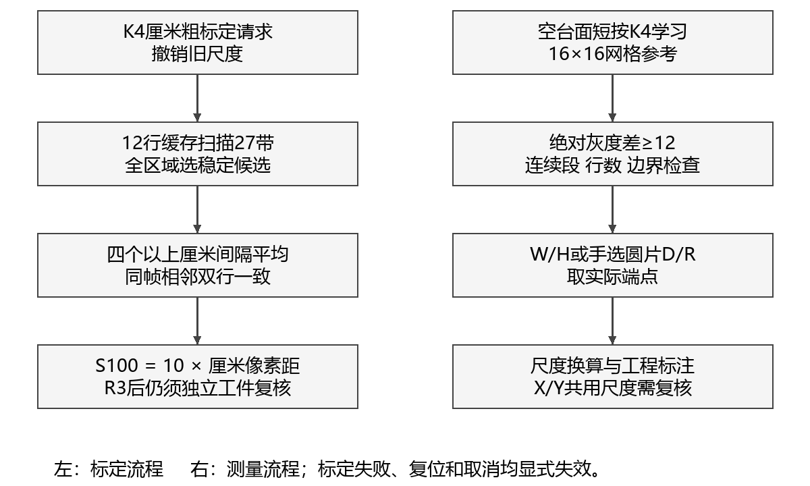

图3 标尺定尺度与背景参照测量流程

尺寸ROI为x=256…1023、y=160…543。单个薄、平、轴对齐工件应完全落在区域内。最新候选过滤不足3个连续前景像素的段；每行至少6个合格像素，至少3行、64像素形成范围，触ROI边界则无效。宽高为轴对齐外接跨度；GAPX/Y只沿x=640、y=352的固定中心截面寻找至少3个背景像素，不是任意孔检测。阴影或反光造成的空段不能直接认定为真实间隙。

以100mm等效像素跨度S100换算跨度P，先求0.1mm整数q，再显示q/10mm。原生公式如下。显示到0.1mm只代表显示分辨率；精度受像素量化、刻线选择、畸变、阈值、姿态和离面高度共同影响。静置读数，X/Y必须分别用独立真值检验。

跨度换算 q = round(P × 1000 / S100)，q单位0.1mm；Word保留原生公式。

### 2.3.2.4 空台面学习与显式圆片档

旧固定阈值加单极性会遗漏接近背景的反光亮面，导致外廓缩小。新候选在ORIGIN测量RUN下短按K4学习空台面：ROI划成16×16网格，共48×24=1152格；每格在中心行取间隔4像素的四个灰度样本形成参照，占1 ERAM。它不是整格256像素平均，要求背景平滑。逐像素绝对灰度差≥12即判前景，可同时保留相对背景较亮或较暗的区域[12]。

学习必须收齐完整帧、正确行尾并写满1152格，才发布BG:OK；否则不确认。BG:NEED/WAIT/OK/FAIL说明参照状态，AUTO12表示最近完成的测量帧使用背景差，CUT表示回退固定阈值。复位、进入CAL和重新学习会清除背景就绪；帧中clear/request在后续SOF生效，避免学习与读取混杂。BINARY仍显示固定阈值二值图，不能当作AUTO12前景掩码。

正确顺序是先用尺标定，移走尺和工件，再对空台面学习，最后放入工件。移动相机、桌面或照明后应重新学习。纹理、阴影、AWB变化、过曝或物体边缘与背景无对比仍可能失败；背景差不恢复已经消失的光学边缘，不应宣传为万能消反光。合成模型中70px漏分割改为140px只证明构造输入下逻辑符合预期，不是实板改善率。

ORIGIN测量RUN下长按K4约1秒，在W/H和D/R档间切换，一次长按只切一次。D/R用于操作者已知的完整正俯视圆片，D取水平外径，R=D/2，并画中心到右边界的半径线；未标定显示PX，已标定显示MM。自动近圆分类SHAPE_ENABLE=0，最终未启用，W≈H也不是圆的充分条件。该功能不拟合任意局部圆弧、不测厚度，异形件应回W/H。

### 2.3.2.5 红色目标与LAST外框

独立TARGET交付保留HSV分类、tracker及guard；MAIN在TRACK_REGION_FIX_V1更新生产观察器，增加相对红优势条件G/B≤R−floor(R/4)。4像素至少3点匹配才构成支持块；保留每行最长且至少8px的连续段，接续至少4行、64支持像素，再选支持面积最大区域。该实现抑制远处散点拉大外框，不是通用连通域或多ID检测。独立模块的支持滤波默认配置不等同于MAIN本次区域选择[17]。

区域结果在EOF后一拍发布，MAIN将边界与LAST中心、支持面积、帧号和有效状态整组锁存，绘2像素绿色外框并保留红色本体。横向边界按4px分组，X/Y为框中心，N为被选连续区域支持面积，均非质心、精密面积或物体数；HEX数字与VALID、ERR须按本义读取。极浅粉、细线、空心环、反光断开或多个相近红物体可能漏检或换选。蓝色仍未集成[17]。

session/frame由采集侧事件建立，HDMI重复显示不能成为独立正观测。observer检查320拍/行与720行，坏行、提前新帧、取消和停止输入使可信状态失效或进入恢复。guard使用64bit CSI域时间计数，6000000周期在名义60MHz下约100ms；这不是精密实测毫秒门槛。未依赖输入继续前进的像素计数代替停止输入超时。

TRACK框仍属于上一完整采集观测，快速移动存在滞后。无目标或无效结果撤销后续标注；旧DDR帧可能连旧框重复。最新延迟候选已引入缓存代次和读帧身份用于计时，不能据此把TRACK改称严格同显示帧检测：框与原图的关联口径仍是LAST，延迟身份和TRACK计数也来自不同观察点。

实验应分别观察慢移、快移、静止、移出、重现、第二红物体及红背景，区分延后框、合并框、误检与显示冻结。当前没有同场YCbCr/HSV准确率对照，因此只说明颜色判据变化，不宣称已证明HSV更优。

### 2.3.2.6 块均值帧差与采集心跳

MOTION仍把1280×720划为32×16像素块，形成40×45共1800块；对每块512像素求8bit灰度均值，前后完整连续帧绝对差≥12才记变化块，至少3块为MOTION。新版把旧稀疏洋红4px提示改为FF3000橙红、8px间距的3×3实心点，每块最多8点/72px；显示上一完整有效变化图，约滞后一采集帧[6][19]。这是标注可见性与发布方式改进，网格和检测阈值未提高分辨率；新实拍见图17。

| 状态或结构 | 定义 | 不能推导的结论 |
| --- | --- | --- |
| 双缓冲历史 | 两组各1800项均值及变化位，仍用2个ERAM | 没有新增整帧RGB缓存 |
| 提交 | 仅完整有效帧交换缓冲角色，要求连续采集ID | 截断帧不作为可信历史 |
| WARMUP / INVALID | 历史未建立 / 帧错误、取消或超时 | 不能把无参考时的0变化当成静止 |
| LAST CHANGED | 最近完整采集帧变化块数 | 计数单位是块，不是运动物体 |
| STILL / MOTION | 变化块少于3 / 至少3 | STILL可能仍有1—2个变化块 |
| GLOBAL | 超过75%块发生变化 | 不能区分灯变、相机移动和大物体 |
| 新版橙红点阵 | LAST完整变化图；8px间距、3×3点 | 改善可见性；非精细轮廓或物体计数 |

复位、丢行、帧中断、非连续身份或观测过期时清除运动历史，重新WARMUP。只有完整帧可以成为下一次参考，避免半帧写入破坏旧参考后仍产生“有效”运动结果。两组缓存分开读写，原生ERAM模型验证同步读语义；仿真不能代替板上供电、温度和CDC验证。

块平均减少存储量和噪声敏感性，适合固定相机观察较明显移动。小目标只占少量块内像素时可能被稀释；块内明暗变化相互抵消、慢速位移或纹理相近会漏检。全局亮度变化会触发大量块，不以GLOBAL告警宣称已识别光照原因。

采集完整帧产生1bit翻转心跳，经HDMI域两级同步。无新心跳达到15000000个像素周期后显示SOURCE STALE，名义75MHz下约200ms，启动/复位也视为过期。它检测采集完成是否停顿；若DDR重复旧帧但采集继续，心跳仍可能正常，故该告警不能证明显示新鲜度，也不是采集至HDMI延迟测量。

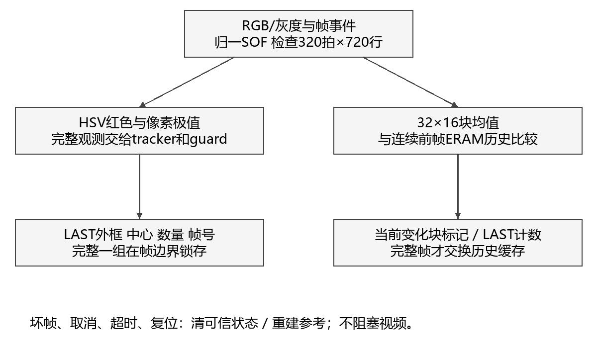

图4 SHAPE历史观察结构 新区域选择见2.3.2.5

### 2.3.2.7 操作与异常判读

| 条件 | K4短按释放 | K4长按 |
| --- | --- | --- |
| BINARY / EDGE | 阈值减10 | 阈值加10，按既有重复语义 |
| ORIGIN测量CAL | 发起厘米标定 | 不作为D/R切换 |
| ORIGIN测量RUN | 学习空台面 | 约1秒切换W/H与D/R，一次一切 |
| TRACK / MOTION | 不调整检测阈值 | 不调整检测阈值 |

K3循环七模式；拨码负责颜色显隐、尺寸/CAL与极性等既有操作，先用屏幕逻辑SW确认映射。标定时通常SW0101，成功后关CAL留DIM为0100；TRACK先SW0000。不能猜物理左右编号。复位后尺度与背景都需重新取得；CAL:OK不表示背景已就绪，BG:OK也不表示尺度正确。

屏幕B/S是HEX饱和计数：B统计前600采集帧中含write-valid且FIFO-full事件的帧数，S统计之后的此类帧数，上限FFFF。它们不是亮度/饱和度，也不是溢出的像素数。启动B非零不自动等于稳态丢帧；S增长应优先排查吞吐和缓存。SW是逻辑开关状态，R是读尺状态，R3才是最近标定成功。源帧号、HDMI计数与B/S须各按本义记录。

### 2.3.2.8 同帧内部延迟与资源优化

同帧计时从LATENCY_PERFORMANCE_V1建立：解码后RAW首有效4PPC拍生成身份与时间，87bit标签和128bit像素使用同一FIFO字跨域。DDR四槽按写代次记录，完整172800打包字才提交；选读时锁存身份与时间，经握手送往HDMI，在首个真实DE打点，收齐921600像素并通过边界检查后发布。最新LATENCY_FRAME_FIX_V1修正RAW错误归属，避免随后消隐期PHY错误误取消尚在ISP尾部打包的完整帧；有效数据期间的错误仍须拒绝[18]。

真实计时参考为配置75MHz、10us量化，尚未物理校准；包含ISP和缓存等待，不含曝光、摄像头内部及显示器延迟。LAT/MIN/MAX仅统计合格不同帧首次显示，AGE为图像年龄；NEW/REP区别新帧与重复，BAD/WAIT或N0不是有效测量。F/N/E为HEX，BAD可能保留旧数；模式共享固定流水，切换后LAT接近不反常。新增C/W/D为采集拒绝掩码、实时槽状态和显示拒绝掩码，用于定位，不是延迟[18]。

新视频出现LAT/MIN/MAX及DEMO，但临时LATENCY_DEMO_V1以确定性LFSR每约1秒生成10.00…30.00ms，初始化20.00ms；这些不是测量值。其F/N/E/AGE/C/W/D仍是实际诊断，图18可见N0000，因此数值跳动不能证明测量成功。最新交付已撤下该模拟显示，沿用真实修复bit；归档仍NOT_RUN。本轮不把DEMO范围填入性能表或用它宣称赛题延迟项完成[18][20]。

INSPECTION_PARTS_MOTION_V1已完成最终构建；原T/L轮巡只是失败试验，最终为W/H、竖段宽S、横梁厚T、左右伸出A/B和外部竖段长V同时标注，零伸出侧隐藏。复用行包络，两稳定嵌套水平段各至少6行；限单个薄工件、同标定平面、正俯视、轴对齐且T横梁水平，复杂或旋转轮廓回退W/H。横向按4px量化，0.1mm显示不是准确度；新素材未展示T/L实物效果[19]。

### 2.3.2.9 方案演进与取舍

已登记名称与锁定简介保持不变。采集、缓存、基础算法、HDMI和OSD主线延续；应用拓展为固定台颜色和薄工件尺寸，K3循环替代原拨码选模式，YCbCr转为HSV主红区域，蓝色仍缺。上一帧外框有实拍，区域选择修复巨框；新增T/L尺寸、运动提示改进、同帧延迟与资源优化。DEMO数字只作历史演示，不补作原简介性能；方案变化和未测项目在技术材料中明示。

| 历史问题或约束 | 采用的方案及理由 | 代价和剩余验证 |
| --- | --- | --- |
| 手动100mm操作繁琐；密集毫米线实拍R5 | 改为厘米长线多间隔、双行平均，符合粗比例需求 | 可能倍数误认；R3后独立X/Y复核 |
| 反光外廓漏分割的实物反馈 | 空台面网格绝对差，兼顾亮暗前景 | 需要平滑固定背景；变光后重学 |
| 圆片只有W/H；资源余量不足 | 手选D/R，保留明确几何前提 | 不是自动识圆；验证外径真值与姿态 |
| 旧TRACK整块绿覆盖、缺外框 | 复用边界结果画LAST框，与文字成组 | 帧级滞后；断流可能显示旧DDR框 |
| 多个全功能尝试超器件容量 | 保留基础字库，配置改原生ERAM延迟 | Slice/ERAM余量极少，长稳与CDC仍需测试 |

这些取舍以本项目的用户反馈、资源和构建记录为依据。没有对应对照实验的选型不补造优越性结论，也不为模仿其他作品加入机械臂、CNN或复杂候选分离。

## 第三部分  完成情况及性能参数

### 3.1 整体介绍

本稿依据最终交付V1.1与main 6432c91：正式输入沿用ebbd3cd，真实延迟bit归档ad7bc68、tag latency-frame-fix-v1-candidate，归档板测NOT_RUN。旧文档PR26已合并，本稿在新文档分支更新。在第六稿12张照片、15段视频基础上增加4段短片：整机巡览、改进运动及带DEMO的延迟界面。T/L与运动已有bit，旧“仍在布线”结论已更新；录制bit SHA仍未绑定[18][19][20]。

原正视/斜视台面照片继续保留。新视频补入遮光封罩外观、外置屏幕与板卡，以及内腔相机/补光（图16）；可说明实际搭建关系，但巡览局部不等同于一张无遮挡的完整正面/45°定帧图。后者及标注尺寸的机械图仍应补入最终材料。

实物图组一 外部显示与板卡安装

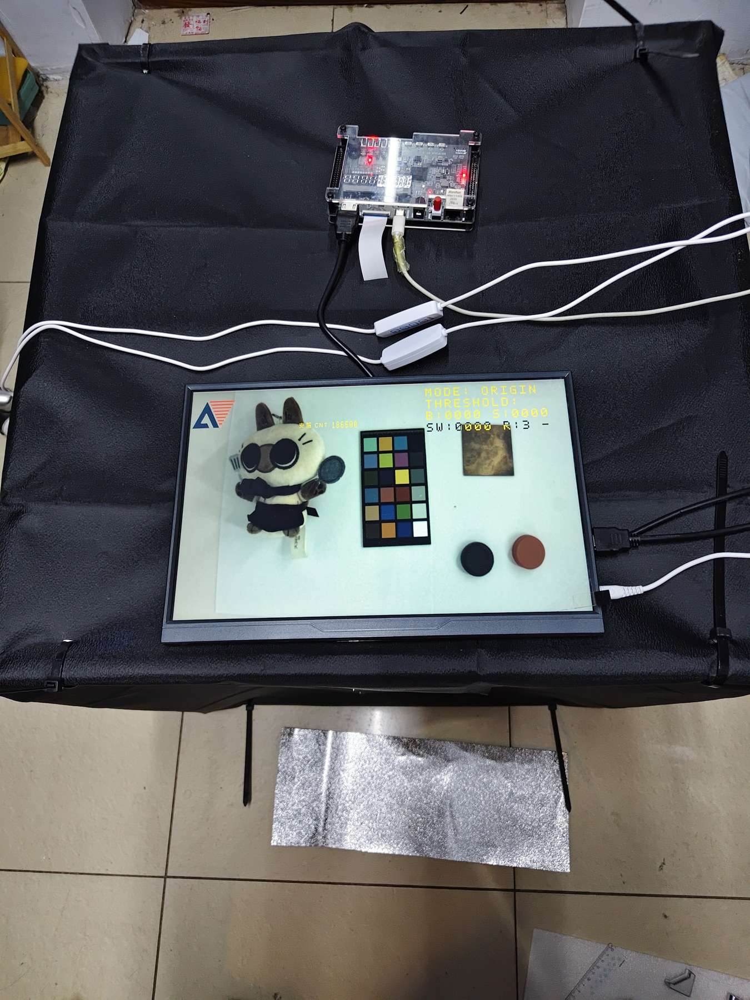

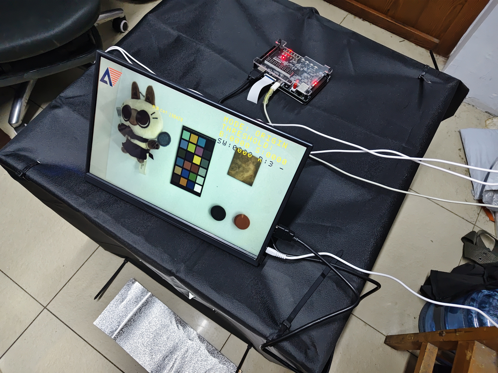

图5 显示器与板卡台面正视及斜视实拍。原照片230024、230130。

### 3.2 工程成果

### 3.2.1 机械成果

新巡览与旧照片相互补充：封罩外有显示器和板卡，内腔可见铝型材、反光内衬、相机安装和灯具。相机高度、框架尺寸、视场、照明均匀度及样品厚度仍未实测。仓库机械frame_concept是设计参考，不能直接当成已制造结构或实物尺寸真值。

实物图组二 相机固定与补光

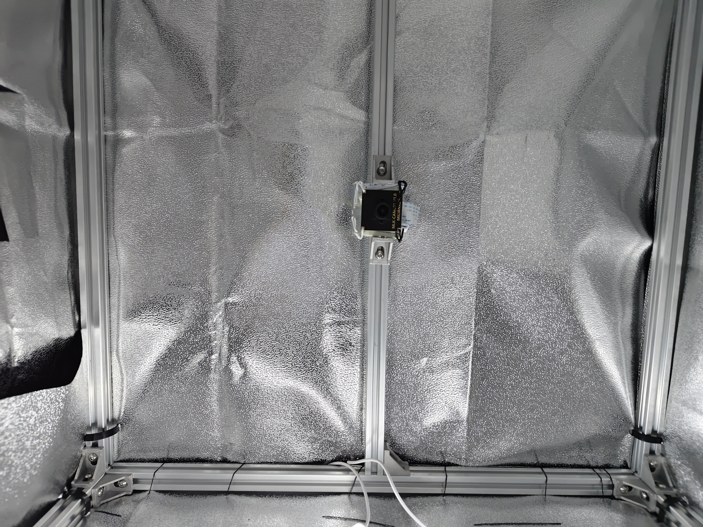

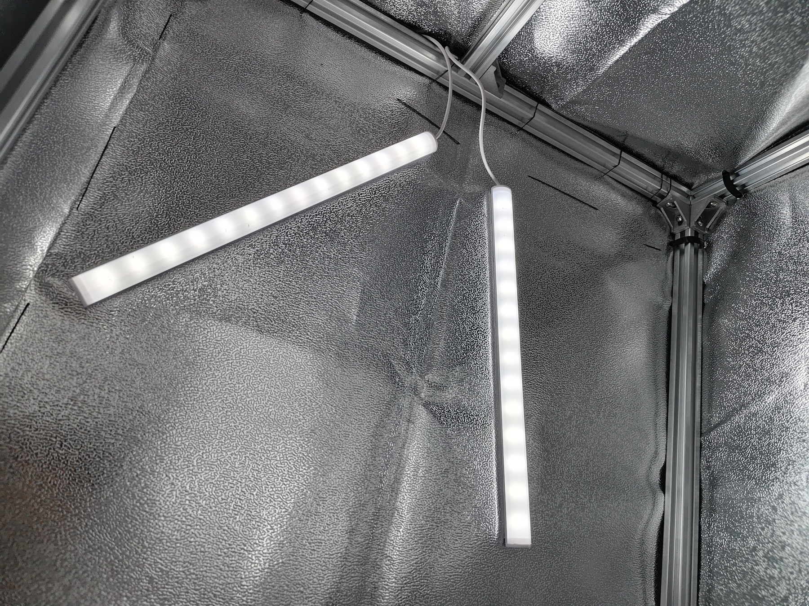

图6 顶部相机固定和侧面补光局部。原照片230048、230218。

### 3.2.2 电路成果

板卡实物和显示/供电线缆照片已补入，板上可辨HX1P35A字样；原相机资料支持MLK-CAM001 V1.0及FFC连接形式。板卡版次与仓库B版原理图关系、实际线长、电源额定值及关键电路页仍待主控确认。当前沿用厂商板卡与IP，不将实物接线或参考原理图包装为自制PCB。

实物图组三 开发板与连接

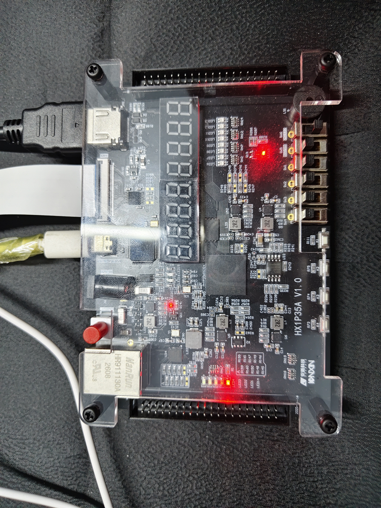

图7 HX1P35A开发板及线缆实拍。原照片230319；厂商板卡，不是自制PCB。

### 3.2.3 软件成果与已有实物现象

原15段视频合计489.95秒、最长92.65秒；新增4段合计43.65秒、最长18.63秒，不能相加成连续长稳。新片已完整解码至EOF并按0.25秒生成175帧，审阅全部1秒顺序联络图和关键抽帧；未作原生逐帧或音频分析。N03/N04容器有edit-list索引提示，但完整解码均正常退出；时间点为名义抽样位置，不是物理延迟读数[20]。

基础模式图组 原图与灰度

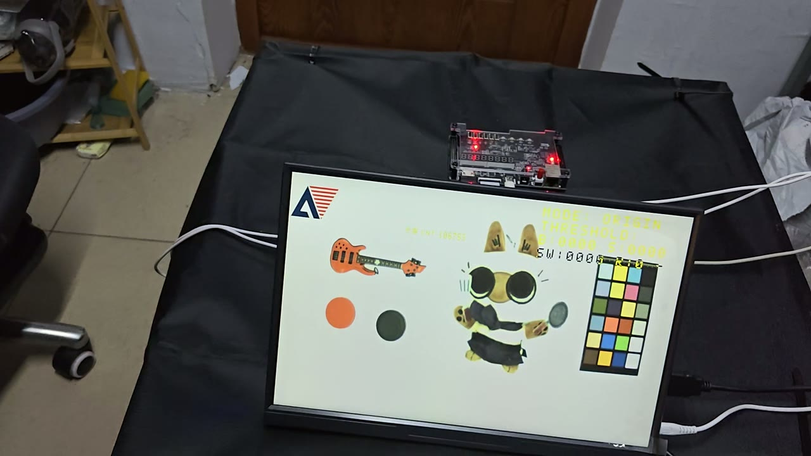

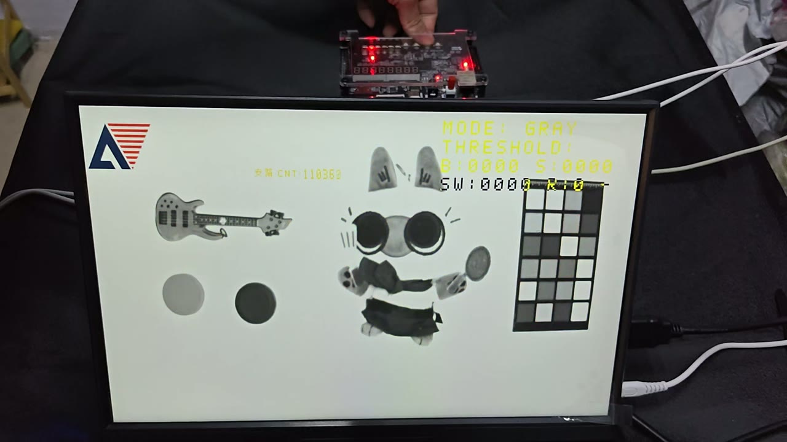

图8 原图与灰度输出。214915约14秒、215017约12秒；保留Logo与OSD。

基础模式图组 二值与风格化

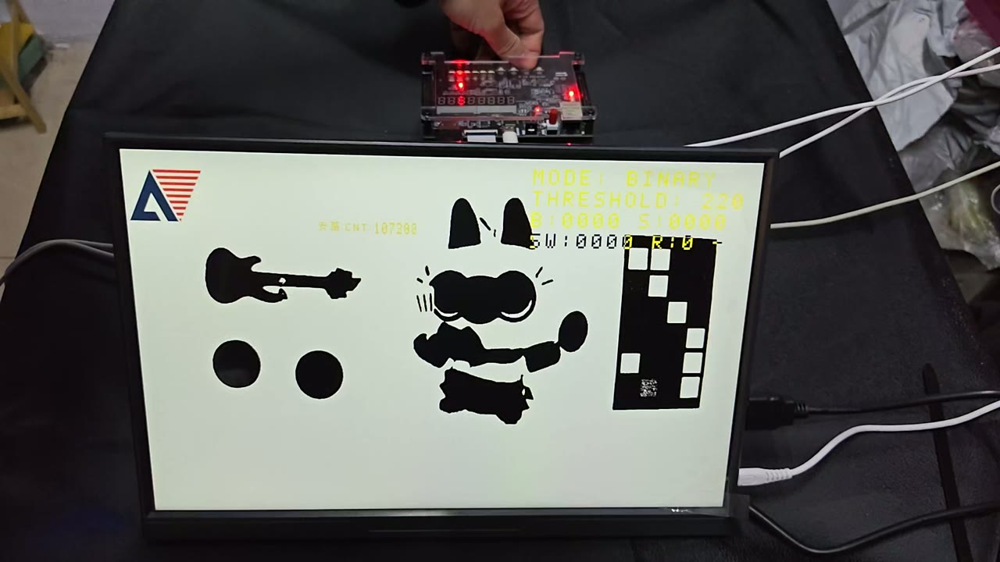

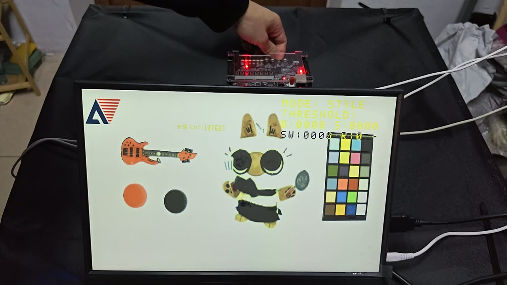

图9 二值与STYLE输出。214915约23秒、28秒；同类场景演示，不是严格配准算法性能对照。

基础模式图组 边缘与阈值

录像中EDGE阈值随操作变化，并显示边缘结构；这里展示一个可读帧，不据此报告边缘定位精度或物理帧率。

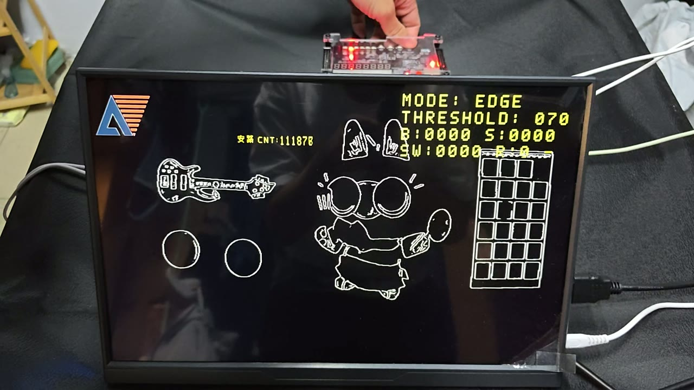

图10 EDGE输出。215017约37秒，THRESHOLD 070。

已看到厘米标定R3/CAL OK、W/H和手选D/R，但没有独立真值。所选尺寸帧明确为BG:NEED和CUT，因此只能证明阈值回退条件下出现读数，尚未形成BG:OK→AUTO12→真实轮廓改善的证据链。颜色LIGHT/CHECK/DIFF与单红目标跟随、移出后SEARCH/VALID0，以及运动/静止切换均可见；准确率、框误差、光学延迟和长稳未测。

### 3.3 特性成果

### 3.3.1 赛题要求与完成程度

| 赛题项目 | 当前证据 | 仍缺 |
| --- | --- | --- |
| 基础采集显示 | 实物画面与操作视频 | 本bit SHA、独立新帧率 |
| 基础算法/OSD/Logo | 五模式及Logo实拍 | 切换瞬态和完整启动记录 |
| 稳定性 | 新旧短片所选帧B/S=0000 | 连续长稳、变光/温度及异常记录 |
| 风格化及应用 | 颜色/粗尺度/D/R实拍；T/L已构建 | 独立误差、BG改善、T/L实物 |
| 多算法切换 | K3与模式变化可见 | 完整循环、多跳/黑屏统计 |
| 跟踪与坐标 | 红瓶盖框/坐标，移出VALID0 | 误差、快移及杂红/多红边界 |
| 帧差运动 | 密集橙红点阵，移动→STILL | 小慢目标、静态误报和灯变对照 |
| 延迟可视化 | 真实功能已构建；视频是DEMO | 不带DEMO且N增长的真实测量 |
| 图像自动调节 | 原AWB保留，等价资源复用 | 定量恢复效果；AE仍关闭 |

对应选题二指南物理页16—18[1]，基础模式与Logo有历史实拍，新版运动点阵有移动/回落STILL证据。延迟功能已有源码、数字及整机构建，实拍却为DEMO，真实修复尚待验收，不能计为已完成实测。T/L只有数字/构建依据；蓝色、自动曝光和工业计量精度不列为完成。各项分别记录实现、构建、实物和量化进度。

### 3.3.2 资源 时序与失败尝试

| 整机最终P&R | 第六稿延迟版 | 当前真实修复版 | 增量 |
| --- | --- | --- | --- |
| Slice / 21216 | 20831 | 19177（90.39%） | −1654 |
| LUT6 | 19532 | 18498 | −1034 |
| FF / 42432 | 21337 | 16374 | −4963 |
| ERAM20K / 108 | 105 | 105 | 0 |
| DSP / 40 | 25 | 25 | 0 |
| Setup WNS / ns | +0.175 | +0.137 | −0.038 |
| Hold WNS / ns | +0.020 | +0.020 | 0 |

最新实际bit为LATENCY_FRAME_FIX_V1，全SYN、PHY、最终STA和bitgen归档通过：19177/21216 Slice（约90.39%），105/108 ERAM，25/40 DSP，Setup/Hold WNS +0.137/+0.020ns，TNS均0，仍保留PHY-5060/5079。相比第六稿延迟候选少1654 Slice、资源余2039 Slice及3 ERAM。沿用原约束，不由正WNS推导全设计CDC/PVT或长稳通过[18][19]。表中为各自最终整机P&R归档，本轮未重跑。

保留失败路径：T/L早期同时标注R0打包21710、轮巡R1为21251，均超容量；R2打包21127但拥塞、30轮超过2小时后中止，无最终STA/bit。最终串行AWB修正首次在途复位不等价后，通过原厂IP逐拍对照，以19209 Slice完成parts/motion全构建；再修RAW错误归属为19177 Slice。没有把打包数或被中止路线冒称最终P&R。

### 3.3.3 数字验证与覆盖边界

本轮仅核查归档、源码和素材，未重跑RTL/TD。保留SHAPE历史规模如下；parts/motion另归档58项门禁，包含9帧运动、7帧原生720p同时标注、8帧实际31拍链路及AWB对照。真实延迟修复另有5组聚焦原生测试：消隐归属、单元、OSD、诊断、实际视频路径；归档报告含旧失败/新通过，实际DDR/FIFO/mixer模型12次提交与10个有效计时样本[18][19]。

| SHAPE历史归档测试 | 规模与结果 | 边界 |
| --- | --- | --- |
| 新/旧ISP与打包 | 各9帧720p；合计4147200有效拍、3110400字一致 | 实际ISP/OSD/原生存储/打包；post-AWB与同步UI起点；读尺搜索高度限定12 |
| 背景学习 | 4帧完整720p、1152格及±11/12/13阈值边界 | 含梯度、亮暗、帧中clear；不代表实物反光改善率 |
| D/R绘图 | 2帧720p，标准字库及径向线 | 已知数字圆片与显示，不是自动圆弧拟合 |
| MAIN TRACK路径 | 128×96、31拍，移动/消失/本体红色/同步 | 实际路径缩小尺寸测试，不是720p动态板测 |
| 几何与控制 | 160帧、91459周期、240换算组；2000随机配置及复位等 | 含模式选择、RAM回绕与首拍有效；物理按键未测 |
| 实验及继承项 | 4096字形行；历史厘米单元19项与全ROI27443319周期 | 实验字体/自动形状未启用；全ROI读尺是独立实例，不是整机全区域仿真 |

延迟模型差值与独立仿真比较、路由数据库的Gray/保持元数据/FIFO扇出审计均为数字或静态证据，不能代替物理PHY活动、MIPI/DDR/HDMI及PVT实测。RAW消隐归属是确认的源码缺陷，但尚未证实就是此前实板N0/BAD的唯一根因。历史读尺全ROI、未启用实验字体和形状模块的覆盖限制仍保留。

### 3.3.4 实拍结果与量化边界

图11—15沿用首批原照片/抽帧，保留成功、失败和可靠性不足状态。新增图16—18来自4段新视频；仅比例缩放与图组排版，图18另作明确标注的矩形裁剪放大，未改数字、调色或消除反光。先审阅顺序图，再选关键状态；时间为名义位置，文件名、SHA、采样和裁剪见配套索引[20]。

| 图组 | 已取得 | 尚缺量化或流程 |
| --- | --- | --- |
| 颜色 | 双区及LIGHT/CHECK/DIFF | 同色交换、照明固定、重复统计 |
| 尺寸/背景 | R5/R3、W/H、BG:NEED/CUT | 独立X/Y；BG:OK/AUTO12对照 |
| 圆片与T/L | D/R实拍；T/L同步标注已构建 | 外径/T-L真值及重复摆放实拍 |
| 动态 | 旧红框及新橙红运动点阵回落 | 误差/滞后、小慢/杂红/灯变 |
| 整机与延迟 | 封罩/内腔巡览；DEMO面板 | 完整两角度/尺寸；真实LAT/长稳 |

原始记录一行对应一次摆放或观察窗，绑定run、bit SHA、样品、标定/背景ID、条件、真值、显示原值和证据文件。尺寸按X/Y和位置分别汇总有符号误差、最大/平均绝对误差及重复性范围；无效、失败与未测单列。仪器名称、分辨率、方法与真值不确定性必须注明。颜色按分组报状态数量，长稳按时长及事件计数，不编造统一“准确率”。

用户此前确认独立真值与连续运行未测；新短片未补足。现在已有改进运动实物现象和封罩/内腔巡览，延迟仅DEMO演示。最小补测为：记录准确bit SHA；用独立量具验证X/Y、D/R、T/L；保留BG:OK/AUTO12同条件对照；真实延迟版5s/30s/120s的LAT/N/E/C/W/D及一段连续观察窗B/S起止。补测建议不写成已有结果。

标定结果图组 失败与成功

两个独立片段都使用厘米长线界面。输入位置、光照或按键之间的单变量因果未被固定，因此不把后一次成功唯一归因某项操作；R3仅表示算法发布粗尺度。

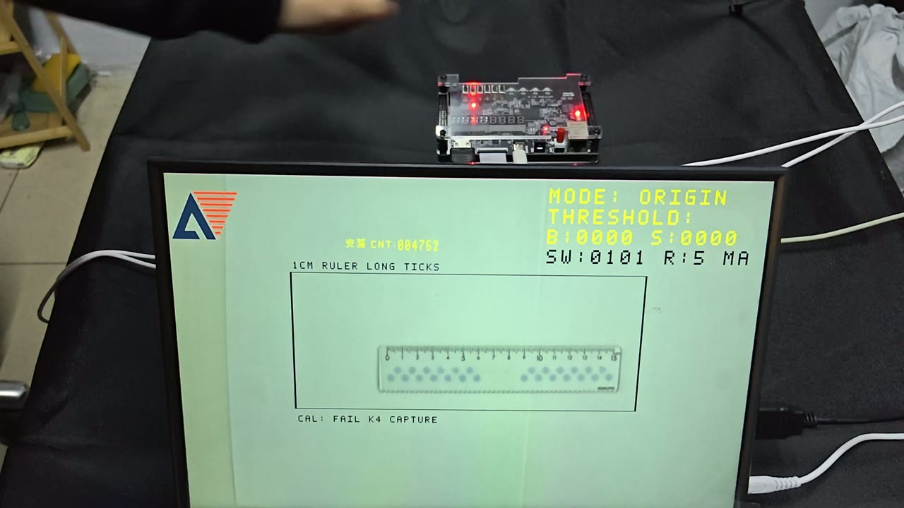

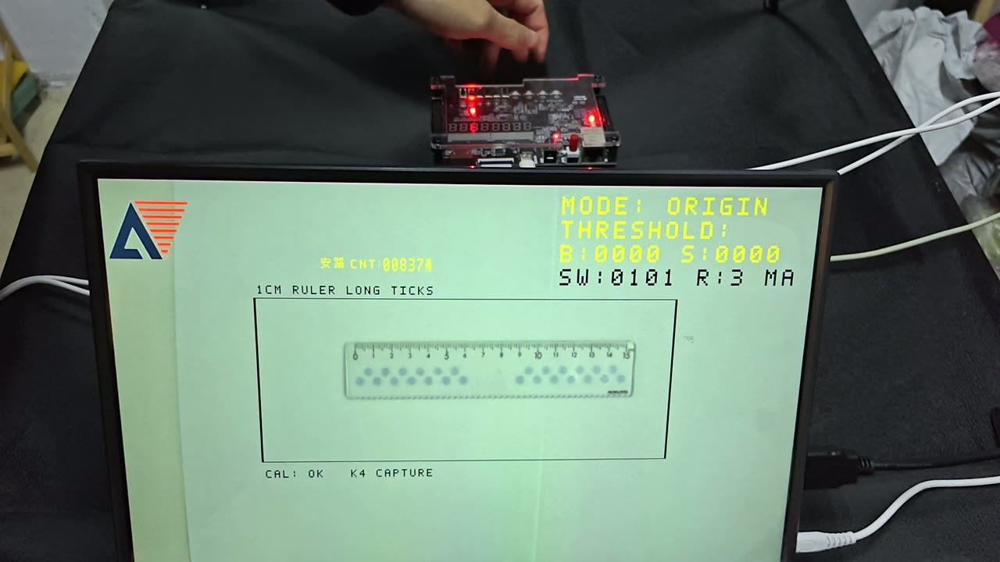

图11 220402约23秒R5/CAL FAIL；221102约23秒R3/CAL OK。

尺寸结果图组 宽高与手选圆片

这些数值是屏幕原值，不是独立量具真值。两帧均显示BG:NEED/CUT；不能用于证明AUTO12背景参照效果，也不能据小数位声称0.1mm精度。R由内部D换算，不能相互证明测量准确度。

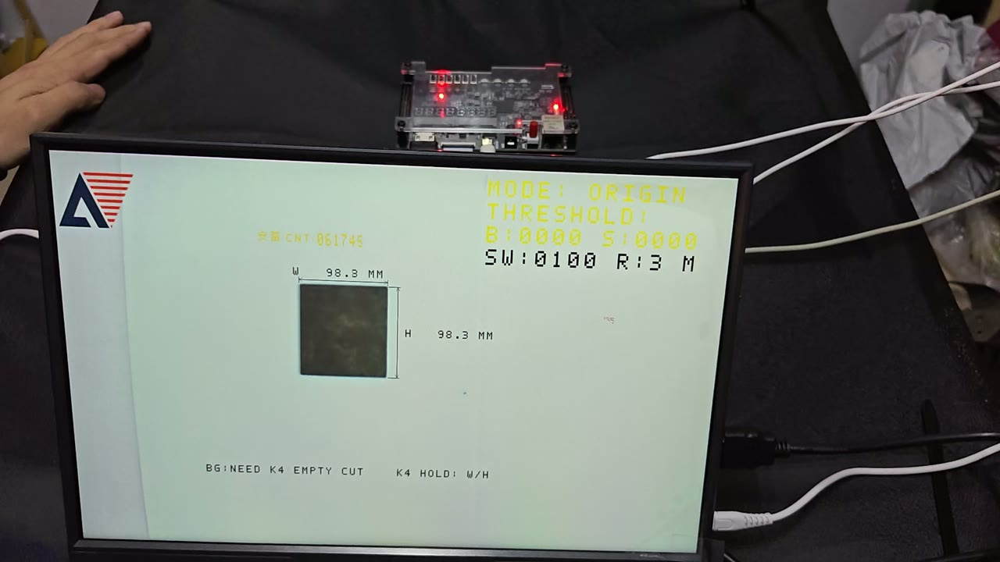

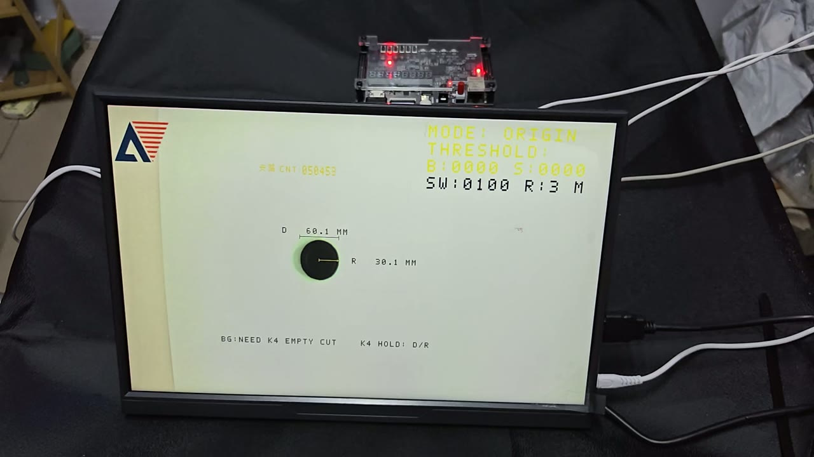

图12 222541约24秒W/H=98.3/98.3 MM；222216约43.5秒D/R=60.1/30.1 MM。

颜色结果图组 可靠性与亮度提示

近亮背景测试区出现252/252/255与CHECK；另一帧参考92/53/41、测试168/92/66，均标RED但显示LIGHT，说明同一颜色名称不代表原始RGB接近。尚无同色交换、标准光源或重复统计，不能计算准确率。

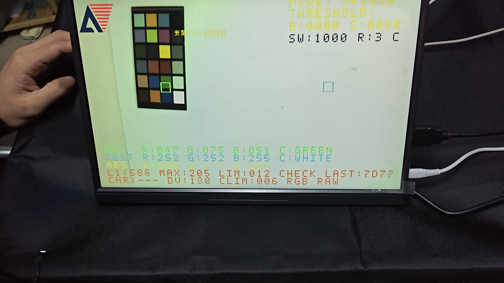

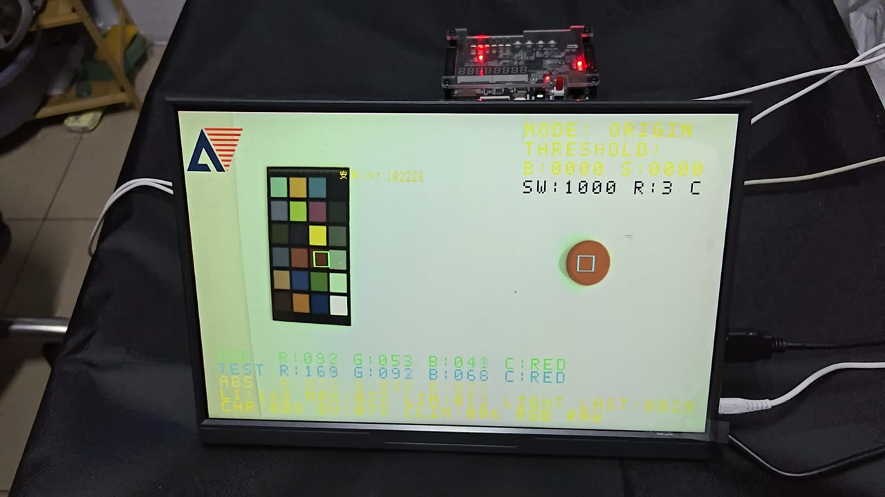

图13 223541约46秒CHECK；约92秒LIGHT。

跟踪结果图组 红目标与移出

同片段中目标在不同位置显示不同X/Y；可支持动态框和丢失撤销的功能演示。尚无定位真值、速度、帧级配准或滞后量化，不从该片段得出误差及漏检率。

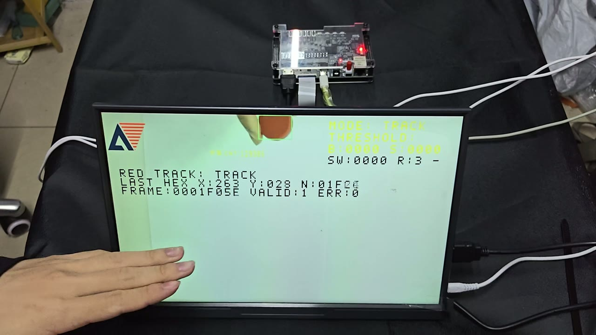

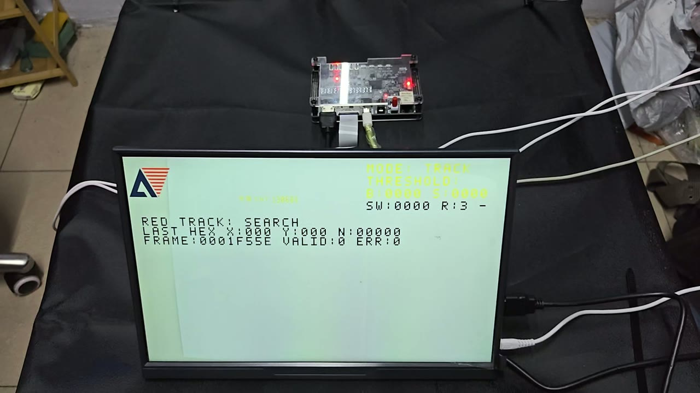

图14 224420约21.5秒红瓶盖有绿色边框、VALID1；约43秒移出后SEARCH、N0、VALID0。

运动结果图组 变化与静止

移动物体与画面变化状态同场可见，停止后可回到STILL。CHANGED单位为块；这些时点不是人工标注的连续逐帧检测率样本。

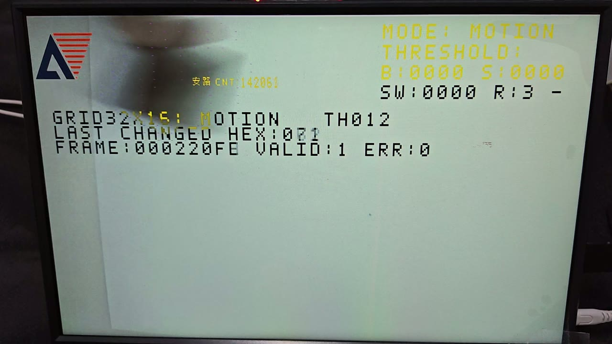

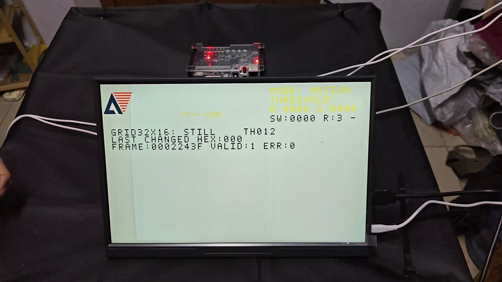

图15 224747约24秒MOTION、CHANGED 071 HEX；约38秒STILL、000 HEX。

整机巡览图组 封罩与内腔

新视频把外部装配与内腔结构串联起来。两幅来自不同片段，均为未裁剪抽帧；不是一次同帧完整总览，也不提供机械尺寸或照度均匀度测量。

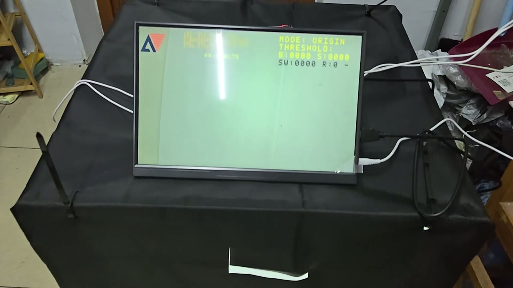

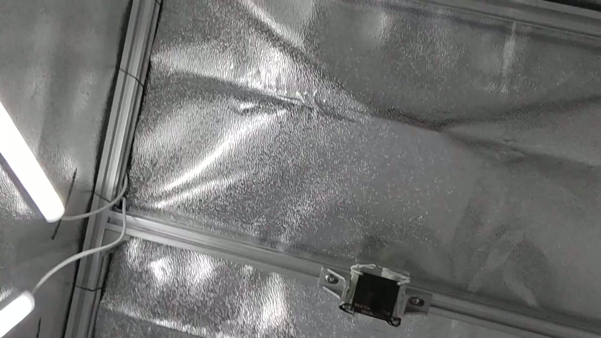

图16 N01约4秒的封罩及外置显示端；N02约6.5秒的内腔相机和灯具。

改进运动图组 密集标注与静止回落

新片展示静止、手进入俯拍场景、橙红点阵出现、手离开后回到静止的顺序。06B为107个变化块，不是107个物体；该帧非最大值。点阵更醒目，不据此推导检测率提升。画面顶部DEMO延迟不作为运动响应时间。

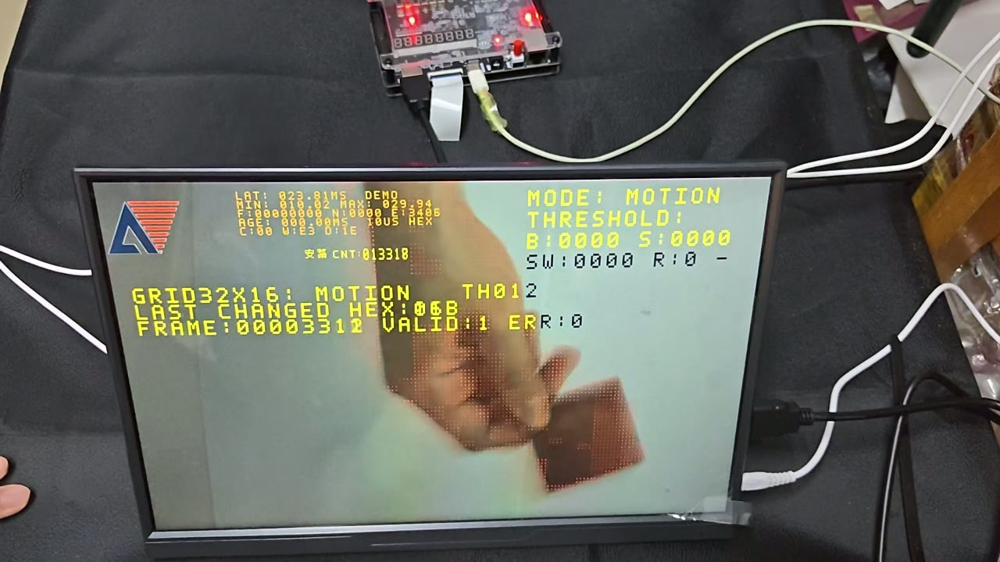

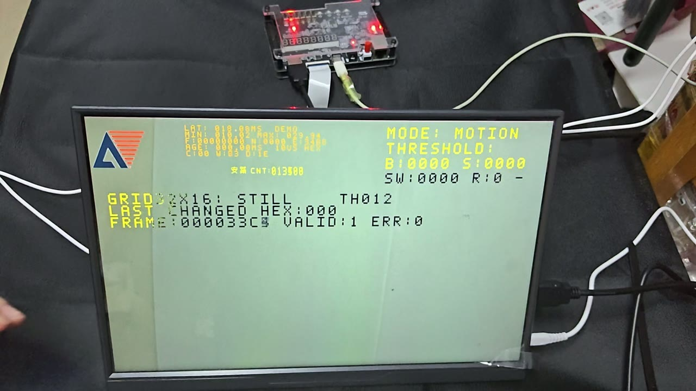

图17 N04约13.5秒MOTION、CHANGED 06B HEX、VALID1/ERR0；约16.5秒STILL、000 HEX。

新增延迟界面图组 演示与真实测量边界

可读LAT 028.81MS、MIN 010.02、MAX 029.94均为临时模拟显示，不能填入实测性能。F/N/E与C/W/D为实际诊断，N0000表示该时刻没有合格测量样本。恢复真实修复bit后需记录N增长和有效状态；该视频不能证明新增测量已实板通过。

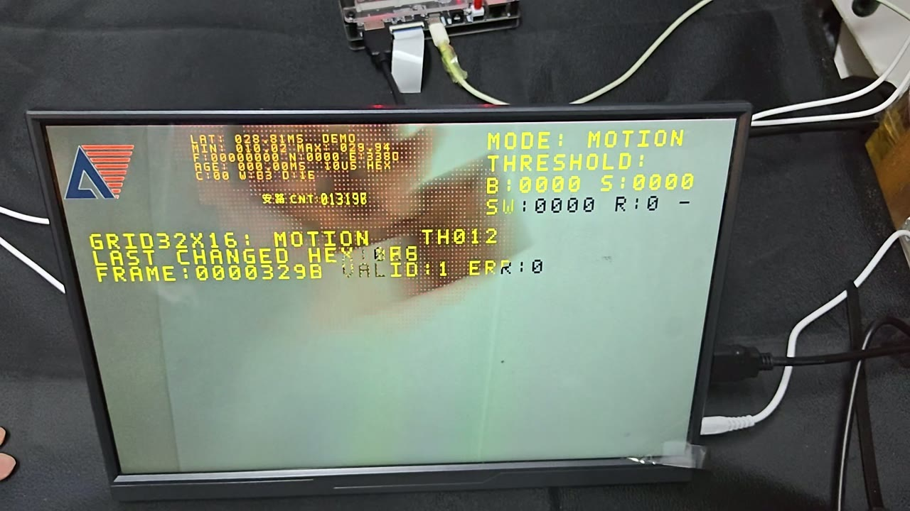

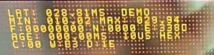

图18 N04约11.5秒全帧及同帧面板局部放大。原文DEMO、N0000均保留；局部裁剪坐标见索引。

### 3.3.5 版本身份与复现

| 身份 | 固定值 |
| --- | --- |
| 本稿交付入口 | final-submission-v1.1 / main 6432c91 / 真实硬件仍沿用LATENCY_FRAME_FIX_V1 |
| 交付源码commit | 6432c918fea3b8ea25d65f5c5fe3816400b0cbfe |
| 实际TD源码 | ebbd3cd7b41bde86c06bdd5bc436dcb3195990d8 |
| 真实bit归档与tag | ad7bc680601d29ac9097803608e0b648068a8a8d / latency-frame-fix-v1-candidate |
| bit | artifacts/bitstreams/LATENCY_FRAME_FIX_V1/ / camera_to_dsi_display.bit |
| bit SHA256 | d516c1d81ec30999d3510ac82e32e354d / d31e1e40dd374ad376e2b572a1f2c16 |
| 对照parts/motion SHA | 1a1737923e33e0f8c87ca918978fff08 / d8dd4c7d6120e54f4835bfc911f1bf11 |
| 真实修复/录制状态 | 归档NOT_RUN；新片DEMO；拍摄SHA待核 |

V1.1修复TD6.2 Windows/Tcl路径传递，要求解压到短目录，例如D:/FPGA/FINAL_SUBMISSION_V1_1；原.al、IP及ROM层次保留。精简代码包含有效工程依赖、当前bit及构建/校验工具，历史测试和报告仍在GitHub。该交付路径修正不是新的硬件构建或实板通过[18]。

复现以最终交付final-submission-v1.1或真实修复tag为入口，核对BUILD_INFO和bit SHA d516…2c16；最新95项正式Git输入与TD源码ebbd3cd逐字相同。本轮复核bit哈希一致，构建清单90项可直接或按换行格式对齐，另5项原始TD字节哈希未独立解决，不能称95项原始字节全部复核通过。实际重新构建须留存原文件/换行及新构建证据，不覆盖历史。

待对齐的5项为mc_to_user_interface.v、ph1p35_324_ddr_wrapper.v、hdmi_tx.v、measure_background.v及camera_to_dsi_display.sdc；Git源内容在交付与TD源码间一致，尚不据此判定RTL功能变动。V5原核验与历次失败证据原样保留，主控需提供原构建输入字节来闭合哈希。旧实拍不能按最新bit重新标记，DEMO录像也不能绑定为真实修复验收。

## 第四部分  总结

### 4.1 可扩展之处

下一步优先核定拍摄bit与5项原始输入字节，补独立尺寸真值、背景参照对照和连续长稳；真实延迟须不带DEMO且N增长、NEW/REP身份正确，记录C/W/D定位拒绝。运动改进已有实拍，仍缺小慢目标和灯变误报；T/L已构建，需真实工件验收。资源余2039 Slice、3 ERAM，后续侧重测量可信和稳定性。

### 4.2 心得体会

实拍使功能与可信度的区别更加具体。界面出现R3和毫米数值，说明流程能够运行，却没有给出独立真值；同一批资料既有R5，也有R3，不能只选成功截图。D/R画面仍显示BG:NEED和CUT，提醒我们必须确认实际走的是哪条分割路径，再讨论背景学习的收益。

红瓶盖移动时出现外框和坐标，移出后回到SEARCH；运动画面也出现变化计数并回到STILL。这些是动态功能的实物证据，尚不足以给出定位误差、漏检率或延迟。颜色实验可见LIGHT和CHECK，说明状态并非只有成功/失败；仅凭两件物体都被标RED，也不能说RGB一致。

最新资源共享使T/L同步标注和延迟诊断得以放入器件；运动密集点阵的实拍也比旧提示清楚。但界面出现数字并非性能证据：新录像明确写DEMO，N仍为零，不能写成实测毫秒。真正的同帧计时必须绑定身份和实际读出，拒绝异常样本。最终交付恢复真实测量后，仍需拍到合格新帧被持续统计；明确保留这个缺口比用演示数值填表更可信。

参考公开竞赛报告[16]的成组展示与原始数据组织方法，我们把实际输入、操作、状态和失效放在一起，并保留失败素材。现阶段最有价值的补充是少量条件固定、真值独立的数据，而不是继续增加算法名称。最终报告应让每个性能结论都能追到版本、样品、原始读数及文件。

## 第五部分  参考文献

[1] 上海安路信息科技股份有限公司. 2026 FPGA创新设计赛道选题指南[Z]. 2026: 物理页16—18. 仓库docs/赛题原PDF.

[2] AnlogicTrack2项目组. RULER_CM_CAL_V1设计说明[EB/OL]. [2026-11-02]. [GitHub 固定提交4d0f779 docs/RULER_CM_CAL_V1_DESIGN.md](https://github.com/Philid14/anlogic-ph1p35-image-processing/blob/4d0f779cefd680363b8a3f0d4d5c33a42d81197f/docs/RULER_CM_CAL_V1_DESIGN.md)

[3] AnlogicTrack2项目组. RULER_CM_CAL_V1构建报告[EB/OL]. [2026-11-02]. [GitHub 固定提交4d0f779 docs/RULER_CM_CAL_V1_REPORT.md](https://github.com/Philid14/anlogic-ph1p35-image-processing/blob/4d0f779cefd680363b8a3f0d4d5c33a42d81197f/docs/RULER_CM_CAL_V1_REPORT.md)

[4] AnlogicTrack2项目组. RULER_CM_CAL_V1板测方案[EB/OL]. [2026-11-02]. [GitHub 固定提交4d0f779 docs/RULER_CM_CAL_V1_BOARD_TEST.md](https://github.com/Philid14/anlogic-ph1p35-image-processing/blob/4d0f779cefd680363b8a3f0d4d5c33a42d81197f/docs/RULER_CM_CAL_V1_BOARD_TEST.md)

[5] AnlogicTrack2项目组. RULER_CM_CAL_V1构建信息[DS/OL]. [2026-11-02]. [GitHub 固定提交4d0f779 artifacts/bitstreams/RULER_CM_CAL_V1/BUILD_INFO.json](https://github.com/Philid14/anlogic-ph1p35-image-processing/blob/4d0f779cefd680363b8a3f0d4d5c33a42d81197f/artifacts/bitstreams/RULER_CM_CAL_V1/BUILD_INFO.json)

[6] AnlogicTrack2项目组. VISION_TRACK_MOTION_V1设计说明[EB/OL]. [2026-11-02]. [GitHub 固定提交4d0f779 docs/VISION_TRACK_MOTION_V1_DESIGN.md](https://github.com/Philid14/anlogic-ph1p35-image-processing/blob/4d0f779cefd680363b8a3f0d4d5c33a42d81197f/docs/VISION_TRACK_MOTION_V1_DESIGN.md)

[7] AnlogicTrack2项目组. COLOR_COMPARE_V1设计说明[EB/OL]. [2026-11-02]. [GitHub 固定提交4d0f779 docs/COLOR_COMPARE_V1_DESIGN.md](https://github.com/Philid14/anlogic-ph1p35-image-processing/blob/4d0f779cefd680363b8a3f0d4d5c33a42d81197f/docs/COLOR_COMPARE_V1_DESIGN.md)

[8] AnlogicTrack2项目组. INSPECTION_UI_DIMENSION_V1实板反馈转录[EB/OL]. [2026-11-02]. [GitHub 固定提交4d0f779 docs/INSPECTION_UI_DIMENSION_V1_BOARD_FEEDBACK_2026-10-30.md](https://github.com/Philid14/anlogic-ph1p35-image-processing/blob/4d0f779cefd680363b8a3f0d4d5c33a42d81197f/docs/INSPECTION_UI_DIMENSION_V1_BOARD_FEEDBACK_2026-10-30.md)

[9] AnlogicTrack2项目组. 图像调试日志[EB/OL]. [2026-11-02]. [GitHub 固定提交4d0f779 docs/IMAGE_TUNING_LOG.md](https://github.com/Philid14/anlogic-ph1p35-image-processing/blob/4d0f779cefd680363b8a3f0d4d5c33a42d81197f/docs/IMAGE_TUNING_LOG.md)

[10] AnlogicTrack2项目组. TARGET颜色检测与年龄保护源码[CP/OL]. [2026-11-02]. [GitHub 固定提交ee2edc5 features/color_target/](https://github.com/Philid14/anlogic-ph1p35-image-processing/blob/ee2edc581877e6a0c7f85073f04e9b7d79277c1b/features/color_target/)

[11] 竞赛技术文档模板[Z]. 用户提供的官方DOCX原件；SHA256 d15a2aa186f600cb9c234bffd9deff0c4e9b05c569643d8a81d536f66f424f0c.

[12] AnlogicTrack2项目组. INSPECTION_SHAPE_TRACK_V1设计说明[EB/OL]. [2026-11-02]. [GitHub 固定提交4d0f779 docs/INSPECTION_SHAPE_TRACK_V1_DESIGN.md](https://github.com/Philid14/anlogic-ph1p35-image-processing/blob/4d0f779cefd680363b8a3f0d4d5c33a42d81197f/docs/INSPECTION_SHAPE_TRACK_V1_DESIGN.md)

[13] AnlogicTrack2项目组. INSPECTION_SHAPE_TRACK_V1构建验证报告[EB/OL]. [2026-11-02]. [GitHub 固定提交4d0f779 docs/INSPECTION_SHAPE_TRACK_V1_REPORT.md](https://github.com/Philid14/anlogic-ph1p35-image-processing/blob/4d0f779cefd680363b8a3f0d4d5c33a42d81197f/docs/INSPECTION_SHAPE_TRACK_V1_REPORT.md)

[14] AnlogicTrack2项目组. INSPECTION_SHAPE_TRACK_V1板测方案[EB/OL]. [2026-11-02]. [GitHub 固定提交4d0f779 docs/INSPECTION_SHAPE_TRACK_V1_BOARD_TEST.md](https://github.com/Philid14/anlogic-ph1p35-image-processing/blob/4d0f779cefd680363b8a3f0d4d5c33a42d81197f/docs/INSPECTION_SHAPE_TRACK_V1_BOARD_TEST.md)

[15] AnlogicTrack2项目组. INSPECTION_SHAPE_TRACK_V1构建与原始证据[DS/OL]. [2026-11-02]. [GitHub 固定提交4d0f779 artifacts/bitstreams/INSPECTION_SHAPE_TRACK_V1/BUILD_INFO.json](https://github.com/Philid14/anlogic-ph1p35-image-processing/blob/4d0f779cefd680363b8a3f0d4d5c33a42d81197f/artifacts/bitstreams/INSPECTION_SHAPE_TRACK_V1/BUILD_INFO.json)

[16] WangBaren02项目组. 基于FPGA的图像识别与机械臂控制系统技术文档[EB/OL]. 2025[2026-11-02]: 5—8, 12, 43—49. [作者公开技术文档 固定提交cfa5611](https://github.com/WangBaren02/Image-acquisition-and-recognition-robotic-arm-analysis-and-control-system-based-on-FPGA/blob/cfa5611b2d89d852fe2f456b313c6fb9c42ea955/docs/technical_report.pdf)

[17] AnlogicTrack2项目组. TRACK_REGION_FIX_V1诊断与修复报告[EB/OL]. [2026-11-03]. [GitHub 固定提交072bc0f](https://github.com/Philid14/anlogic-ph1p35-image-processing/blob/072bc0f8858ceb3009659f8df7cb02b9da05ed36/docs/TRACK_REGION_FIX_V1_REPORT.md)

[18] AnlogicTrack2项目组. 内部延迟、临时模拟与最终交付资料[EB/OL]. [2026-11-03]. [原集成 6ad4f7c；](https://github.com/Philid14/anlogic-ph1p35-image-processing/blob/6ad4f7cd70b5614240c07db2a16775aa492d9f14/docs/LATENCY_PERFORMANCE_V1_REPORT.md)[真实修复 6432c91；](https://github.com/Philid14/anlogic-ph1p35-image-processing/blob/6432c918fea3b8ea25d65f5c5fe3816400b0cbfe/docs/LATENCY_FRAME_FIX_V1.md)[DEMO说明 e2c37e2；](https://github.com/Philid14/anlogic-ph1p35-image-processing/blob/e2c37e23e2ce4a1d506105727f5303186cc3e757/docs/LATENCY_DEMO_V1.md)[最终交付 6432c91；](https://github.com/Philid14/anlogic-ph1p35-image-processing/blob/6432c918fea3b8ea25d65f5c5fe3816400b0cbfe/submission/README.md)

[19] AnlogicTrack2项目组. INSPECTION_PARTS_MOTION_V1最终构建与验证报告[EB/OL]. [2026-11-03]. [固定报告 793c9d3；](https://github.com/Philid14/anlogic-ph1p35-image-processing/blob/793c9d3de58420524007474bafb2125cbad104f1/docs/INSPECTION_PARTS_MOTION_V1_REPORT.md)

[20] AnlogicTrack2项目组. 2026年11月2—3日实拍资料[DS]. 原12张照片/15段视频与新增4段视频；SHA、名义时间、审阅范围及裁剪见第六/七稿配套素材索引。
