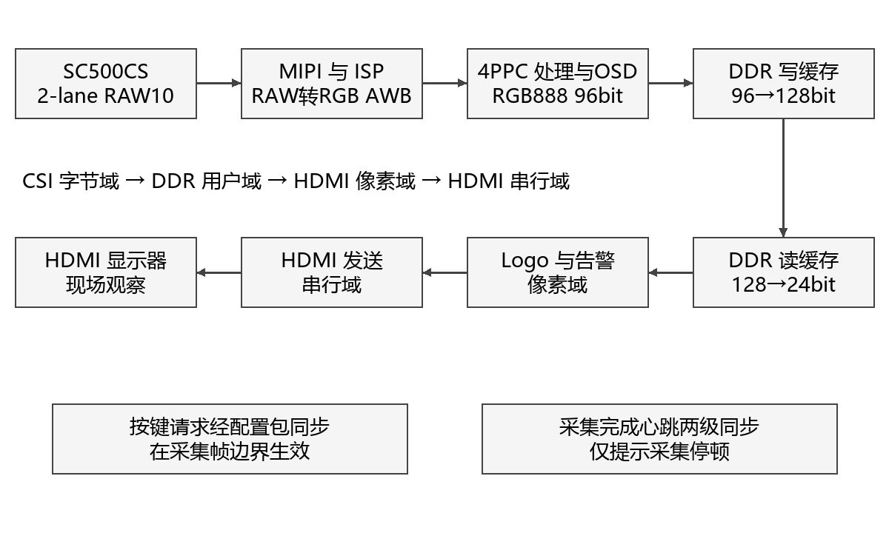
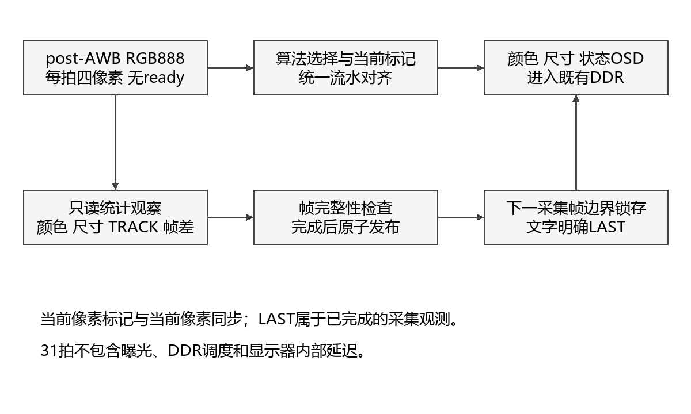
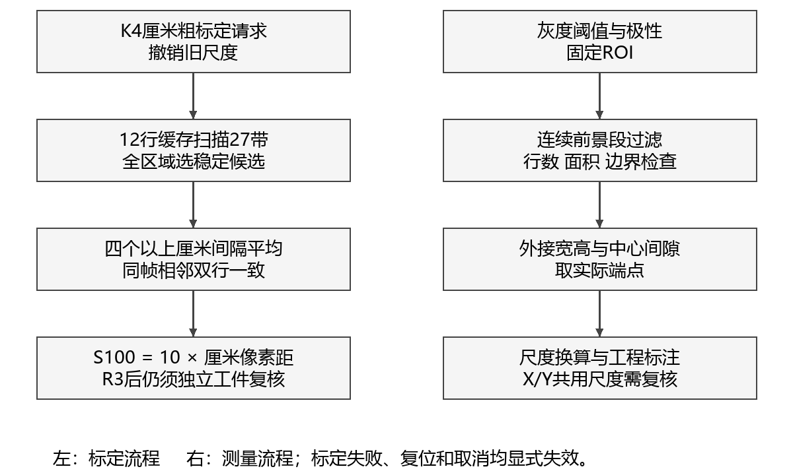
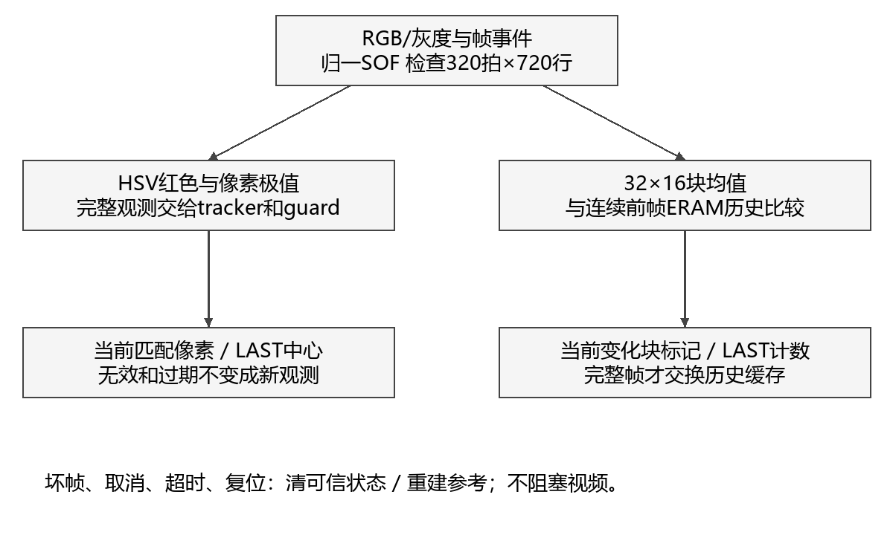

# 基于安路FPGA的实时图像处理与颜色目标检测系统

技术文档第四稿  RULER_CM_CAL_V1候选
工程版本固定于8dd6702  最新候选板测NOT_RUN

### 摘要

本作品以安路PH1P35MDG324和HX1P35A开发板构建固定俯拍视觉检测终端，将SC500CS的MIPI RAW10视频经解包、去马赛克和白平衡后，送入RGB888、96bit、每拍四像素的无反压硬件流水，经DDR缓存与HDMI连续显示。系统保留原图、灰度、二值、边缘和风格化处理，面向薄工件提供双区域RGB一致性筛查、厘米刻线平均粗标定及外接宽高与中心截面间隙标注，并扩展红色像素定位和32×16块均值帧差。设计通过完整帧提交、观测身份与年龄保护、LAST状态说明和随像素缓存限制异常传播，以Logo无损字典与显式ERAM映射缓解资源压力。针对旧方案实拍CAL FAIL/R5，新候选改用至少五条厘米长线的多个间隔与相邻两行平均，保留失效检查及独立尺寸复核。最新候选已归档原生数字回归和完整TD布局布线，Slice占用97.69%，Setup WNS为+0.145ns。历史资料已有基础显示、颜色界面及标定失败反馈；本候选厘米标定成功、测量误差、七模式动态效果、长稳和端到端延迟仍待实测。本文明确区分已观察现象、数字验证与待补指标。

## 第一部分  作品概述

### 1.1 功能与特性

作品面向固定俯拍、可控照明的桌面检测。基础链路完成MIPI采集、FPGA处理、DDR缓存、安路Logo和HDMI显示，七模式通过K3循环切换，K4调整原有阈值或请求标定。应用层比较两个固定区域的RGB，提示原始接近、可能亮度变化或明显差异；读取公制厘米长刻线建立粗尺度，显示薄工件外接宽高与中心间隙。TRACK标记当前红色像素并显示LAST观测，MOTION提示变化块和计数。历史显示与失败反馈已有记录，最新候选应用效果和量化性能待板测。

### 1.2 应用领域

适用于实验台样品颜色一致性筛查、单个薄型零件二维外形复核及机器视觉教学。固定平台使相机姿态、样品平面和照明条件可重复，便于比较测量误差与环境影响。目前尚无计量校准和工业现场验证，应用定位为可复现的嵌入式视觉展示与验证平台。

### 1.3 主要技术特点

四像素统计只读观察视频，不通过ready阻塞输入；有效、行帧标记与像素同深度传播。完整帧后提交统计，界面区分当前像素标记与LAST观测。厘米标定先平均多个间距，再要求同帧相邻两行一致，搜索全区域后选择稳定候选；失败撤销可信尺度。尺寸线采用实际端点。复用既有DDR，使用原生ERAM存储运动历史与Logo字典，并保留源码、回归、布局布线和板测各层证据。

### 1.4 主要性能指标

| 项目 | 候选配置或归档结果 |
| --- | --- |
| 格式与并行度 | 1280×720；RGB888、96bit、4PPC |
| 像素流水 | 31拍；不含DDR和显示器 |
| 布局布线 | Slice20726/21216；ERAM102/108；DSP25/40 |
| 时序 | Setup/Hold WNS +0.145/+0.020ns |
| 实板性能 | 帧率、误差、延迟及长稳未测 |

### 1.5 主要创新点

（1）将颜色比对、标尺尺度与工件端点直接转为画面内可解释读数。

（2）以完整帧、观测身份和年龄控制统计可信度，区分当前标记与LAST信息。

（3）用逐像素等价的Logo字典及显式ERAM，在紧张资源内加入跟踪和帧差。以上为工程组合创新。

### 1.6 设计流程

保留厂商接口基线，先验证采集显示，再接入并行算法与应用；以独立数字模型核对逐像素输出，冻结实际TD输入后完成构建和归档。候选上板先复核旧功能，再做应用量化、异常恢复及长期稳定性测试，最后补齐实物照片和参数表。

## 第二部分  系统组成及功能说明

### 2.1 整体介绍

图1给出当前视频闭环。厂商参考工程负责D-PHY、MIPI、PLL、DDR及HDMI底座；自定义RTL在既有彩色流上实现算法选择、检测统计和OSD。运行时无PC参与核心像素处理，PC仅用于构建、下载和证据整理。

图1 视频闭环与时钟边界示意

| 时钟域 | 约束频率 | 职责 |
| --- | --- | --- |
| CSI字节 | 59.995MHz | 像素处理、统计与写出 |
| DDR用户 | 66.667MHz | 缓存读写调度 |
| HDMI像素 | 75.002MHz | 读出、Logo和告警 |
| HDMI串行 | 375.094MHz | TMDS发送 |
| 外设控制 | 23.810MHz | 按键、相机控制相关逻辑 |

以上来自最终STA约束，非频率计实测。CSI、DDR和HDMI不在同一时钟域，沿用已有FIFO/缓存跨域。统计结果先叠加到CSI域像素流，不逐位异步采样坐标；采集心跳两级同步只用于停顿提示。

### 2.2 硬件系统介绍

#### 2.2.1 硬件整体介绍

系统采用PH1P35MDG324 FPGA、HX1P35A开发板、米联客MLK-CAM001 V1.0 SC500CS模组、DDR缓存和HDMI显示器，配顶部固定相机与可控照明平台。沿用厂商PHY、PLL、DDR及接口参考，未新增其他厂商FPGA。板卡与模组实物版本、镜头、供电和线长需随最终实物清单绑定。

#### 2.2.2 机械设计介绍

用户已确认框架、顶部俯拍、置物平台、遮光与可调照明完成。相机高度和样品平面固定用于降低重复摆放差异；厚件离面、透视、畸变及平台倾斜仍会改变尺度。实际框架尺寸、相机距离、镜头视场、照明布置与安装局部图尚待补充。

待补机械图：整体尺寸与相机/平台关系图、相机安装支架局部图、光源和遮光结构图。上述图需按真实成品绘制或拍摄，不能用概念结构图证明已完成实物，也不能把曾讨论的60cm框架作为当前实测尺寸。

#### 2.2.3 电路各模块介绍

| 模块 | 关键输入输出 | 关系与边界 |
| --- | --- | --- |
| 相机控制 | O_cam_scl / IO_cam_sda O_cam_24m / O_cam_rst | 配置、时钟与复位；AE请求关闭 |
| MIPI接收 | IO_rx_clk_pad_p/n IO_rx_data_pad_p/n[3:0] | 顶层引出4对焊盘；当前相机配置为2-lane，不等于4PPC |
| DDR接口 | ddr_addr[12:0]、ddr_dq[15:0]、dqs/ck等 | 厂商控制器及既有缓存调度；不新增整帧RGB缓存 |
| HDMI发送 | O_tmds_ch0/1/2_p、O_tmds_clk_p | 有效1280×720，总时序1650×750 |
| 控制入口 | I_button[1:0]、I_switch[3:0] | 实体键/拨码映射用屏幕SW和既有资料确认 |

仓库提供HX1P35B_FT_40P_2/3/8原理图；是否与当前HX1P35A实物版次完全对应尚未由本轮确认。最终应补入与板卡一致的MIPI、DDR、HDMI、供电/时钟原理图片段，并标注输入输出和关键网络；当前接口表不是原理图替代品，不据此修改引脚。

一行320个4PPC有效拍，一帧230400拍；RGB有效载荷为2764800字节。行帧总时序下75.002MHz/(1650×750)约60.61Hz，仅说明配置值，实测刷新、采集帧率和独立新帧率须分别记录。DDR重复显示不会成为新的采集观测。

现有提前帧通知与首有效像素不同。新增observer将提前/内联SOF归一到真实有效首拍，核对每行长度与全帧拍数后发布结果；错误行尾、提前新帧和截断使该次观测无效。不得将协议草案中的EOF、abort或缓存代次接口视为主线已普遍提供。

### 2.3 软件系统介绍

#### 2.3.1 软件整体介绍

实时处理由Verilog硬件完成；PC侧负责TD构建、下载和独立参考模型回归，无云端或PC图像算法参与运行时像素处理。源码分为厂商接口底座、ISP流水、颜色/尺寸应用、vision观察器、控制与OSD，以及独立测试与构建脚本。

图2 硬件流水和观察结果发布流程

#### 2.3.2 软件各模块介绍

##### 2.3.2.1 基础算法与模块接口

| 模块 | 实现方法 | 解释边界 |
| --- | --- | --- |
| GRAY/BINARY | Y=(77R+150G+29B+128)>>8；Y≥阈值为白 | 整型定点计算；不是显示器亮度计量 |
| EDGE | 高斯、Sobel、非极大值抑制和有界弱边传播 | 水平成对取样后复制；非1280独立Sobel，也非完整递归Canny |
| STYLE | 局部色彩均值、亮度量化、暗线保护 | 保守风格化；不承诺全局闭合区域填充 |
| AWB | 沿用既有帧统计白平衡 | 无新AE闭环；不等同标准色彩校正 |
| 应用与observer | 颜色/尺寸统计、TRACK、块均值帧差 | 作用于未风格化彩色流；不降低视频吞吐 |

| 模块 | 关键输入 | 关键输出 |
| --- | --- | --- |
| ruler_area_calibration | gray[31:0]、valid/user/last、enable/request_toggle | span[10:0]、calibrated、status[2:0] |
| planar_measure_stats | 4路二值像素、valid/user/last、极性和ROI | sizes/box_coords/gap_coords、有效状态 |
| vision_source_observer | rgb[95:0]、gray[31:0]、valid/user/last | target/motion_mark[3:0]、坐标/计数/帧号、complete_toggle、protocol_error |

##### 2.3.2.2 固定双区域颜色比对

颜色比对将标准样品和待测样品同时置于画面固定区域，在同一完整采集帧分别统计1024个像素的RGB，减少跨帧曝光变化引入的差异。参考区x=304…335、y=304…335；测试区x=944…975、y=304…335，边界均包含。四lane均参与统计，区域未完整采集则不发布有效比较。

| 量或状态 | 含义 | 界限 |
| --- | --- | --- |
| 均值 RGB | 各通道(sum+512)>>10，四舍五入 | 码值依赖sensor、AWB、曝光和照明 |
| ABS、L1、MAX | 逐通道绝对差、差的和、最大通道差 | MAX≤12为当前原始RGB接近阈值 |
| CHR、DV | 归一化通道比例最大差、maxRGB亮度代理差 | 用于解释差异，不是ΔE或照度 |
| 可靠性门槛 | 两区均sumRGB≥96、maxRGB≥32且<254 | 排除过暗和接近饱和；不保证无反光 |
| MATCH | 可靠且原始MAX≤12 | 当前码值相近，不证明标准色度一致 |
| LIGHT | 可靠、原始不匹配、归一化CHR≤6 | 可能受亮度因素影响；不自动等同颜色相同 |
| DIFF、CHECK、WAIT | 明显差异、可靠性不足、数据未完整 | 保留原因，不能统一记为检测失败或成功 |

平均值使单像素噪声影响减弱，固定区域便于现场复现；代价是区域内背景、纹理和高光会改变均值。归一化可提示近似乘性亮度变化，但材质、反射谱、相机响应和真实样品明度也会产生类似现象。系统未引入色度计标定、标准光源光谱、CCM或CIE ΔE计算，文档使用“RGB颜色一致性筛查”，不写“工业色差测量”。

同色同材质样品交换左右区域后是否仍MATCH？仅改变一侧照明时LIGHT和DIFF的比例如何？明显异色、黑白、镜面及饱和样品是否给出合理状态？实验须保存原图、两区均值和状态，报告重复次数与错误类型，不能仅选取一张成功照片。阈值12和6保留源码原值，尚无实拍依据用于重新调参。

##### 2.3.2.3 自动标尺与平面尺寸

在ORIGIN、DIM与CAL条件下短按K4发起标定。AREA标题应为1CM RULER LONG TICKS。搜索区x=256…1023、y=192…479，宽768、高288，复用12行缓存扫描27个重叠带，约需54个采集帧及分析等待。输入必须是水平、清晰、黑色公制厘米长刻线，至少五条长线；尺与工件同平面，背景尽量干净浅色。算法不识别数字或单位[2][3]。

每行灰度对比度至少16，暗阈值取low+(high−low)/4；提取未裁断、宽1…4px的笔画中心，采用加倍坐标保留半像素信息。接受12…120px/cm的连续间距，相对首间距容差约25%+1px，至少四个间隔；先求行内平均，再平均同一完整捕获帧内的相邻两条有效行，两行容差约12.5%+1.2px/cm。全27带搜索结束后优先较大稳定间距，以减少过早选中半厘米线的风险。

| 界面状态 | 含义与边界 | 操作者动作 |
| --- | --- | --- |
| R0 / R1 / R2 | 未标定 / 等待采样 / 分析 | 保持标尺静止，不连续重按K4 |
| R3 / CAL:OK | 周期一致并发布粗尺度，尚非精度证明 | 关闭CAL，独立工件复核，再测尺寸 |
| R4 / R5 | 对比度不足 / 间距未通过 | 留存原图、刻线条件和失败画面 |
| R6 / R7 | 帧几何错误 / 取消 | 检查链路或重试，不能沿用失败候选 |

相邻厘米长线平均d像素，对应10mm，因此旧接口S100=10d像素/100mm，有效范围120…1200。例如d=34px时S100=340，170px工件跨度对应50mm。新请求先撤销旧尺度，复位清尺度，错误帧不接受缓存候选，取消不确认。成功后关闭CAL、保留DIM；屏幕SW通常0101→0100，实体拨码顺序与极性须现场核对[4]。

X/Y共用S100，Y依赖正俯拍和近似等比例成像。本版是粗比例尺，不承诺精密计量；最大稳定间距仍可能误认半厘米、其他周期或背景纹理。R3后必须用独立量具量过的工件分别验证X/Y，并排除约2倍、5倍等尺度错误。0.1mm显示分辨率不是0.1mm准确度。旧密集1mm规则属于历史方案，不作为本版输入要求。

图3 标尺读取与尺寸测量流程示意

测量ROI为x=256…1023、y=160…543，针对单个薄、平、轴对齐并与背景形成灰度对比的工件。连续前景段小于3像素、行内合格像素少于8时过滤；至少3行和64像素才形成有效范围，接触ROI边界视为无效。亮/暗前景由应用开关选择。

宽高取轴对齐外接范围；间隙只在x=640、y=352的固定中心截面上寻找，至少3个中央背景像素。工程尺寸线采用实际外框和间隙端点，配延长线、箭头及透明文字。它不是轮廓拟合、自动圆弧/内外径、任意多孔检测或厚度测量。

以100mm等效像素跨度S100换算像素跨度P，先求0.1mm整数读数q，再显示q/10mm。计算取四舍五入。小数位数只代表显示分辨率，误差仍由像素量化、阈值、标尺、畸变和姿态决定。数值来自最近完成采集帧，工件静置后读数；文字尚无完整避碰。

q = round(1000P / S100)，显示毫米值为q/10。

##### 2.3.2.4 红色目标定位与年龄保护

TRACK直接引用TARGET固定提交ee2edc5中的分类、统计、跟踪和guard四个模块，由MAIN观察适配器提供真实采集身份。九个交付RTL原样保留并记录blob，未把历史独立集成交付中的整套DDR事务方案接入本候选。

| 步骤 | 当前行为 | 可验证语义 |
| --- | --- | --- |
| 分类 | HSV红色中心±30°；chroma≥24；maxRGB≥32 | 仅红色，不宣称蓝色已集成 |
| 空间统计 | 完整帧匹配数≥64形成正观测；统计极值 | 多块红色合并，非独立多目标ID |
| 跟踪 | 3次可靠正观测进入TRACK；缺失15次及超时保护 | 重复结果不增加观测次数，不刷新观测时间 |
| 实时标记 | 当前匹配像素绿青色覆盖 | 标记跟随当前输入像素，不保留旧框 |
| LAST信息 | 最近完整帧包围框中心、像素数及帧号 | 中心非质心；N非目标数量；完整颜色框未显示 |
| 格式 | X/Y三位、N五位、FRAME八位十六进制 | 例如X=280(hex)对应640像素 |

session/frame由采集侧事件建立，HDMI重复显示不能成为独立正观测。observer检查320拍/行与720行，坏行、提前新帧、取消和停止输入使可信状态失效或进入恢复。guard使用64bit CSI域时间计数，6000000周期在名义60MHz下约100ms；这不是精密实测毫秒门槛。未依赖输入继续前进的像素计数代替停止输入超时。

同一次完整观测的文字字段在帧边界锁存，再与相应输出像素一同进入DDR，避免半帧字段更新。文字明确LAST，不承诺该文字的观测身份与当前DDR所显示原图同帧。当前路径未提供全套显示帧事务租约，也未完成严格同帧历史框选择，因此不能将“随像素缓存”描述为端到端检测帧匹配已完成。

固定颜色阈值受AWB、阴影、反光及红色背景干扰；目标多个区域会合并扩大范围。测试应包含单红卡移动、停下、移出后重现、极小红块、红背景及第二个红物体，分别记录误检、漏检、合并和恢复。当前support3默认关闭，未依据实拍修改生产阈值。

##### 2.3.2.5 块均值帧差与采集心跳

MOTION将全图划为32×16像素块，形成40×45、共1800个块。对块内全部512像素求四舍五入的8bit灰度均值，与前一完整连续采集帧的同块均值比较。绝对差≥12为变化块；结果在该块右下角最后四个像素上标洋红色，同帧像素经原DDR显示[6]。

| 状态或结构 | 定义 | 不能推导的结论 |
| --- | --- | --- |
| 双缓冲历史 | 各1800字节，映射4096×8安路双口ERAM | 没有新增整帧RGB缓存 |
| 提交 | 仅完整有效帧交换缓冲角色，要求连续采集ID | 截断帧不作为可信历史 |
| WARMUP / INVALID | 历史未建立 / 帧错误、取消或超时 | 不能把无参考时的0变化当成静止 |
| LAST CHANGED | 最近完整采集帧变化块数 | 计数单位是块，不是运动物体 |
| STILL / MOTION | 变化块少于3 / 至少3 | STILL可能仍有1—2个变化块 |
| GLOBAL | 超过75%块发生变化 | 不能区分灯变、相机移动和大物体 |
| 当前洋红标记 | 变化块末拍四像素提示 | 不是运动目标轮廓或完整区域填充 |

复位、丢行、帧中断、非连续身份或观测过期时清除运动历史，重新WARMUP。只有完整帧可以成为下一次参考，避免半帧写入破坏旧参考后仍产生“有效”运动结果。两组缓存分开读写，原生ERAM模型验证同步读语义；仿真不能代替板上供电、温度和CDC验证。

块平均减少存储量和噪声敏感性，适合固定相机观察较明显移动。小目标只占少量块内像素时可能被稀释；块内明暗变化相互抵消、慢速位移或纹理相近会漏检。全局亮度变化会触发大量块，不以GLOBAL告警宣称已识别光照原因。

采集完整帧产生1bit翻转心跳，经HDMI域两级同步。无新心跳达到15000000个像素周期后显示VIDEO STALE，名义75MHz下约200ms，启动/复位也视为过期。它检测采集完成是否停顿；若DDR重复旧帧但采集继续，心跳仍可能正常，故该告警不能证明显示新鲜度，也不是采集至HDMI延迟测量。

图4 目标和运动观察流程及可信状态边界

##### 2.3.2.6 操作 配置与异常恢复

| 入口 | 操作 | 结果与边界 |
| --- | --- | --- |
| K3 | 循环按键 | EDGE→ORIGIN→GRAY→BINARY→STYLE →TRACK→MOTION→EDGE |
| K4常规 | 短按−10，长按+10 | 只调整EDGE或BINARY当前阈值；默认80/130 |
| K4标定 | ORIGIN、DIM、CAL条件下短按 | 发起厘米长线搜索；新请求撤销旧尺度 |
| 应用控制位 | 颜色、尺寸、亮暗前景、CAL | 尺寸优先于颜色；实体拨码极性以现场SW读数核对 |
| 配置包 | 模式3bit、边缘8bit、二值8bit | 19bit原子配置，经同步后在采集帧边界生效 |
| 阈值边界 | TRACK与MOTION固定判据 | K4不修改这两个模式的检测阈值 |

宽RGB延迟负载去除无必要复位，以便推断原生延迟存储；valid、行帧标记和配置保持复位并同深度对齐。无效拍RGB不承诺数值，首个有效拍必须完整经过自身流水，不能依赖上电RAM内容。已有测试覆盖复位后立即有效、行中复位、提前/内联SOF与valid间隙。

| 故障输入 | 应见结果 | 失败条件 |
| --- | --- | --- |
| 帧中再来SOF、错误EOL、截断 | 该帧不提交可信统计；状态复位/重建 | 坏帧被当成完整正观测或污染运动参考 |
| 结果重复、乱序 | 不增加独立观测；身份异常受控 | 相同结果反复使TRACK确认或延长年龄 |
| 长时间停止可靠帧 | guard失效；心跳超时；恢复先建参考 | 历史结果无限保持为当前可信状态 |
| 复位中在途数据 | valid先清，输出重新对齐 | 旧RGB/字段被误标有效，或恢复后永久冻结 |
| DDR重复/跳帧 | 按真实现象记录，不伪装新观测 | 仅凭HDMI刷新计数宣称检测更新正常 |

既有DDR、FIFO/Gray约束与复位风险仍待MAIN核查及板测；历史独立接口方案不代表已集成。

##### 2.3.2.7 初始方案与当前实现

硬件平台、采集显示、硬件流水、灰度/二值/边缘、按键阈值和OSD主线保持一致。为服务固定台检测，新增双区颜色比对、自动标尺、平面尺寸及块均值运动检测。初版YCbCr分割调整为当前HSV红色判据；蓝色目标检测未作为本候选已完成功能。初版“上一帧包围框”在当前TRACK仅体现为LAST框中心与计数，完整颜色框尚未接入；尺寸外框属于独立测量功能。文档和演示须直述这些差异，不能以新增功能替代原承诺的说明。

## 第三部分  完成情况及性能参数

### 3.1 整体介绍

当前工程基线为RULER_CM_CAL_V1，HEAD 8dd6702，实际TD输入9d1eff3。完整数字回归、布局布线与bit已经归档；本候选Board Test仍为NOT_RUN。以下将用户确认、仓库历史拍屏文字反馈与本候选数字验证分别列出，不把旧版静态界面或失败现象升级为新版成功。

待补整机实物正面全景与斜45°全景：同场看到框架、相机、平台、光源、板卡和显示器，并记录拍摄版本。用户此前提供的是相机/排线实物资料及结构示意，尚不能替代官方模板所需的完整成品照片。

### 3.2 工程成果

#### 3.2.1 机械成果

用户已确认框架、顶部俯拍、置物平台、遮光和可调照明完成。实际尺寸、相机工作距离、安装垂直度、照明均匀性与完整成品照片尚缺；曾讨论的60cm框架与15…30cm排线采购不能直接填成最终实测配置。

#### 3.2.2 电路成果

用户提供了米联客MLK-CAM001 V1.0相机、FFC排线与板端MIPI口实物照片，支持已选模组与连接形式的说明。尚缺供电/HDMI/板卡全貌及其与当前bit绑定记录，也未核实HX1P35A实物与仓库B版原理图的对应关系。未发现可宣称完成的自制PCB成果。为避免将局部照片误作整机验收，本稿不以它替代全景或当前显示图。

#### 3.2.3 软件成果：已有实物现象

历史资料并非全部“未测”。下表记录真实反馈的最小结论，同时给出不能推出的结果；原始拍屏部分因有人物反射未入库，当前只能引用仓库文字转录[8][9]，不擅自上传这些照片。

| 来源与阶段 | 已有实验现象 | 结论限制 |
| --- | --- | --- |
| 用户直接确认 | 基础出图、五模式、Logo和部分操作完成；固定平台完成 | 无当前bit SHA绑定，非本版七模式验收 |
| 10月调试记录 | 增益分档时同场景逐步变亮；EDGE出图，弱光边缘不足 | 仅短时主观反馈，无照度/噪声/长稳量测 |
| 10月30日V1反馈 | REF/TEST/ABS界面可见，两区RGB约22/20/19与20/18/17，BLACK/BLACK | 证明读数界面出现，不证明颜色判别准确 |
| 同次尺寸与开关 | X/Y CAL及SPAN0256可见；DIM框/十字、W/H与GAP横线、NO VALID OBJECT；第四路切换无明显变化 | 旧手动CAL:OK不证明真实100mm标定；无有效尺寸；显隐/极性未验明 |
| 后续V2/V3反馈 | 透明尺CAL FAIL；大采样框混入背景；小32×32框可见，同黄纸左右RGB仍不同 | 仅局部现象，不能唯一归因照明，也无误判率 |
| 近期未绑定bit拍屏 | 1MM / R5 / CAL FAIL | R5为间距未通过，非R6帧错误；不能锁定历史tag或证明单一光学原因 |

最新1CM标题、R3/CAL:OK后的粗尺度、真实W/H/GAP、七模式动态与长期稳定尚无本版实物记录。这些缺口不能用旧CAL:OK、合成图或数字PASS补填。

### 3.3 特性成果

#### 3.3.1 赛题对应与完成程度

按选题指南第16—18物理页组织验收[1]。下表的“已实现”指固定源码及数字/构建证据，不能替代最新候选实板验收。

| 赛题项目 | 本候选对应实现 | 尚缺的验收证据 |
| --- | --- | --- |
| 基础 采集与显示 | MIPI→ISP→DDR→HDMI；既有平台沿用 | 最新bit连续画面、实际刷新与缓存状态 |
| 基础 图像处理 | 灰度、二值、边缘及STYLE | 实拍效果、阈值操作、光照变化 |
| 基础 OSD与Logo | 状态、应用读数、安路Logo | 现场可读性及七模式可见性 |
| 基础 长期稳定 | 复位/错误/超时数字测试；STA归档 | 30分钟或更长录像、花屏/冻结与溢出记录 |
| 扩展 风格化及检测 | STYLE、颜色比对、平面尺寸、红色定位 | 真实样品区分率、误差与边界失败 |
| 进阶 多算法切换 | 七模式、去抖、帧边界配置 | 实体操作、切换连续性 |
| 进阶 跟踪与坐标 | 红色像素标记、LAST框中心/计数 | 移动、消失重现、杂红干扰与年龄表现 |
| 进阶 帧差运动 | 全像素块均值帧差、变化块提示 | 静置误报、移动检出、灯变GLOBAL |
| 进阶 延迟可视化 | 有帧计数及采集心跳告警 | 同一帧采集至HDMI计时尚未集成完成 |
| 进阶 图像自动调节 | 沿用既有AWB；AE请求关闭 | 白平衡适应性实测；不宣称自动曝光 |

表中的待补项指本版验收；历史基础画面与界面出现的证据见3.2.3。延迟可视化、自动曝光、完整颜色包围框与蓝色目标不作为当前已完成能力。模板第三部分仍缺成品照片、实测数据和仪器方法，当前稿用于工程审阅。

#### 3.3.2 资源 时序与优化证据

| 整机最终P&R | VISION基线 | 厘米候选 | 增量 |
| --- | --- | --- | --- |
| Slice / 21216 | 20694 | 20726（97.69%） | +32 |
| LUT6 | 19497 | 19445 | −52 |
| FF / 42432 | 20285 | 20230 | −55 |
| ERAM20K / 108 | 102 | 102 | 0 |
| DSP / 40 | 27 | 25 | −2 |
| Setup WNS / ns | +0.106 | +0.145 | +0.039 |
| Hold WNS / ns | +0.020 | +0.020 | 0 |

本版Setup/Hold TNS均为0，HDMI域Setup WNS为+0.145ns，CSI域为+0.221ns，STA覆盖率95.66%；仅剩490 Slice及6 ERAM。最终报告保留PHY-5060/5079时钟相关warning及PHY-7022密度提示。正WNS只覆盖既有约束，不能证明所有CDC/Gray约束或板上环境均无风险[3][5]。

历史Logo字典将原ROM改为16384×10索引加1024×25调色板，逐像素等价；独立综合Slice 21761→19849只是检查点，不能当作整机P&R。VISION开发期还保留了分布式运动缓存超容量的失败综合，最终采用显式ERAM及负载复位优化。本次厘米候选在该基线上仅修改读尺规则与AREA标题，其余82个实际TD输入不变；没有放宽SDC。不能把历史优化估算、早期失败综合与本版最终P&R混算。

#### 3.3.3 数字验证结果与适用边界

下表为固定工程已经归档的结果，本次撰稿复核结果JSON、报告及源码清单，未重新运行RTL、TD或板测。测试输入为数字构造，不包含镜头、真实Sensor、照明及显示器。原生仿真使用安路ERAM/GSR模型；独立模型另断言S100=10×构造厘米像素距，避免单位错误只在模型与RTL之间相互复现。

| 归档验证 | 规模与结果 | 适用边界 |
| --- | --- | --- |
| 厘米读尺单元 | 19项；3992831周期 | 12…120px/cm、非整数距、混合刻线、边界、错误帧/取消/复位 |
| 默认全区域读尺 | 27443319周期；S100=500 | 1280×720、768×288、完整27带；上/下位置，独立读尺实例 |
| ISP旧功能/新标尺 | 9帧720p；2073600有效拍、1555200打包字一致 | 实际ISP/ERAM/GSR/OSD/标注/打包；读尺搜索高度限定12，非全288区域整机仿真 |
| TRACK/MOTION | 8帧720p；1843200拍、1382400字一致 | 红块移动/静置/移出及帧差、字形与标记 |
| 控制及继承回归 | 按键/CDC/心跳/复位门禁归档 | 实体键、真实断流和DDR电气不在数字模型内 |
| Logo与源码冻结 | 历史Logo等价证据；84个实际TD输入可追溯 | 本次仅2个正式HDL变化，不能把历史独立综合写作本版P&R |

两组视频回归共17帧、3916800有效4PPC拍、2937600打包字。全区域读尺单测与搜索高度12的整机仿真互相补充，不能写成“全区域整机仿真”。通过既定数字输入不证明真实读尺成功、持续60fps、尺寸精度或30分钟无花屏。

重复/乱序frame、session重启、提前SOF、错误EOL、缺EOF、尾拍目标与非完整尾拍、结果晚到/缺失、DDR槽复用、显示重复/跳帧、CDC复位在途数据及框文字混观测，应按独立输入和失效条件继续审计。当前1280宽恰为4的整数倍，不支持尾lane屏蔽的新格式；格式变化必须先变更接口和验证。现有observer/guard单元覆盖不等于全DDR事务故障已验收。

#### 3.3.4 仍缺的实测与最优先实验

先核对bit SHA，按既有PROGRAM_SRAM流程加载RULER_CM_CAL_V1；当前AREA应出现1CM RULER LONG TICKS。1MM意味着尚未进入新AREA候选显示口径，但界面标题本身也不能替代文件SHA校验。回滚对照为VISION，条件保持不变。

| 优先级与实验 | 需要新增的现象/数据 | 已有程度 |
| --- | --- | --- |
| P0 E00/E01 | 全景与版本；启动1分钟、七模式/Logo/阈值、动作连续性 | 实物与旧五模式有确认，新版待测 |
| P0 E04 | 至少五条厘米长线；K4→R状态序列→CAL:OK；请求/成功次数、耗时和失败条件 | 只有旧CAL FAIL/R5，厘米成功未见 |
| P0 E05 | 独立量具真值；分轴宽高与中心间隙；中心/边缘重复；排除2倍/5倍比例错误 | 旧界面无有效工件，真实读数和误差未测 |
| P0 E02 | 连续30分钟起步；明暗/切换；冻结花屏/回跳次数、FRAME/ERR/B/S增量与恢复 | 无完整长稳记录，30分钟为内部建议 |
| P1 E03/E09 | 同色交换、异色、单侧照明、暗/饱和；RGB/状态分布与画质对照 | 已有读数与同纸左右差异，无成组统计 |
| P1 E06/E07/E08 | 红卡移动/消失重现；静止/移动/灯变；受控复位与停顿恢复 | 数字测试已有，当前动态实物记录未见 |
| P2 E10 | 实际刷新/新采集帧率、高速录像光学延迟或可信内部同帧计时 | 均未测，内部同帧计时路径未完成 |

E00…E10的输入、独立预期、失败条件和回填字段见同目录附件《主控实验清单》；证据有无与版本限制见《实验现象盘点》。所有建议次数与时长均为团队实验设计，不冒充官方固定门槛。失败、无效与未测分开记录，不将未知内部计数填0。

建议至少3种真值尺寸，每种在中心及边缘位置各重复5次，保持同一标定与样品平面；水平、垂直分开统计。记录有符号误差e=读数−真值、绝对误差最大值、平均绝对误差及重复性范围，并写明量具分辨率。标定成功率另计成功次数/请求次数；失败样本不得删除。该方案为待执行建议，尚无实测数值。

高速录像同时拍摄物体事件和屏幕响应得到光学端到端估计，包含曝光、显示器与录像帧量化误差。内部采集首有效像素至同帧HDMI首有效像素需可信身份、统一时基和事件匹配；当前未完成该整机路径。两者不同，不使用31拍流水或FRAME计数差代替测量。

#### 3.3.5 版本身份与复现

| 身份 | 固定值 |
| --- | --- |
| 工程候选 | RULER_CM_CAL_V1；PR #27，Draft，依赖VISION候选，未合并 |
| 审阅工程HEAD | 8dd67021a9f667047bad150125d2e17dd7a33c2a |
| 实际TD输入 | 9d1eff3e1e88861bfac317c6064c51062282aa4d |
| 归档 / tag | 67204bf5f0a2caae1b5b657bb3b684799deb4ec8 / ruler-cm-cal-v1-candidate |
| bit目录 | artifacts/bitstreams/RULER_CM_CAL_V1/；camera_to_dsi_display.bit，1789539 bytes |
| bit SHA-256 | 6372f765f61ec31d8a18923596c8326ce 84a0fd7637850847d5ac364cc3aebc2 |
| 回滚VISION SHA | f3dfd9f1ad42bbca95199ac128b9d4808 327d4482a1465019ce85a678c0b63a0 |
| 板测状态 | NOT_RUN；历史现象不改写本候选状态，不签发最终板测tag |

复现先检出固定tag，核对BUILD_INFO、bit SHA及实际TD输入清单，再按归档工具版本与工程入口执行SYN→PHY→最终STA→bitgen，保留原始日志和warning。数字回归分别复用unit、full_roi、stream_r1、features与controls的归档命令，不能用替代primitive改变原生模型语义。本文仅复核既有证据，没有本轮重建或板测。

本稿在PR #26的文档分支增量提交，保留第二稿与官方模板第三稿。正式登记作品名保持不变；五部分模板结构、原页面几何、页眉页脚及原样式保留，表格与结构图等排版增补记录于TEMPLATE_COMPARISON.md。不得将本稿审阅状态写成比赛最终验收通过。

## 第四部分  总结

### 4.1 可扩展之处

优先完成厘米粗标定成功率、独立尺寸复核、颜色边界、七模式和长稳验收，排除倍数尺度错误，核查FIFO/CDC和温度余量。随后补齐显示帧身份与延迟事件。双轴独立标定、畸变校正、标准色彩测量、候选分离或CNN均需实测需求和资源依据，不在本候选中宣称完成。

### 4.2 心得体会

视频工程需要先建立完整闭环，再讨论算法效果。四像素并行、无ready输入、行帧对齐、跨域和缓存使“最新统计”与“当前显示帧”具有不同含义。本项目以完整帧提交、LAST说明、年龄保护和异常恢复限制错误传播，但严格同帧历史框与内部延迟测量仍未完成。

真实失败反馈改变了本轮技术取舍。旧密集毫米刻线在拍屏中出现R5，用户接受大致比例后，新方案改用厘米长线的多间隔与双行平均。该改变降低了输入刻线要求，并不自动保证真实读尺成功；规律纹理或半厘米周期仍可造成倍数误认，必须保留失败样本并用独立工件检查。用R3状态代替尺寸准确度，会使文档失去可验证性。

资源优化也需要同口径证据。Logo与运动历史通过ERAM换取逻辑空间；厘米候选相对VISION增加32 Slice，同时减少52 LUT6、55 FF和2 DSP，ERAM不变。当前剩余490 Slice和6 ERAM，正WNS也只在约束覆盖范围内成立，不能据此宣称资源充裕或现场零故障。

历史资料已经证明部分界面可见，也暴露颜色左右差异、旧标定失败和开关现象未解释的问题。下一步应把这些现象转成版本绑定、条件固定、真值独立的成组实验，补齐新标定、误差、动态性及长期稳定的数据，再由负责人确认最终材料。

## 第五部分  参考文献

[1] 上海安路信息科技股份有限公司. 2026 FPGA创新设计赛道选题指南[Z]. 2026: 物理页16-18. 仓库docs/赛题原PDF.

[2] AnlogicTrack2项目组. RULER_CM_CAL_V1设计说明[EB/OL]. [2026-11-02]. https://github.com/Philid14/anlogic-ph1p35-image-processing/blob/8dd67021a9f667047bad150125d2e17dd7a33c2a/docs/RULER_CM_CAL_V1_DESIGN.md.

[3] AnlogicTrack2项目组. RULER_CM_CAL_V1构建与验证报告[EB/OL]. [2026-11-02]. https://github.com/Philid14/anlogic-ph1p35-image-processing/blob/8dd67021a9f667047bad150125d2e17dd7a33c2a/docs/RULER_CM_CAL_V1_REPORT.md.

[4] AnlogicTrack2项目组. RULER_CM_CAL_V1板测方案[EB/OL]. [2026-11-02]. https://github.com/Philid14/anlogic-ph1p35-image-processing/blob/8dd67021a9f667047bad150125d2e17dd7a33c2a/docs/RULER_CM_CAL_V1_BOARD_TEST.md.

[5] AnlogicTrack2项目组. RULER_CM_CAL_V1构建信息及原始证据[DS/OL]. [2026-11-02]. https://github.com/Philid14/anlogic-ph1p35-image-processing/blob/8dd67021a9f667047bad150125d2e17dd7a33c2a/artifacts/bitstreams/RULER_CM_CAL_V1/BUILD_INFO.json.

[6] AnlogicTrack2项目组. VISION_TRACK_MOTION_V1设计说明[EB/OL]. [2026-11-02]. https://github.com/Philid14/anlogic-ph1p35-image-processing/blob/8dd67021a9f667047bad150125d2e17dd7a33c2a/docs/VISION_TRACK_MOTION_V1_DESIGN.md.

[7] AnlogicTrack2项目组. COLOR_COMPARE_V1设计说明[EB/OL]. [2026-11-02]. https://github.com/Philid14/anlogic-ph1p35-image-processing/blob/8dd67021a9f667047bad150125d2e17dd7a33c2a/docs/COLOR_COMPARE_V1_DESIGN.md.

[8] AnlogicTrack2项目组. INSPECTION_UI_DIMENSION_V1实板反馈转录[EB/OL]. [2026-11-02]. https://github.com/Philid14/anlogic-ph1p35-image-processing/blob/8dd67021a9f667047bad150125d2e17dd7a33c2a/docs/INSPECTION_UI_DIMENSION_V1_BOARD_FEEDBACK_2026-10-30.md.

[9] AnlogicTrack2项目组. 图像调试及历史反馈日志[EB/OL]. [2026-11-02]. https://github.com/Philid14/anlogic-ph1p35-image-processing/blob/8dd67021a9f667047bad150125d2e17dd7a33c2a/docs/IMAGE_TUNING_LOG.md.

[10] AnlogicTrack2项目组. TARGET颜色检测与年龄保护源码[CP/OL]. [2026-11-02]. https://github.com/Philid14/anlogic-ph1p35-image-processing/blob/ee2edc581877e6a0c7f85073f04e9b7d79277c1b/features/color_target/.

[11] 竞赛技术文档模板[Z]. 用户提供的官方DOCX原件; SHA-256 d15a2aa186f600cb9c234bffd9deff0c4e9b05c569643d8a81d536f66f424f0c.
