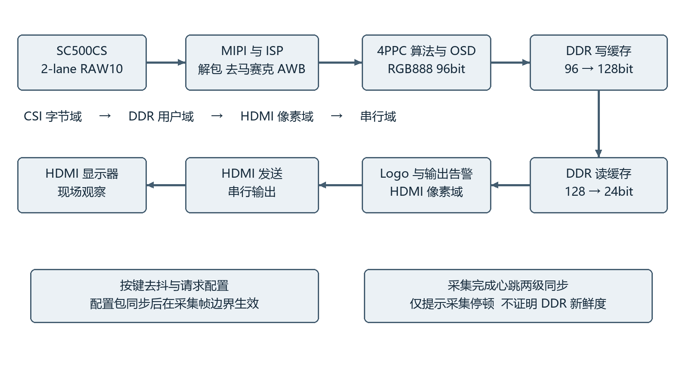
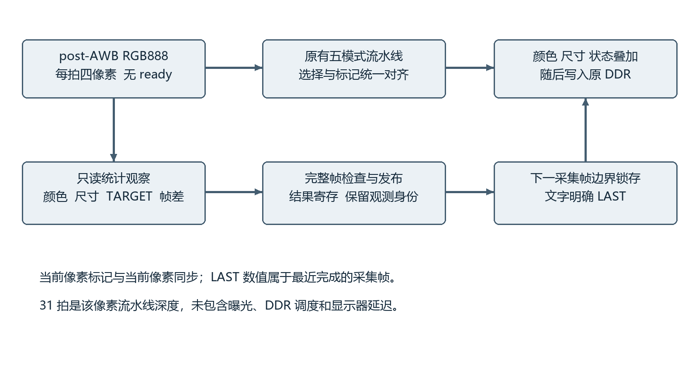

2026 FPGA 创新设计赛道  上海安路选题二

基于安路FPGA的
实时图像处理与颜色目标检测系统

技术报告  第二版审阅稿

以固定平台颜色比对与薄工件二维尺寸测量为应用主体
扩展红色目标定位与块均值帧差检测

| 编制信息 | 范围与状态 |
| --- | --- |
| 文档日期 | 2026年11月1日 |
| 工程基线 | VISION_TRACK_MOTION_V1 候选；PR #24，未合并 |
| 证据状态 | RTL、数字回归与完整 TD 构建已有归档；本候选 Board NOT_RUN |
| 身份说明 | 沿用已登记作品名称；本文说明初始方案向当前实现的演进，不修改已锁定简介 |

### 摘要

本作品以安路PH1P35MDG324和HX1P35A开发板构建固定式视觉检测终端，将SC500CS的MIPI RAW10视频经解包、去马赛克及白平衡处理后，送入RGB888、96bit、每拍四像素的硬件流水线，复用DDR视频缓存并通过HDMI连续输出。系统提供原图、灰度、二值、边缘和风格化模式，以双区域RGB统计比较样品颜色，在固定俯拍场景下通过1mm刻线标尺建立像素尺度，对薄工件外接宽高与中心截面间隙作原位尺寸标注；新增红色目标像素定位及32×16块均值帧差检测，给出最近完整采集帧的坐标、计数与运动状态。设计以无反压观察、完整帧提交、过期失效和结果随像素缓存控制异常传播，并以Logo无损字典映射及显式ERAM降低逻辑压力。最新候选通过17帧720p独立参考模型逐像素回归和完整TD综合、布局布线、最终时序及bit生成，Slice占用97.54%，Setup WNS为+0.106ns。当前实板验收、测量误差、长稳运行与端到端延迟仍待补充，本文分别给出实现证据、适用边界和可复现实验方法。

关键词  安路FPGA  流式图像处理  颜色比对  平面尺寸  目标定位  帧差检测

---

## 第一部分 作品概述

### 1.1 功能与特性

作品面向固定俯拍、可控照明的桌面视觉检测。基础链路完成MIPI采集、FPGA处理、DDR缓存、安路Logo及HDMI显示；K3循环选择七种模式，K4调整原有边缘或二值阈值。应用层比较两固定区域的平均RGB，区分原始接近、可能亮度变化和明显差异；通过标尺标定显示薄工件宽高与中心截面间隙。TRACK对主要红色目标作像素标记并显示历史观测坐标，MOTION显示变化块与计数。功能已进入最新构建候选，整机实测结论待录入。

### 1.2 应用领域

适用于实验台样品颜色一致性筛查、单个薄型零件二维外形复核及机器视觉教学。固定平台使相机姿态、样品平面和照明条件可重复，便于比较测量误差与环境影响。目前尚无计量校准和工业现场验证，应用定位为可复现的嵌入式视觉展示与验证平台。

### 1.3 主要技术特点

核心计算部署于FPGA。四像素并行统计在观察视频的同时完成，不通过ready阻塞输入；有效、行帧标记与像素沿同深度流水传播。完整帧后才提交统计，界面区分当前像素标记与LAST观测。尺寸标注直接使用测得端点；自动标定需同帧可信刻线一致。复用既有DDR路径，不新增整帧RGB缓存，并用原生ERAM存储运动历史与Logo字典。

### 1.4 主要性能指标

格式1280×720；算法口96bit、4PPC；像素流水31拍。完整P&R：Slice 20694/21216，ERAM 102/108，DSP 27/40，Setup/Hold WNS +0.106/+0.020ns。输出约60Hz为配置目标，实测帧率、测量误差及端到端延迟未测。

### 1.5 主要创新点

一是将颜色、标尺尺度和尺寸端点直接转为画面内可解释读数；二是以帧完整性、观测身份和年龄控制统计可信度；三是通过Logo逐像素等价的ERAM字典与运动历史映射，在紧张资源内加入两项扩展，并保留失败构建和原始证据。以上为工程组合创新，不主张基础算法原创。

### 1.6 设计流程

保留厂商接口基线，先验证采集显示，再接入并行算法与应用；以独立数字模型核对逐像素输出，冻结实际TD输入后完成构建和归档。候选上板先复核旧功能，再做应用量化、异常恢复及长期稳定性测试，最后补齐实物照片和参数表。

---

### 1.7 赛题要求与证据状态

按选题指南第16—18物理页组织验收[1]。下表的“已实现”指固定源码及数字/构建证据，不能替代最新候选实板验收。

| 赛题项目 | 本候选对应实现 | 尚缺的验收证据 |
| --- | --- | --- |
| 基础 采集与显示 | MIPI→ISP→DDR→HDMI；既有平台沿用 | 最新bit连续画面、实际刷新与缓存状态 |
| 基础 图像处理 | 灰度、二值、边缘及STYLE | 实拍效果、阈值操作、光照变化 |
| 基础 OSD与Logo | 状态、应用读数、安路Logo | 现场可读性及七模式可见性 |
| 基础 长期稳定 | 复位/错误/超时数字测试；STA归档 | 30分钟或更长录像、花屏/冻结与溢出记录 |
| 扩展 风格化及检测 | STYLE、颜色比对、平面尺寸、红色定位 | 真实样品区分率、误差与边界失败 |
| 进阶 多算法切换 | 七模式、去抖、帧边界配置 | 实体操作、切换连续性 |
| 进阶 跟踪与坐标 | 红色像素标记、LAST框中心/计数 | 移动、消失重现、杂红干扰与年龄表现 |
| 进阶 帧差运动 | 全像素块均值帧差、变化块提示 | 静置误报、移动检出、灯变GLOBAL |
| 进阶 延迟可视化 | 有帧计数及采集心跳告警 | 同一帧采集至HDMI计时尚未集成完成 |
| 进阶 图像自动调节 | 沿用既有AWB；AE请求关闭 | 白平衡适应性实测；不宣称自动曝光 |

### 1.8 与已登记初版方案的关系

硬件平台、采集显示、硬件流水、灰度/二值/边缘、按键阈值和OSD主线保持一致。为服务固定台检测，新增双区颜色比对、自动标尺、平面尺寸及块均值运动检测。初版YCbCr分割调整为当前HSV红色判据；蓝色目标检测未作为本候选已完成功能。初版“上一帧包围框”在当前TRACK仅体现为LAST框中心与计数，完整颜色框尚未接入；尺寸外框属于独立测量功能。文档和演示须直述这些差异，不能以新增功能替代原承诺的说明。

---

## 第二部分 系统组成及功能说明

### 2.1 整体介绍

图1给出当前视频闭环。厂商参考工程负责D-PHY、MIPI、PLL、DDR及HDMI底座；自定义RTL在既有彩色流上实现算法选择、检测统计和OSD。运行时无PC参与核心像素处理，PC仅用于构建、下载和证据整理。

图1 视频链路与主要时钟边界结构示意  不是实物接线图

| 时钟域 | 最终报告约束频率 | 主要职责 |
| --- | --- | --- |
| CSI字节域 | 59.995MHz | RAW与RGB处理、统计、像素写出 |
| DDR用户域 | 66.667MHz | 读写调度与缓存传输 |
| HDMI像素域 | 75.002MHz | 像素读出、Logo、输出告警 |
| HDMI串行域 | 375.094MHz | HDMI发送 |
| 外设控制域 | 23.810MHz | 按键、控制、相机时钟相关逻辑 |

频率来自本候选最终时序报告，是约束口径而非频率计实测值。异步视频通过已有FIFO与缓存路径跨域。新统计先烧入CSI域像素，不把多个坐标位分别跨域采样。不能由STA通过推导所有CDC与Gray指针物理约束均已验证。

---

### 2.2 硬件系统介绍

#### 2.2.1 硬件整体与机械平台

核心器件为安路PH1P35MDG324，使用HX1P35A开发板、SC500CS模组与HDMI显示器。实物模组丝印为米联客MLK-CAM001 V1.0；接口和供电沿现有连接及原理图，不以普通SC500CS商品名推断引脚。用户已确认框架、顶部俯拍、置物平台、遮光与可调照明完成。框架精确尺寸、相机工作距离、镜头视场、光源参数和实际线长仍需录入实物清单。

建议将相机与标定面固定，测量时避免厚件引起的离面放大率差异。支架刚性、平台平整度与光照均匀性会影响边缘和刻线检测，须用实拍与量具检验。当前尚缺整机实物照片，本文结构图仅说明功能，不用概念效果图充当已完成实物。

#### 2.2.2 电路与模块连接

| 链路 | 格式与约束 | 核对入口 |
| --- | --- | --- |
| 摄像头到FPGA | 2-lane MIPI RAW10；原sensor寄存器保留 | design_top_wrapper、MIPI IP与sensor配置 |
| 彩色观察流 | RGB888；96bit；4PPC；无ready | ISP post-AWB观察点 |
| DDR写入 | 96→128打包；一帧172800个128bit字 | video_in与打包逻辑 |
| DDR读出 | 原有多帧地址区；读出转单像素 | video_out及FIFO |
| HDMI输出 | 有效1280×720；总时序1650×750 | design_top_wrapper第737—741行及输出模块 |

#### 2.2.3 吞吐与帧事件

一行320个4PPC有效拍，一帧230400拍；RGB有效载荷为2764800字节。行帧总时序下75.002MHz/(1650×750)约60.61Hz，仅说明配置值，实测刷新、采集帧率和独立新帧率须分别记录。DDR重复显示不会成为新的采集观测。

现有提前帧通知与首有效像素不同。新增observer将提前/内联SOF归一到真实有效首拍，核对每行长度与全帧拍数后发布结果；错误行尾、提前新帧和截断使该次观测无效。不得将协议草案中的EOF、abort或缓存代次接口视为主线已普遍提供。

---

### 2.3 RTL系统与基础算法

#### 2.3.1 软件整体与流水结构

工程“软件”包括Verilog模块、约束、测试模型和构建脚本；实时算法在FPGA内执行。彩色像素并行送往五模式链和只读观察器，新模式选择原图加匹配标记，颜色/尺寸层及状态层继续同深度对齐，总深度为31拍[2]。这不是采集到屏幕的总延迟。

图2 并行观察与结果提交结构示意  LAST并非当前显示帧结果

#### 2.3.2 各模块算法与边界

| 模块 | 实现方法 | 解释边界 |
| --- | --- | --- |
| GRAY/BINARY | Y=(77R+150G+29B+128)>>8；Y≥阈值为白 | 整型定点计算；不是显示器亮度计量 |
| EDGE | 高斯、Sobel、非极大值抑制和有界弱边传播 | 水平成对取样后复制；非1280独立Sobel，也非完整递归Canny |
| STYLE | 局部色彩均值、亮度量化、暗线保护 | 保守风格化；不承诺全局闭合区域填充 |
| AWB | 沿用既有帧统计白平衡 | 无新AE闭环；不等同标准色彩校正 |
| 应用与observer | 颜色/尺寸统计、TRACK、块均值帧差 | 作用于未风格化彩色流；不降低视频吞吐 |

---

### 2.4 固定双区域颜色比对

颜色比对将标准样品和待测样品同时置于画面固定区域，在同一完整采集帧分别统计1024个像素的RGB，减少跨帧曝光变化引入的差异。参考区x=304…335、y=304…335；测试区x=944…975、y=304…335，边界均包含。四lane均参与统计，区域未完整采集则不发布有效比较。

| 量或状态 | 含义 | 界限 |
| --- | --- | --- |
| 均值 RGB | 各通道(sum+512)>>10，四舍五入 | 码值依赖sensor、AWB、曝光和照明 |
| ABS、L1、MAX | 逐通道绝对差、差的和、最大通道差 | MAX≤12为当前原始RGB接近阈值 |
| CHR、DV | 归一化通道比例最大差、maxRGB亮度代理差 | 用于解释差异，不是ΔE或照度 |
| 可靠性门槛 | 两区均sumRGB≥96、maxRGB≥32且<254 | 排除过暗和接近饱和；不保证无反光 |
| MATCH | 可靠且原始MAX≤12 | 当前码值相近，不证明标准色度一致 |
| LIGHT | 可靠、原始不匹配、归一化CHR≤6 | 可能受亮度因素影响；不自动等同颜色相同 |
| DIFF、CHECK、WAIT | 明显差异、可靠性不足、数据未完整 | 保留原因，不能统一记为检测失败或成功 |

#### 2.4.1 技术取舍

平均值使单像素噪声影响减弱，固定区域便于现场复现；代价是区域内背景、纹理和高光会改变均值。归一化可提示近似乘性亮度变化，但材质、反射谱、相机响应和真实样品明度也会产生类似现象。系统未引入色度计标定、标准光源光谱、CCM或CIE ΔE计算，文档使用“RGB颜色一致性筛查”，不写“工业色差测量”。

#### 2.4.2 真实实验要回答的问题

同色同材质样品交换左右区域后是否仍MATCH？仅改变一侧照明时LIGHT和DIFF的比例如何？明显异色、黑白、镜面及饱和样品是否给出合理状态？实验须保存原图、两区均值和状态，报告重复次数与错误类型，不能仅选取一张成功照片。阈值12和6保留源码原值，尚无实拍依据用于重新调参。

---

### 2.5 标尺标定与平面尺寸测量

#### 2.5.1 自动标尺

在ORIGIN、DIM与CAL条件下短按K4发起标定。搜索区x=256…1023、y=192…479，宽768、高288。检测器分27个相邻带扫描，每带复用12行；用同一有效采集帧内至少两条可信刻线行的一致间距建立尺度。只接受2—16px/mm、至少24个可信间隔和累计128px横向覆盖。标尺须有已知1mm黑色刻线，检测并不读取数字；仅厘米线或类似纹理可能导致错误尺度。完整搜索约需54个采集帧周期及分析等待，期间应保持标尺静止[6][7]。

| 界面状态 | 解释 | 操作者动作 |
| --- | --- | --- |
| R0 / R1 / R2 | 未标定 / 等待采样 / 分析 | 确认1mm标尺与位置，等待完整搜索 |
| R3 | 刻线检测通过并发布尺度 | 移走标尺后用独立量具检验X、Y |
| R4 / R5 / R6 / R7 | 对比度不足 / 周期不一致 / 帧几何错误 / 取消 | 保留失败画面，调整条件后重新请求 |

发起新请求先撤销旧尺度，复位清除尺度。内部ruler_span为100mm等效像素跨度S100，同值赋给X、Y；水平标尺直接约束X，Y依赖垂直俯拍及近似等比例成像。未校正透视、镜头畸变或离面高度，必须分别测水平和垂直真值，不能由一次水平标定宣称双轴精确。

#### 2.5.2 工件范围与尺寸定义

测量ROI为x=256…1023、y=160…543，针对单个薄、平、轴对齐并与背景形成灰度对比的工件。连续前景段小于3像素、行内合格像素少于8时过滤；至少3行和64像素才形成有效范围，接触ROI边界视为无效。亮/暗前景由应用开关选择。

宽高取轴对齐外接范围；间隙只在x=640、y=352的固定中心截面上寻找，至少3个中央背景像素。工程尺寸线采用实际外框和间隙端点，配延长线、箭头及透明文字。它不是轮廓拟合、自动圆弧/内外径、任意多孔检测或厚度测量。

像素跨度P转换为0.1mm整数读数q=round(P×1000/S100)，显示值为q/10mm。小数位数是显示分辨率，误差由像素量化、边缘阈值、标尺、畸变和姿态决定。复杂边缘附近可能遮挡文字，尚无完整文字避碰。数值来自最近完成采集帧，移动工件须先静置再读数。

---

### 2.6 红色目标定位与历史观测

TRACK直接引用TARGET固定提交ee2edc5中的分类、统计、跟踪和guard四个模块，由MAIN观察适配器提供真实采集身份。九个交付RTL原样保留并记录blob，未把历史独立集成交付中的整套DDR事务方案接入本候选。

| 步骤 | 当前行为 | 可验证语义 |
| --- | --- | --- |
| 分类 | HSV红色中心±30°；chroma≥24；maxRGB≥32 | 仅红色，不宣称蓝色已集成 |
| 空间统计 | 完整帧匹配数≥64形成正观测；统计极值 | 多块红色合并，非独立多目标ID |
| 跟踪 | 3次可靠正观测进入TRACK；缺失15次及超时保护 | 重复结果不增加观测次数，不刷新观测时间 |
| 实时标记 | 当前匹配像素绿青色覆盖 | 标记跟随当前输入像素，不保留旧框 |
| LAST信息 | 最近完整帧包围框中心、像素数及帧号 | 中心非质心；N非目标数量；完整颜色框未显示 |
| 格式 | X/Y三位、N五位、FRAME八位十六进制 | 例如X=280(hex)对应640像素 |

#### 2.6.1 身份与年龄

session/frame由采集侧事件建立，HDMI重复显示不能成为独立正观测。observer检查320拍/行与720行，坏行、提前新帧、取消和停止输入使可信状态失效或进入恢复。guard使用64bit CSI域时间计数，6000000周期在名义60MHz下约100ms；这不是精密实测毫秒门槛。未依赖输入继续前进的像素计数代替停止输入超时。

#### 2.6.2 原子显示的实际边界

同一次完整观测的文字字段在帧边界锁存，再与相应输出像素一同进入DDR，避免半帧字段更新。文字明确LAST，不承诺该文字的观测身份与当前DDR所显示原图同帧。当前路径未提供全套显示帧事务租约，也未完成严格同帧历史框选择，因此不能将“随像素缓存”描述为端到端检测帧匹配已完成。

#### 2.6.3 场景限制

固定颜色阈值受AWB、阴影、反光及红色背景干扰；目标多个区域会合并扩大范围。测试应包含单红卡移动、停下、移出后重现、极小红块、红背景及第二个红物体，分别记录误检、漏检、合并和恢复。当前support3默认关闭，未依据实拍修改生产阈值。

---

### 2.7 块均值帧差运动检测

MOTION将全图划为32×16像素块，形成40×45、共1800个块。对块内全部512像素求四舍五入的8bit灰度均值，与前一完整连续采集帧的同块均值比较。绝对差≥12为变化块；结果在该块右下角最后四个像素上标洋红色，同帧像素经原DDR显示[2]。

| 状态或结构 | 定义 | 不能推导的结论 |
| --- | --- | --- |
| 双缓冲历史 | 各1800字节，映射4096×8安路双口ERAM | 没有新增整帧RGB缓存 |
| 提交 | 仅完整有效帧交换缓冲角色，要求连续采集ID | 截断帧不作为可信历史 |
| WARMUP / INVALID | 历史未建立 / 帧错误、取消或超时 | 不能把无参考时的0变化当成静止 |
| LAST CHANGED | 最近完整采集帧变化块数 | 计数单位是块，不是运动物体 |
| STILL / MOTION | 变化块少于3 / 至少3 | STILL可能仍有1—2个变化块 |
| GLOBAL | 超过75%块发生变化 | 不能区分灯变、相机移动和大物体 |
| 当前洋红标记 | 变化块末拍四像素提示 | 不是运动目标轮廓或完整区域填充 |

#### 2.7.1 历史污染与异常恢复

复位、丢行、帧中断、非连续身份或观测过期时清除运动历史，重新WARMUP。只有完整帧可以成为下一次参考，避免半帧写入破坏旧参考后仍产生“有效”运动结果。两组缓存分开读写，原生ERAM模型验证同步读语义；仿真不能代替板上供电、温度和CDC验证。

#### 2.7.2 算法适用范围

块平均减少存储量和噪声敏感性，适合固定相机观察较明显移动。小目标只占少量块内像素时可能被稀释；块内明暗变化相互抵消、慢速位移或纹理相近会漏检。全局亮度变化会触发大量块，不以GLOBAL告警宣称已识别光照原因。

#### 2.7.3 采集停顿提示

采集完整帧产生1bit翻转心跳，经HDMI域两级同步。无新心跳达到15000000个像素周期后显示VIDEO STALE，名义75MHz下约200ms，启动/复位也视为过期。它检测采集完成是否停顿；若DDR重复旧帧但采集继续，心跳仍可能正常，故该告警不能证明显示新鲜度，也不是采集至HDMI延迟测量。

---

### 2.8 控制 配置与异常恢复

| 入口 | 操作 | 结果与边界 |
| --- | --- | --- |
| K3 | 循环按键 | EDGE→ORIGIN→GRAY→BINARY→STYLE →TRACK→MOTION→EDGE |
| K4常规 | 短按−10，长按+10 | 只调整EDGE或BINARY当前阈值；默认80/130 |
| K4标定 | ORIGIN、DIM、CAL条件下短按 | 发起1mm标尺搜索；新请求撤销旧尺度 |
| 应用控制位 | 颜色、尺寸、亮暗前景、CAL | 尺寸优先于颜色；实体拨码极性以现场SW读数核对 |
| 配置包 | 模式3bit、边缘8bit、二值8bit | 19bit原子配置，经同步后在采集帧边界生效 |
| 阈值边界 | TRACK与MOTION固定判据 | K4不修改这两个模式的检测阈值 |

#### 2.8.1 数据与控制复位

宽RGB延迟负载去除无必要复位，以便推断原生延迟存储；valid、行帧标记和配置保持复位并同深度对齐。无效拍RGB不承诺数值，首个有效拍必须完整经过自身流水，不能依赖上电RAM内容。已有测试覆盖复位后立即有效、行中复位、提前/内联SOF与valid间隙。

#### 2.8.2 取消与超时

| 故障输入 | 应见结果 | 失败条件 |
| --- | --- | --- |
| 帧中再来SOF、错误EOL、截断 | 该帧不提交可信统计；状态复位/重建 | 坏帧被当成完整正观测或污染运动参考 |
| 结果重复、乱序 | 不增加独立观测；身份异常受控 | 相同结果反复使TRACK确认或延长年龄 |
| 长时间停止可靠帧 | guard失效；心跳超时；恢复先建参考 | 历史结果无限保持为当前可信状态 |
| 复位中在途数据 | valid先清，输出重新对齐 | 旧RGB/字段被误标有效，或恢复后永久冻结 |
| DDR重复/跳帧 | 按真实现象记录，不伪装新观测 | 仅凭HDMI刷新计数宣称检测更新正常 |

既有DDR、FIFO/Gray约束与复位风险仍待MAIN核查及板测；历史独立接口方案不代表已集成。

---

## 第三部分 完成情况及性能参数

### 3.1 整体完成状态

最新候选已归档完整TD综合、布局布线、最终时序及bit，板测记录为NOT_RUN[3][4]。较早基础画面、五模式与实物平台由用户确认完成，但不自动继承为当前候选七模式、应用精度或长稳验收。本文所称“已完成构建”仅对应下列固定bit及实际TD输入。

### 3.2 工程成果与资源

| 完整P&R指标 | V4对照 | VISION候选 | 差值 |
| --- | --- | --- | --- |
| Slice / 21216 | 20994 | 20694  97.54% | −300 |
| LUT6 | 19863 | 19497 | −366 |
| FF / 42432 | 19116 | 20285 | +1169 |
| ERAM20K / 108 | 90 | 102  94.44% | +12 |
| DSP / 40 | 27 | 27 | 0 |
| Setup WNS ns | +0.146 | +0.106 | −0.040 |
| Hold WNS ns | +0.020 | +0.020 | 0 |

Setup/Hold TNS均为0，HDMI域Setup WNS为+0.190ns；STA coverage为95.68%。剩余522 Slice、6 ERAM，设计密度较高，不能宣传为“资源充裕”或“全部资源减少”。最终报告仍保留PHY-5060/5079时钟相关warning与PHY-7022高密度提示。正WNS受既有约束覆盖范围限制，不保证现场零故障。

#### 3.2.1 资源优化的证据口径

Logo由原ROM改为16384×10索引加1024×25调色板的无损字典，与既有流水相遇而不增加HDMI延迟。独立综合检查点Slice 21761→19849，不是整机P&R。新增运动缓存首次推断为分布式RAM时综合Slice 22456超容量，失败报告保留；改用显式ERAM后再优化负载复位，最终仅r4完成P&R及bit。表中最终数字不能由独立综合估算替代。

相对V4减少的Slice和LUT与增加的FF/ERAM一起报告，体现资源交换；不把省下的逻辑面积误写成新增算法“零资源成本”。

---

### 3.3 数字验证与适用边界

本轮撰稿复核归档结果和源码，未重新运行TD或新增板测。候选报告中的完整ISP回归使用当前源码和实际厂商ERAM/GSR模型，以独立参考模型逐像素比较；开发期Icarus结果不替代最终原生门禁。

| 已有验证 | 输入与独立预期 | 归档结果 |
| --- | --- | --- |
| 旧功能9帧720p | 固定RGB场景、旧模式/OSD/标定；比较全部有效输出 | 2073600个4PPC拍；1555200打包字一致 |
| 新增8帧720p | 红块移动/静置/移出、帧差与全部文字标记 | 1843200个4PPC拍；1382400打包字一致 |
| observer单元 | 14帧，移动/缺失/取消/错行/超时/重现 | 37679周期检查 |
| 按键与CDC | 七模式、阈值保留、原子配置、心跳过期恢复 | 归档门禁通过；非实体按键测试 |
| 负载复位 | 立即有效、行中复位、SOF类型、valid空隙 | 701周期；575有效拍 |
| Logo等价 | 32768地址及不规则流、复位、两帧输出 | 1857588周期；1851484有效像素等价 |
| 源码冻结 | 84个实际TD输入及TARGET九个原git blob | manifest与归档bit绑定 |

#### 3.3.1 能证明什么

17帧合计3916800个有效4PPC拍、2937600个打包字，支持既定数字输入和UI同步条件下算法、标记、字形及流水一致。它不覆盖真实sensor噪声、镜头、照明、DDR PHY电气、HDMI兼容、门级SDF或温度。因此“数字逐像素一致”不能升级为“实拍检测准确”“持续60fps”或“30分钟无花屏”。

#### 3.3.2 尚需系统验证的故障

重复/乱序frame、session重启、提前SOF、错误EOL、缺EOF、尾拍目标与非完整尾拍、结果晚到/缺失、DDR槽复用、显示重复/跳帧、CDC复位在途数据及框文字混观测，应按独立输入和失效条件继续审计。当前1280宽恰为4的整数倍，不支持尾lane屏蔽的新格式；格式变化必须先变更接口和验证。现有observer/guard单元覆盖不等于全DDR事务故障已验收。

---

### 3.4 实板验证方法与采集要求

先核对候选bit的SHA-256，按团队既有PROGRAM_SRAM流程操作；先以V4确认连接正常，再加载VISION候选。初始将SW诊断显示四位置0，先验证视频底座，再打开应用。录像需同时拍到屏幕、实物动作和操作入口，不能只保存静态成功截图。

| 实验 | 可重复输入 | 观察与记录 | 当前状态 |
| --- | --- | --- | --- |
| 基础闭环 | 启动1分钟；七模式逐次切换；阈值加减 | Logo、模式、阈值、实时动作、花屏/冻结/回跳 | 未测 |
| 颜色比对 | 同色交换左右；异色；单侧变光；黑白反光 | 两区RGB、MAX/CHR、状态、各类重复次数与误判 | 未测 |
| 标尺与尺寸 | 真实1mm标尺；至少3种宽高与间隙；X/Y分别验证 | R状态、标定成功耗时、真值、读数、误差 | 未测 |
| TRACK | 红卡左中右；停下；移出重现；第二红物体 | 当前像素、LAST HEX坐标/FRAME、状态切换与延迟 | 未测 |
| MOTION | 静置、移动、停止、移出、快速调光 | CHANGED、STILL/MOTION/GLOBAL、误报/漏检 | 未测 |
| 异常恢复 | 受控复位；如获准再测试采集停顿 | VIDEO STALE/WARMUP、恢复时长、是否残留旧结果 | 未测 |
| 长期稳定 | 30分钟起步，固定条件；穿插明暗与切换 | 5/30/120秒及末尾FRAME、ERR、B/S；异常次数 | 未测 |
| 帧率与延迟 | 相同输入事件及输出事件的仪器/高速录像 | 区分刷新、新采集帧和光学端到端；标测量误差 | 未测 |

#### 3.4.1 结果汇报格式

每次填版本/tag/bit SHA、板卡及摄像头、显示器、线材长度、供电、照明、相机高度和操作顺序。异常写出“何时、何模式、做了什么、屏幕持续多久、计数如何变化、如何恢复”。不能读取的内部溢出或欠读填未测；屏幕无花屏只能支持外观稳定，不能证明内部计数始终为零。

---

### 3.5 实物照片与量化数据待补

按初稿模板，第三部分应以实物照片和测量记录为主。现阶段以下项目明确保留待补，不以仿真图、CAD概念图或成功构建截图冒充。补入数据时应同时更新结论，而不是仅将“未测”改成“完成”。

| 应补材料 | 最少需要包含的内容 | 它如何提高技术说明 |
| --- | --- | --- |
| 实物正面与45°全景 | 框架、相机、平台、光源、开发板、显示器同场 | 证明闭环与场景确实搭建 |
| 连接和电路局部 | 相机丝印/排线、板卡、供电与HDMI接口 | 使硬件配置可复现，定位线材/供电风险 |
| 颜色实验成组照片 | 同色/异色/遮光/饱和及两区数字 | 从“能出读数”提升为“能解释判别边界” |
| 真实标尺和尺寸对照 | 量具真值、样品厚度、X/Y及位置分布 | 建立误差与畸变范围，不靠小数位宣称精度 |
| TRACK/MOTION录像 | 动作、模式、LAST FRAME及状态可读 | 证明进阶项的动态性与恢复过程 |
| 长稳记录 | 连续时长、异常次数、环境、计数前后值 | 直接支撑赛题稳定性要求 |
| 资源/时序页 | 最终同版本area/STA/BUILD_INFO | 把优化和可实现性连接到可追溯版本 |

#### 3.5.1 尺寸误差建议统计

建议至少3种真值尺寸，每种在中心及边缘位置各重复5次，保持同一标定与样品平面；水平、垂直分开统计。记录有符号误差e=读数−真值、绝对误差最大值、平均绝对误差及重复性范围，并写明量具分辨率。标定成功率另计成功次数/请求次数；失败样本不得删除。该方案为待执行建议，尚无实测数值。

#### 3.5.2 光学延迟与内部延迟

高速录像同时拍摄物体事件和屏幕响应得到光学端到端估计，包含曝光、显示器与录像帧量化误差。内部采集首有效像素至同帧HDMI首有效像素需可信身份、统一时基和事件匹配；当前未完成该整机路径。两者不同，不使用31拍流水或FRAME计数差代替测量。

---

### 3.6 构建复现与版本追溯

| 身份 | 固定值 |
| --- | --- |
| 仓库 | Philid14/anlogic-ph1p35-image-processing；Private |
| 审阅内容HEAD | 123186a9d339990b207b846cb15e6a7e309c22a7 |
| 实际TD输入提交 | c3bdf9240647d9f98a2ff68c416693ad1e20f4b9 |
| 归档提交 | be226969254331561de1e6376610cd6bf99af601 |
| 候选tag | vision-track-motion-v1-candidate |
| 归档目录 | artifacts/bitstreams/VISION_TRACK_MOTION_V1/ |
| bit文件 | camera_to_dsi_display.bit；1789539 bytes |
| bit SHA-256 | f3dfd9f1ad42bbca95199ac128b9d4808 327d4482a1465019ce85a678c0b63a0 |
| 整机工程入口 | in_out_example/lab_ex3_osd_SC500_720P/ lab_ex3_osd/td_project/camera_to_dsi_display.al |
| 板测状态 | NOT_RUN；本报告不签发最终板测tag |

#### 3.6.1 复现顺序

在独立工作区检出候选tag；校验BUILD_INFO、bit SHA及源码manifest。按归档记录配置相同TD版本、器件、顶层和IP路径，执行SYN→PHY→最终STA→bitgen，保留完整日志和warning。仅当实际重建成功才能更新重建结果；本文不把阅读旧报告写成重新构建。

验证优先复用候选build_evidence中的原生命令、SIM_SOURCE_MANIFEST和full_results.json。其本地绝对工具路径应按环境映射，不能随意替换安路primitive行为。数字模型输入边界为post-AWB RGB与同步UI，若需验证实际Sensor至HDMI链路，应单独增加接口与实板证据。

#### 3.6.2 初稿继承与审阅责任

本稿继承PR #19的五部分提纲，并保留PR #25初版Word/PDF作为来源；修正其EDGE_CONTROL_V1旧基线及仍把应用写为规划的内容。源码未作修改。提交前仍需人类确认实物照片、作者信息、最新板测、规格和用词，批准当前最新文档SHA后才可作为最终比赛材料。

---

## 第四部分 总结

### 4.1 可扩展方向

下一步优先完成当前bit实板验收、尺寸误差与颜色边界统计，核查FIFO/CDC与温度余量；补齐同帧显示身份和延迟事件后再考虑完整历史框。双轴独立标定、畸变校正、标准色彩测量、候选分离或CNN均需资源和场景依据，不在本候选中宣称完成。

### 4.2 设计实践与待解决问题

工程实践表明，视频系统的难点并不只在单个算法。无ready视频要求观察逻辑始终跟随输入；四像素尾拍、帧标记和OSD必须一起对齐；跨域及缓存又使“最新结果”和“当前显示帧”成为不同概念。本候选通过完整帧提交、LAST语义、失效恢复与随像素缓存限制错误传播，同时保留严格同帧匹配尚缺的边界。

资源优化需要同口径证据。Logo字典在逐像素等价的前提下将逻辑转向ERAM，运动历史也必须显式映射原生存储；最终虽在V4基础上增加功能且减少Slice，ERAM和FF仍上升，时序裕量也缩小。失败综合、独立估算与最终P&R分别保留，有助于解释取舍并避免夸大收益。

目前最影响作品完成度的是实板证据：同色/异色在真实照明下能否稳定区分、标尺能否可靠标定及误差多大、七模式是否稳定切换、运动/定位能否在异常后恢复、长时间是否出现冻结或缓存问题。完成这些实验后，报告才能从“候选已实现”升级为“系统经实测验证”；任何结论均应与具体bit绑定。

## 第五部分 参考文献

[1] 上海安路信息科技股份有限公司 2026 FPGA创新设计赛道选题指南，仓库docs/赛题原PDF，物理页16—18。

[2] VISION_TRACK_MOTION_V1_DESIGN.md，docs/，提交123186a9d339990b207b846cb15e6a7e309c22a7。

[3] VISION_TRACK_MOTION_V1_REPORT.md，同提交；含原生回归、资源与已知限制。

[4] artifacts/bitstreams/VISION_TRACK_MOTION_V1/BUILD_INFO.md及build_evidence/的area、最终STA和manifest，见本文3.6版本身份。

[5] VISION_TRACK_MOTION_V1_BOARD_TEST.md，docs/，同提交；当前NOT_RUN。

[6] INSPECTION_USABILITY_V4_DESIGN.md及REPORT.md，docs/，同提交保留版本。

[7] INSPECTION_AUTO_DIMENSION_V2_DESIGN.md及REPORT.md，docs/，同提交保留版本。

[8] COLOR_COMPARE_V1_DESIGN.md及REPORT.md，docs/，同提交保留版本。

[9] TARGET RTL与接口交付，features/color_target/，固定提交ee2edc581877e6a0c7f85073f04e9b7d79277c1b。

[10] 技术文档初稿，PR #19提交36cb263c080859d4541dac34212780e268318063；PR #25提交449f03ec516c8dc7766ae4dc0750190e4613f440。

---

## 附录 实板实验记录与提交门槛

以下为空白采集模板，不是已执行结果。每次实验保留原始录像、照片及CSV，并把记录路径写回仓库板测文档。数值未知时填写“未测”，不以0代填。

| 运行身份 | 待填写内容 |
| --- | --- |
| 日期 操作者 | 未填 |
| 版本 tag bit SHA | 未填 |
| 板卡 摄像头 镜头 显示器 | 未填 |
| 相机高度 平台尺寸 光源 供电 线长 | 未填 |
| 启动与下载结果 | 未测 |
| 基础视频 七模式 Logo 阈值 | 未测 |
| 录像/图片/数据文件路径 | 未填 |

| 时间/操作 | 模式/应用 | FRAME ERR B/S | 现象/次数/恢复 |
| --- | --- | --- | --- |
| 5秒 | 未测 | 未测 | 未测 |
| 30秒 | 未测 | 未测 | 未测 |
| 120秒 | 未测 | 未测 | 未测 |
| 30分钟及以后 | 未测 | 未测 | 未测 |

| 样品与位置 | 量具真值mm | 显示值mm | 误差/标定状态 |
| --- | --- | --- | --- |
| 水平外宽/第__次 | 未测 | 未测 | 未测 |
| 垂直外高/第__次 | 未测 | 未测 | 未测 |
| 中心间隙/第__次 | 未测 | 未测 | 未测 |

提交门槛：确认登记名称保持一致；将本文待补照片换为真实图并写拍摄版本；填入最新候选板测与误差；核对帧率/延迟口径；保留失败与未测项；对最终Word和PDF逐页检查。当前稿可供工程审阅，不作为已完成实板验收的证明。
